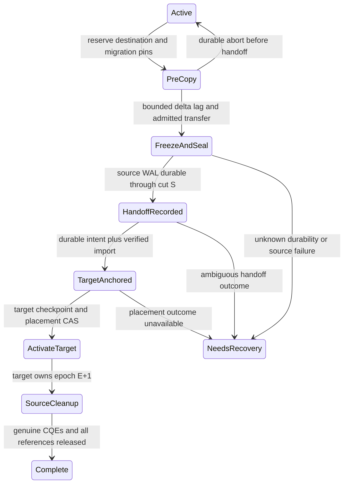

# Ciagomem — SLAE: Technical Whitepaper and Master Engineering Specification

**Version:** 3.0, R11 foundations, memory orchestration and horizontal multi-model contract revision — 1 November 2026\
**Product:** Ciagomem — SLAE, the Unified State-Log Actor Engine (“The Store”)\
**Language:** CiaQL — Ciagomem Query and Cognitive Language\
**Status:** Architecture and component implementation; **not signed off for production**\
**Workspace:** [`ciagomem-slae`](README.md), package version `0.3.0`

Historical remediation evidence includes the [R10 verification report](review/r10/Ciagomem-SLAE-R9-Remediation-Verification.md.txt) and its preserved R10 patch evidence; R9 evidence remains under review/r9. Earlier reports are retained in [review/reports](review/reports), with patch/probe/log evidence under review and original extracted source evidence under review/initial-source. Superseded ZIPs and extracted workspaces were removed after preservation; see the [cleanup manifest](docs/cleanup-manifest.json). The current workspace is authoritative; historical evidence is not source to copy over it.

“Must” describes a design requirement. “Implemented” identifies code present in the workspace. Targets and proposed deployment settings are not measurements or production guarantees. No Miri, cross-architecture, power-cut, or performance result from the supplied review is represented as a result obtained for this revision.

## Contents

1. [Scope and review disposition](#1-scope-and-review-disposition)
2. [Storage architecture](#2-storage-architecture)
3. [Memory and capacity](#3-memory-and-capacity)
4. [Concurrency and progress](#4-concurrency-and-progress)
5. [Identity, slots, and routing](#5-identity-slots-and-routing)
6. [I/O, checkpoints, and the write-ahead log](#6-io-checkpoints-and-the-write-ahead-log)
7. [Transactions and recovery](#7-transactions-and-recovery)
8. [Authorization, capabilities, and exports](#8-authorization-capabilities-and-exports)
9. [Information flow and AI frames](#9-information-flow-and-ai-frames)
10. [CiaQL grammar and policy](#10-ciaql-grammar-and-policy)
11. [Operations, backup, and evolution](#11-operations-backup-and-evolution)
12. [Workspace and reference implementation](#12-workspace-and-reference-implementation)
13. [Verification and production exit criteria](#13-verification-and-production-exit-criteria)
14. [Application schemas, collections, array storage and language clients](#14-application-schemas-collections-array-storage-and-language-clients)
15. [Concurrency scaling, placement, migration and restart contracts](#15-concurrency-scaling-placement-migration-and-restart-contracts)

16. [R11 ownership and pin lifetimes](#16-r11-self-audit-remediation-cpudma-ownership-and-pin-lifetimes)
17. [Application and operator contract](#17-complete-application-and-operator-documentation-contract)
18. [Sub-agent memory orchestration](#18-sub-agent-memory-orchestration-and-hybrid-context-assembly)

## 1. Scope and review disposition

The architecture combines actor-local state, append-only durability, deterministic multi-actor coordination, and labelled AI memory. Its operating objective is one million **registered** tenants on a 16 GiB node, with a bounded resident working set. Registered tenants, resident actors, and concurrent agent sessions are separate capacity dimensions.

The previous document incorrectly described a small monolithic reference kernel as a complete production engine. In particular, its embedded crate did not contain the WAL, eviction state machine, reactor, replay system, or actual SPSC rings described in the prose. This workspace retains the P0 WAL, lifecycle, ring, and simulation modules alongside a reviewed v3 API, but these components do not constitute a fully integrated service.

### R10 revision — 31 October 2026

The [R10 ledger](docs/R10_REMEDIATION.md) records four incoming findings and their applied corrections: checkpoint owning-state/ticket publication before submission, private simulator pending operations, genuine CQE retirement after WAL fencing without durability publication, and typed Wake-only message-ring submission plus LogWrite dispatch checks. The input patch was normalized to the canonical Ciagomem names, not copied over newer schema/SDK contracts. Local results and unavailable hardware checks are separated from reviewer evidence. Sections14–15 add target contracts; they do not implement distributed services or change persistent formats.

### R9 revision — 31 October 2026

The [R9 ledger](docs/R9_REMEDIATION.md) supersedes the earlier advisory publisher and teardown contracts. Durable publication outside core now requires its one DurabilityPublisher; raw bind/unbind/publish methods are crate-private. Logs own the publisher through initialization and runtime. Pending-I/O owner destruction fences the core and retains the referenced buffers instead of freeing them. Arena pending counters cover lifecycle submissions/completions. Lifetime tracking is provisionally armed before backend submission, rolled back on rejection, and retained on unwind. CQE handlers require an unsafe proof of genuine backend completion; raw numeric tokens are not safe evidence that buffers can be released. A new submission invalidates an older device-release acknowledgement. This is a memory-safety fallback with an explicit retention cost, not the missing production cancel/reap driver. The obsolete R8 ZIPs were removed after preserving evidence; one policy file and one review prompt remain.

### R8 revision — 31 October 2026

The [R8 ledger](docs/R8_REMEDIATION.md) supersedes affected earlier contracts. Logs hold the core's only DurabilityPublisher; direct publish/bind/unbind are crate-private. Duplicate binding and shorter-than-published recovery reject. Publisher Drop releases the claim on normal teardown and failed initialization. A pending-I/O log or lifecycle drop fences the core and retains its referenced buffers. Exports check boot and expiry using trusted current time. Engine retains Send + Sync when its journal does, with a thread-safe clock and atomic time high-water mark. No dependency or persistent-format change is introduced. There is one engineering policy.json and one current review prompt; obsolete archives/extracted copies were cleaned while preserving review/source evidence.

### R7 revision — 31 October 2026

The [R7 ledger](docs/R7_REMEDIATION.md) supersedes affected R6 contracts. The supplied three-fix patch was applied after reproducing its probes. Additional changes enforce engine entry-time capability expiry/boot checks and bind the WAL exclusively to its core controls, rejecting a second log or a published watermark beyond recovery, and publish recovered durability after superblock confirmation. A startup validator detects unrelated arena control arrays; the absent node host must still invoke it for every class. No persistent format change or new dependency is introduced.

### R6 revision — 31 October 2026

The [R6 disposition ledger](docs/R6_REMEDIATION.md) supersedes affected R5 contracts. All eight supplied probes reproduced their described behavior before this correction. R6-N1 through N7 now have corrected executable contracts: shared cross-class core controls, no derived-label attestation laundering, random incarnations, boot-bound and tenant-budgeted replay protection, epoch-aware image classification, WAL-coverage-gated recovery and explicit owner checkpoint barriers.

This revision changes arena constructors, capability/provenance/approval APIs and framing, replay tracker inputs and load admission. Update callers; old signed objects cannot bypass new mandatory boot binding. Production anchor, WAL replay driver, reactor scheduling, repair and storage qualification remain open. The R6 reviewer's Miri and ARM compile results apply to the preceding source, not these changes.

### R5 revision — 31 October 2026

The supplied R5 deep-research report and harness review an older four-crate bundle. This revision retains the newer five-crate actor-native execution milestone and applies the relevant R5 corrections to it. The [R5 disposition ledger](docs/R5_REMEDIATION.md) lists every finding, executable guards and remaining gates. Original reproduction assertions are preserved as text, because many assert that a vulnerability exists and therefore cannot serve as positive fix tests.

This revision changes identity metadata, reference literals, label/endorsement APIs, canonical slot types and checkpoint-image format. It is a breaking component revision; no automatic migration or production compatibility guarantee is implied. R5 findings are not all production-closed: the anchor provider, integrated durable deletion/recovery, fleet/S3 adapters, reactor control scheduling and hardware qualification remain explicit gates.

### 1.1 Review resolution matrix

| Review finding                                        | Corrective implementation                                                                                                                       | Remaining boundary                                                                                              |
| ----------------------------------------------------- | ----------------------------------------------------------------------------------------------------------------------------------------------- | --------------------------------------------------------------------------------------------------------------- |
| Missing lifetime and unstable `str::as_str`           | Replace the substring parser with the existing typed P0 lexer/parser and extend its grammar                                                     | Unsupported syntax returns an error                                                                             |
| S1 / P0-A: foreign reads and fleet scans              | Policy requires a verified session, a trusted actor-owner resolver, operation scopes, and operator scope for scans                              | Every executor entry point must invoke policy per request                                                       |
| S2 / P0-B: foreign actors hidden in raw bodies        | Typed field paths and mutation ASTs; participant and owner checks include qualified references                                                  | An actor-native reference executor is supplied; arbitrary expression evaluation remains unsupported             |
| S3: named argument smuggling, defaults and limits     | Token-based named arguments; duplicate and malformed arguments rejected; `top_k` bounded to 1–1,000                                             | The reference executor enforces work/result/group/join limits; node allocator enforcement remains open          |
| S3b: discarded vector/metric                          | Similarity AST retains the numeric vector, metric, and threshold                                                                                | Runtime `$q` vector bindings are rejected until implemented                                                     |
| S3c/S3d: stage splitting and TAKE/EXPORT disagreement | Parser consumes grammar productions; TAKE may be followed only by one final EXPORT                                                              | Typed JOIN/LINK and explicit schema upgrade APIs are available; unsupported administration commands fail closed |
| S4 / P0-F: unrestricted S3 prefixes                   | Exact bucket and path-boundary matching, strict canonical destination grammar                                                                   | Operator-managed configuration and storage transport remain external                                            |
| S5 / P0-C: incarnations repeat on restart             | Persistent create/lookup/delete journal with hash chain and independent rollback anchor; only unacknowledged tail bytes may be discarded        | Deploy a durable independent anchor and integrate identity metadata with WAL/backup                             |
| S6 / P0-D: forgeable endorsements                     | Ed25519 provenance and content/field/action/session-bound single-use approvals; private labels                                                  | Trusted issuer, session and nonce lifecycles must be integrated                                                 |
| S6b / P0-E: unsigned or unrestricted caveats          | HMAC chain; mandatory tenant, expiry, UID, session, audience, boot epoch, operation and key-epoch caveats; private verified-session fields      | Authentication transport and key rotation are not a server implementation                                       |
| S7: 64-principal aliasing                             | Sorted explicit 128-bit principal IDs, maximum four readers, fail closed beyond that bound                                                      | Larger sets require an authenticated external representation                                                    |
| S8: home-grown ARX                                    | RustCrypto HMAC-SHA256 in a dedicated crypto crate, with known-answer testing                                                                   | SHA-256 content binding is supplied; no vault service is supplied                                               |
| S9/S10: unused deadline and false poison              | Both arena read paths call deadline readers; a delayed writer is `WriterStalled`                                                                | Portable `Instant` clock remains; calibrated counters and attach-time repair remain open                        |
| S11: unbounded overflow and credits                   | Overflow rejects with ownership of the unsent item; cumulative consumption acknowledgements are idempotent; separate control/data mesh capacity | Reactor control-priority dispatch remains open                                                                  |
| S12: linear dirty scans                               | Preallocated intrusive first-dirty FIFO; constant-time insert, unlink and head decision                                                         | Monotonic per-core LSN contract enforced; no measured 50 ns claim                                               |
| Vote-slot ABA                                         | Single-owner mutable vote table; tagged ballots and duplicate rejection precede state mutation                                                  | Sequencer and message delivery are separate work                                                                |
| Unbudgeted export windows                             | Shared byte/session budget reserved before allocation, released on error/drop                                                                   | Session manager must share one authoritative budget and handle FD/VMA limits                                    |

See the [remediation ledger](docs/REVIEW_REMEDIATION.md) for implementation paths, tests, and open production gates.

## 2. Storage architecture

Separate representations serve different access patterns; this is a workload trade-off under the RUM conjecture, not a proof that read, update, and storage overhead can all be minimized simultaneously.

1. **Resident state:** Word-atomic seqlock payloads in actor arenas. One canonical arena implementation supports heap-backed testing and an engine-private Linux HugeTLB allocation path; root exports alias the persistence-wired slot/seqlock types.
2. **Durability:** Per-core WAL v2 records and CRC32C, with group-commit batching. Actual device guarantees depend on the I/O path, filesystem, drive, and power-loss behavior.
3. **Cold state:** A/B extent checkpoints and validated reloads. The new reference executor provides per-tenant bitmap/inverted/vector indexes and numeric zone maps. A separate full columnar shadow store and production search service remain open.

Previously stated 2.90× and 2.98× write amplification values are withdrawn as release guarantees. A reproducible benchmark must specify workload, record size, batch occupancy, padding mode, metadata writes, and device bytes written.

## 3. Memory and capacity

Section15.3 defines a separate12 GiB-arena storage-service profile with full capacity/header math; it is not extra capacity added to this original profile.

### 3.1 Revised planning budget

A 16 GiB node contains 16,384 MiB. Reserve 820 MiB, just over 5%, for allocation variability and omitted overhead instead of assigning every byte to nominal subsystems.

| Region                                                        |        MiB | Accounting requirement                                                                      |
| ------------------------------------------------------------- | ---------: | ------------------------------------------------------------------------------------------- |
| Kernel, networking, page tables, and I/O metadata             |      2,048 | Measure kernel slab, pinning, page tables and registered-buffer overhead                    |
| Agent processes                                               |      2,048 | Charge agent process memory through its cgroup; engine-created shmem remains engine-charged |
| Control heap                                                  |        512 | Include allocator metadata, stacks as assigned, bounded queues, and emergency reserve       |
| Routes, dirty lists, indexes, DMA scratch, log/export buffers |        524 | Explicitly include 33 bytes per dense dirty-list tenant slot and all label storage          |
| Engine arena                                                  |     10,432 | At most 5,216 × 2 MiB HugePages under this planning split                                   |
| Contingency reserve                                           |        820 | Do not allocate this reserve as additional steady-state actor capacity                      |
| **Total**                                                     | **16,384** | Budget model; not yet a boot-time enforced node allocator                                   |

The current lifecycle route entry stores two u64 values (16 bytes before allocator/table overhead); it does not carry the full incarnation. A future 32-byte authenticated route design would consume 30.52 MiB per million entries. The dense dirty arrays now require **33 bytes per slot**, or 31.47 MiB per million slots, excluding per-core headers. Allocate only the tenant slots owned by each core; allocating a million-slot tracker on each of 14 cores multiplies this cost by 14. The canonical full-incarnation `SlotHeader` occupies **128 bytes**. Include headers, routing metadata and external authoritative identity maps in the deployed budget.

The 10,432 MiB arena provides about 10.68 KiB per tenant if all one million are resident, before headers and fragmentation. A 10–30% resident working set is a planning assumption requiring workload validation. The target five-class profile (Section 14.1), 14 cores and one initial 2 MiB hugepage per class/core assign 140 MiB before payload occupancy; this is part of the arena budget, not extra capacity. The four handle class bits retain 11 reserved encodings, not 16 active arenas. The existing generic arena constructor still requires host admission enforcement of this target profile.

### 3.2 Sessions and labelled values

Within the nominal 154 MiB log/export portion, an example split assigns 64 MiB to at most **16,384 concurrent 4 KiB windows** and 90 MiB to other buffers. These are deployment choices, not automatically active defaults. `ExportBudget` must be shared across all sessions. Count at least two engine file descriptors per window, plus mappings and receiving-process descriptors, against host limits. Larger windows reduce the session count proportionally.

Labels have variable representation and metadata overhead. On the tested x86_64 build, `Label` is 176 bytes before up to 64 bytes of reader storage and allocator overhead; `CoreControl` is 256 bytes. The wire image header is 128 bytes, distinct from the 64-byte Rust ExtentImage value. Reproduce with `cargo run --release --offline -p ciagomem-core --example layout`. Budget actual `Label`, reader-set allocations, persisted provenance, frames, and WAL expansion. Do not assume the old 17-byte bitmap label cost applies to the new explicit-reader representation.

## 4. Concurrency and progress

Sections15.4–15.5 specify target anti-thrashing, session multiplexing and hot-reader policies, preserving the implemented primitives below.

### 4.1 Seqlocks and deadlines

Payload words are accessed as 8-byte atomics. Readers validate snapshots using the sequence and acquire fences; writers publish an even sequence on commit. The canonical arena uses time-bounded reads and distinguish a deadline from an observed stalled writer.

`WriterStalled` means an odd sequence stayed unchanged long enough to trigger fallback. It is **not proof of corruption or writer death**. Under release `panic = "abort"`, a writer panic terminates the process; preemption, faults and firmware pauses can delay a writer that will commit normally. Never reclaim or overwrite a slot solely on this observation.

The implemented `MonotonicClock` uses `Instant`. A calibrated TSC/CNTVCT clock, clocksource qualification, affinity assumptions and a fallback policy must be implemented and measured before claiming CPU-counter or syscall-free deadline timing. Do not infer instruction-level timing from the trait name.

For any future persistent arena attach, odd headers require repair from validated checkpoints and WAL. A private process arena has no implemented hot-attach recovery path.

### 4.2 Mesh and backpressure

P0 provides real producer/consumer SPSC lanes and doorbell coordination. The reviewed `OutboundFlow` controller is separate: it accepts a lane abstraction, tracks credits, and keeps a strictly bounded overflow queue. At capacity, `send` returns `Err(original_item)` without allocating another queue entry. The caller must reject new admissions or retain the item in another explicitly budgeted owner; silently dropping transaction-control messages is forbidden.

Credit returns acknowledge a cumulative consumed-message index. Duplicate/reordered acknowledgements are idempotent; acknowledgements beyond the sent index reject without granting capacity. `PriorityMesh` allocates separate fixed-capacity data and control meshes. A reactor must give control traffic priority; allocating the lanes alone does not provide that dispatcher.

A future reactor must drain inbound traffic before pumping outbound queues and preserve control-record progress under admission pressure. Credit conservation remains a simulation invariant to establish after integration.

### 4.3 Constant-time dirty tracking

A preallocated intrusive doubly linked list stores `prev`, `next`, `rec_lsn`, `since_ns`, and `latest_lsn`, and a checkpoint-barrier flag for dense per-core tenant slots. First-dirty insertion order follows monotonic per-core LSN order. Insert, checkpoint unlink, minimum lookup and pin decisions use a fixed number of array accesses; no heap allocation occurs after initialization.

Zero LSNs, invalid tenant indexes and decreasing mutation LSNs are rejected. `on_checkpointed(tenant, image_lsn)` rejects a checkpoint older than that tenant's latest mutation, retaining its conservative first-dirty pin. Only a covering checkpoint unlinks the node. For a hot tenant, `begin_checkpoint` freezes mutation admission and captures the latest LSN; match the existing lifecycle Flushing gate, defer writes, and complete/unlink before admitting the deferred mutations as newly dirty. `checkpoint_failed` releases the barrier while retaining the pin. These O(1) operations avoid a permanently stale hot-tenant pin at the cost of a checkpoint pause. The owner must call check_admission before assigning an LSN or appending a WAL record. on_dirty does not use the barrier to reject an already-logged record; a record logged during a checkpoint makes that completion stale, releases admission and retains the older covering pin. Append and immediate pin registration must be serialized before later appends, completion or truncation; invalid/zero/out-of-order LSNs remain errors. The head identifies the oldest required WAL record; pressure triggers a freeze-checkpoint or relocation request. No runtime benchmark threshold is substituted for these structural guarantees.

## 5. Identity, slots, and routing

`SlotHandle` packs a 40-bit generation, 4-bit class and 20-bit class-local index; zero is invalid. Generation assignment occurs within the write section. Stale handles and LSN regressions must be rejected before mutation. Durable watermarks use `fetch_max` and never move backward.

Root and module APIs now export the same canonical `SlotArena`, `SlotHandle`, `ExtentLoc`, `SeqWord`, `WordsMut`, `CoreControl` and visibility types. `ExtentLoc::new_checked` rejects overflow. `WordsMut` construction is crate-private; mutations use writer guards. Equal-LSN mutation writes reject as duplicates; checkpoint-header stamping uses a separate internal operation.

Tenant IDs use a server-held keyed PRF with canonical namespace/name collision checks. The identity journal persists names, IDs, full incarnations and deletion records. Each record chains a SHA-256 digest to the preceding head; the journal is synced before advancing an independent compare-and-set `IdentityAnchor`. Only then does the operation return success. The file lock excludes concurrent writers; write/anchor failure fences the instance. Each newly created incarnation is independently drawn as a nonzero 128-bit OS-random value and persisted in the record, rather than deterministically derived from a restorable counter. Fresh creations after joint journal/anchor restore therefore have probabilistic uniqueness assuming fresh OS entropy. This does not detect restoration of existing live history; a whole VM/RNG restore needs an independently qualified reseed protocol.

Reopening reconstructs the live identity map. `lookup` and idempotent `register` preserve an existing incarnation; duplicate `create` rejects; explicit delete/recreate obtains a fresh incarnation. Recovery requires the exact independently acknowledged journal head. Missing/corrupt acknowledged records fail closed; arbitrary torn/zero-filled bytes strictly beyond that head are truncated and synced. The test anchor is memory-only. No deployable independent anchor is bundled: its durable implementation, provisioning, backup/restore and disaster-recovery protocol are production gates. A second file restored alongside the journal does not prevent rollback.

Both the canonical slot header and **extent image format v3** retain all 128 incarnation bits. The 128-byte image header includes identity, epoch, image sequence and tombstone flag under CRC32C, plus a body checksum. Validation requires the expected incarnation, accepts image epochs no newer than the current recovered log epoch, optionally checks an exact historical epoch from trusted image metadata, and rejects tombstones. `ImageStatus` distinguishes all-zero Absent from Invalid and Valid; malformed, identity/epoch-mismatched and corrupt nonzero extents request repair, never an errno-0 fresh-tenant path. Known previous-image metadata plus erased copies also requests repair. Physical absence alone does not authorize recreating an existing catalog identity. Old v2 images fail closed; an offline migration tool is not supplied. A durable deletion/tombstone publication protocol across WAL, routes and identity anchor remains integration work; a format flag alone is not that protocol.

`nospec_index` is an architectural bounds helper. Rust bitmask syntax alone is **not** evidence of a Spectre-safe machine-code barrier. Compiler output and architecture-specific mitigation must be validated before a speculative-execution guarantee is made.

## 6. I/O, checkpoints, and the write-ahead log

The IoBackend buffer-lifetime contract for tracked lifecycle/log submissions is upheld on owner destruction by retaining backing while operations remain outstanding, rather than freeing it. Deliberate retention can exhaust memory after repeated abandonment; normal teardown must drain/cancel and reap. This is not a complete audit of all raw-buffer APIs.

The P0 workspace includes I/O traits, a deterministic seeded I/O simulator, Linux `io_uring` wrappers, WAL envelopes, group commit and a lifecycle state machine. These were absent from the original v3 embedded crate; their presence in the workspace does not imply that every reviewed API uses them.

Required lifecycle invariants:

1. Reuse only after ownership is revoked and outstanding I/O and pins reach zero.
2. Freeze buffers while the device may read them.
3. Checkpoint only state whose required WAL records are durable.
4. Write the inactive extent copy and publish the route flip only after a full successful completion.
5. Match completion operation, object and ticket so stale CQEs cannot mutate new state.
6. Verify checksums, identity incarnation and schema version when choosing a recovered image.

Component tests exercise A/B recovery and completion gating under simulated failures. Reload rejects mismatched identity/epoch/tombstone images. A corrupt selected current copy reports `NeedsRepair`/load failure instead of silently falling back. Recovery with one valid A/B copy proceeds only with trusted recovered WAL coverage: `wal_start_lsn - 1 <= checkpoint_lsn <= wal_end_lsn`. Otherwise it requests repair. A nonempty suffix emits ReplayRequired and keeps the route unpublished until the trusted driver applies/scans the complete committed suffix and calls finish_replay. Abort revokes and frees a failed or deleted replay; incomplete replay never publishes a client route. A no-suffix checkpoint can publish directly. Both valid copies can be ranked by image sequence. The production WAL decoder, catalog continuity, deletion replay and repair service remain integration work; a caller-supplied interval must be established by recovery rather than guessed. Normal clean cold loads instead use the tenant-specific empty interval RecoveryBounds::clean(current_epoch, image_epoch, checkpoint_lsn) from durable metadata proving no uncheckpointed tenant mutations. Exactly that image loads without a global suffix scan; stale images and dirty tenants with missing WAL still request repair. The WAL exclusively claims its core controls at open and publishes the recovered end after superblock_durable confirms the reopened superblock. Publication remains monotonic, so open rejects a reused control whose watermark exceeds the recovered end. Recovering a shorter prefix requires fresh controls and arenas plus explicit loss/repair handling; fresh memory alone does not resolve lost acknowledged data. There is no manual new-commit prerequisite.

On terminal WAL write failure, pending acknowledgements become **indeterminate**, the log and core fence, later CQEs cannot advance published durability, but genuine matching completions still retire device references so a fully reaped fenced log can become quiescent. The WAL handler dispatches only Op::LogWrite. Fence and durable state live in a node-owned Arc array explicitly shared by every size-class arena and WAL for that core. Fields are private and publication/fencing serialize on a control-path mutex. Reads check only their validated owner core and recheck the fence after snapshot validation. Other cores remain available. Allocate the control array once per node. WAL open binds the array/core ID and holds the core's only DurabilityPublisher. No external arena holder can directly advance the watermark or revoke its claim. Duplicate binding rejects and CQE processing cannot substitute another control object. The guard also releases the claim if initialization fails; invalid/exhausted recovery counters reject rather than wrapping. The host must call log.validate_arena for every class before accepting work; mismatched allocations reject. There is still no node constructor to enforce complete registration automatically. This does not erase bytes a device may already have persisted: recovery must resolve the outcome. Stale/duplicate lifecycle CQEs are rejected before decrementing in-flight counts. Lifecycle submissions provisionally increment an arena pending counter before calling the backend; rejected submissions roll it back, and genuine completions decrement it. WAL buffers similarly enter InFlight before backend code can unwind. Both on_cqe handlers are unsafe: the caller must prove that a matching token/result is a completed request owned by that controller, with no remaining device access. Proven nonmatching stale tokens do not release active buffers. A pending-I/O lifecycle/log drop fences the core, and the arena/log retains backing referenced by abandoned operations until process exit. The owning destructors enforce this tracked drop-path lifetime; caller discipline alone is insufficient. The production reactor must cancel and reap every operation before reclaiming memory. release_device_references is an unsafe acknowledgement that prior device references have terminated; subsequent submissions invalidate that acknowledgement.

The pin tracker supplies an explicit checkpoint admission barrier, and lifecycle Flushing defers mutations. Coordinating begin, submit, CQE completion/failure, durable seal, relocation and admission resumption still requires the future reactor. Reserve control-record headroom independently from user-log capacity to prevent a full ring from blocking completion records.

## 7. Transactions and recovery

The corrected `VoteTable` is owner-local state. `open`, `vote`, and `close` require exclusive mutable access. A ballot includes transaction sequence and participant index; stale and invalid ballots are rejected; matching duplicates and conflicting duplicates are distinguished before mutating either vote mask. Transaction sequences must advance and may not be reused. Participant 63 is an ordinary bit, and all 64 participants must vote before a 64-participant decision.

This removes the tag-check/atomic-RMW ABA window. The table does not supply a sequencer, deterministic scheduler, lock manager, network protocol or replay engine.

A complete Calvin implementation must:

- Sequence transactions deterministically and carry `tx_seq` through every participant record.
- Persist a unique decision and participant data before the applicable acknowledgement boundary.
- Recover by first collecting durable decisions and then applying only authorized committed prepares.
- Wait for all required participant durable watermarks and, in strict HA mode, replica acknowledgements.
- Reject cross-tenant participants unless explicitly authorized by the session and ownership policy.

**Strict ACID and strict serializability remain unproven for an integrated engine.** Component voting and single-log recovery tests cannot establish those properties.

## 8. Authorization, capabilities, and exports

### 8.1 Session and query authorization

The trusted authentication path verifies a signed capability for the current tenant incarnation, UID, session, audience, boot epoch, operation, key epoch and time. Only verification constructs `VerifiedMacaroon`; callers cannot fill its fields directly. Re-verify for every request so expiration and key-epoch changes apply. The reference engine additionally owns a boot epoch and trusted clock, rejecting expired/foreign-boot verified tokens at each public Engine entry; its clock high-water mark prevents regression from reviving a connection token. The engine remains Send + Sync when its Journal does; its clock requires Send + Sync and its high-water time is atomic. LocalExportRoot is separately bound to a boot epoch and requires trusted current time for each create, rejecting expired/foreign-boot tokens before creating a file. Pure helpers such as join::equi_join process caller-held snapshots and are not independent authentication boundaries. This is entry-time validity, not cancellation of an in-flight query or revocation of an already returned file. `AuthContext` also receives an authoritative actor-owner resolver and operator-maintained destination rules.

A single-actor source, every transaction participant, and all typed qualified actor paths must belong to the verified tenant. Operator scope enables only scans within the verified tenant. Fleet-wide backup rejects until a separately rooted fleet capability and adapter exist. Writes require write permission; an operator bit does not silently waive actor ownership. Policy is required even for ASTs supplied programmatically. Successful policy produces an opaque `ValidatedQuery` carrying tenant/session and owner version. The reference executor rejects a stale owner version before execution; its exclusive owner operation prevents an ownership change during execution. External ownership catalogs require their own consistent version/epoch protocol.

### 8.2 Cryptographic primitives

`ciagomem-crypto` supplies RustCrypto HMAC-SHA256 behind `Prf`, domain-length framing, MAC chaining and constant-time equality through `subtle`. The earlier ARX function is removed from the default implementation. An RFC 4231 known-answer test exercises HMAC-SHA256.

Macaroon verification requires signed Tenant, ExpiresAt, PeerUid, Session, Audience, BootEpoch, Ops and KeyEpoch caveats. Generate SessionEpoch once per engine startup from OS entropy, retain it outside restored data, and populate verification context from this trusted value, never from request input. All caveats are conjunctive; attenuation cannot add authority. Unknown, missing, expired, mismatched, or unsigned caveats fail closed.

Reference MACs bind tenant incarnation, session, actor, expiry, opaque ID and trusted vault location/generation/digest metadata. `$ref:0xID.32hex` preserves the 128-bit MAC in the AST; bare IDs reject. Resolve against the authenticated tenant's private index. Missing, forged and expired references return the same denial class. This does not claim constant-time index lookup. Digest generation, storage, secure root-key provisioning, authenticated transport and key rotation are integration responsibilities; no production vault service is claimed.

### 8.3 Export isolation

The engine arena remains private. An agent receives only an authorized projection through a sealed read-only memfd window. The implemented constructor creates mappings, sets shrink/grow/future-write/seal seals, verifies denial of both a new writable shared mapping and `mprotect` upgrade on a read mapping made from its **O_RDWR** descriptor, then reopens the agent descriptor O_RDONLY. An O_RDONLY-only probe would be vacuous. Owned descriptors/mappings/budget reservations use RAII; only a borrowed agent descriptor is exposed. The relevant kernel fix is commit `8ec396d05d1b`; the earlier rejected CVE identifier is withdrawn. This probes the required behavior on the running kernel; it is not a general kernel security certification.

`ExportBudget` reserves bytes and a session count before allocation and releases them on failure or drop. The session manager must use one shared authoritative budget. FD passing through `SCM_RIGHTS`, projection publication, seqlocked cross-process access, request rings and session lifecycle are not implemented as a service. Publish lazily on a session request rather than copying K windows on every mutation unless a measured budget permits it.

## 9. Information flow and AI frames

Integrity is ordered `External < AgentDerived < UserDirect < Policy`. Joining inputs takes minimum integrity, union of provenance category bits and intersection of explicit reader principal IDs. Reader IDs are 128-bit values, not `tenant % 64` bits. The current bounded representation accepts at most four distinct readers and rejects larger sets.

Frame admission requires Policy integrity for hard constraints, UserDirect for active intent/playbooks, AgentDerived for facts, and permits External only in untrusted variable positions. The runtime must populate engine-attested variables itself and render untrusted content outside trusted instruction prefixes.

Labels have private fields; public untrusted construction produces only External integrity. Higher integrity requires verified **Ed25519 content-bound provenance** from a configured trusted public key. Derived/P-LLM labels clear issuer and signed scope; a recomputed digest is not an attestation and derived bytes require fresh signed provenance before Fact admission. A verifier contains no signing material. An endorsement binds tenant, session, engine boot epoch, exact source categories, content digest, destination frame field, tool, sink, expiry and a nonzero nonce. Per-tenant quotas and a global active-tenant bound isolate replay capacity; a min-heap expires entries without a full-map scan. Approvals with more than 300 seconds remaining reject; accepted approvals retain replay protection until their actual expiry on the tracker's monotonic high-water clock. Admission evaluates stale timestamps at that clock for session, provenance and approval checks; client-provided time is not permitted. Mandatory boot binding in capabilities, provenance, approvals, tracker and frame permits prevents old approvals crossing restart even if a logical session ID is reused. Zero-source approvals reject. A valid approval may elevate AgentDerived intent/playbook content; it never elevates External content or manufactures Policy authority. Signing keys belong only to the authenticated trusted issuer.

P-LLM output inherits the join of **every** context label and is capped at AgentDerived integrity. Q-LLM output is always External. Empty context defaults to External with no readers. Frame admission checks the reader set before admission and checks trusted provenance against the supplied bytes. Labels alone never authorize tool side effects. Frame admission rejects expired authenticated sessions; action permits expire no later than the issuing capability, even if provenance and approval last longer. `authorize_tool_call` consumes a one-use frame permit bound to the same session, tool, sink and argument digest, with expiry and reader checks. Retain one replay tracker for the boot/session lifetime; resetting it mid-boot is unsupported. Generate a fresh OS-random SessionEpoch after every engine start and obtain newly issued capabilities, provenance and approvals. Reusing a fixture boot epoch, or rolling back a running engine and its RNG without a reseed protocol, defeats this premise.

These helpers must be invoked by every frame compiler, executor and gateway path. A standalone correct lattice does not establish end-to-end prompt-injection resistance.

## 10. CiaQL grammar and policy

Section 14.7 defines the target collection/schema/array EBNF and spanned AST extensions. The syntax and execution described immediately below are the current reference profile; new productions are not implemented merely by appearing in this document.

The default API uses the P0 token stream, recursive-descent parser and typed AST, extended for shorthand and named arguments. It does not reuse the ZIP's raw substring-stage parser. The maximum query length is 64 KiB, with 16,384 tokens and independent stage, nesting, list and transaction participant bounds. Similarity vectors have a separate 4,096-dimension bound, rather than the generic 256-element list bound. Unknown calls reject. IN/CONTAINS are case-insensitive. Iterative preflight bounds caller-built ASTs before recursive semantic walks; Query destruction drains recursive nodes iteratively. Callers must validate before using recursive Clone/Debug/PartialEq on an untrusted programmatically constructed AST.

Implemented sources are actor IDs (`@id` or `ACTOR(id)`), `TX_ACTORS[...]` / `tx [@id,...]`, scans, and operator-policy-checked backup destinations. Implemented stages include comparisons, boolean expressions, mutations, projection, grouping/reduction, numeric-vector similarity, bounded search arguments, frame stages, TAKE and EXPORT.

```text
@0x0008F421
where state.status == "ACTIVE" and state.wallet.balance_cents >= 5000
mutate {
  state.wallet.balance_cents -= 5000,
  state.metrics.tx_count += 1
}
select {
  remaining_cents: state.wallet.balance_cents,
  tx_lsn: meta.last_tx_seq
}
take 5
```

`|>` may separate stages without changing their meaning. Strings are tokens, so a string containing `top_k: 7`, `limit`, or `|>` cannot supply an argument or split a stage. Bare field `limit > 3` is parsed as an implicit state field. Qualified paths retain explicit roots. Unknown stages, malformed values, duplicate arguments, duplicate participants and trailing garbage are errors.

TAKE must be final except for one following final EXPORT. Search `top_k` defaults to 10 only when omitted; an explicitly invalid value is an error. Similarity preserves numeric vectors and metric; runtime vector parameters such as `$q` fail until binding is implemented. Named search fields remain restricted to a field path, not an executable expression.

Parsing does not execute queries or authorize them. Policy validates the resulting AST and requires exact destination matches: S3 rules name a concrete bucket plus canonical path prefix; local rules are under `/var/backups/ciagomem/`. Reject ambiguous escaping, userinfo, query/fragment components, traversal, broad scheme-only rules and path-prefix boundary confusion.

The `ciagomem-engine` reference crate now executes typed reference joins, programmatic bounded equijoins, registered referential links, strict and chunked cascades, projected/schema upgrades, hybrid search, and grouped aggregates. It uses explicit bounded selection rules rather than a general cost-based join optimizer. Tenant-name aliases and unsupported administration syntax remain errors. The following sections specify these capabilities and distinguish the reference implementation from production reactor/WAL integration.

This document specifies the five database capabilities in the Ciagomem ecosystem and records their implementation boundaries. The accompanying `ciagomem-engine` crate is an executable, owner-local reference engine. It composes typed CiaQL, verified sessions, per-tenant indexes, immutable snapshots, and journal-gated writes. It does not start a network server or pin operating-system threads.

### 10.1. Architecture and invariants

```text
CiaQL text
  → bounded lexer and typed AST
  → session / operation / actor policy
  → stage and consistency checks
  → per-tenant, per-core candidate selection
  → exact residual evaluation
  → relationship / search / aggregation stages
  → result budget check
  → journal batch for pending writes
  → owner-local state and index publication
```

An actor is identified by `(id: u64, incarnation: u128)`. Tenant incarnation is separate from actor incarnation. Both are retained in the FlatBuffers image. Reusing an actor ID does not make an old reference valid.

The reference partition is `actor_id % core_count`. Each shard owns its row directory, slot allocator, tenant index namespaces and accounting. Its hot structures have no global index lock. `Engine` coordinates these shards through exclusive mutable access in one process; they are **simulated owner cores**, not concurrently running reactor threads. A production dispatcher must move owner state/endpoints to pinned threads and preserve the same publication contracts.

`Snapshot` holds `Arc<Record>` and `Arc<[u8]>`. Copying its handle pins the immutable version; it does not copy the underlying actor image. This is same-process reference sharing, not raw pointer sharing across process boundaries. FlatBuffers borrowed getters avoid decoding their payloads. Query results, mutable field maps, schema upgrades and joins that materialize values can still allocate and copy.

Every execution calls the existing structural and authorization policy. Tenant indexes are separate, and text statistics use the current authorized candidate corpus. Operator scan permission does not grant reads of every tenant's payload. Dynamically resolved join targets are checked again at execution time. Result labels conservatively join all participating actor labels.

### 10.2. Joins: reference lookup and bounded read fan-out

#### Direct relationship path

A field stores `Scalar::Ref(ActorRef { id, incarnation })`, not a raw pointer or an unversioned integer. Example:

```text
@1
join @actor(state.organization) as @org
where @org.state.name == "Ciago"
select {
  organization_name: @org.state.name,
  balance: state.wallet.balance
}
```

The parser represents JOIN targets and alias-qualified paths as typed nodes. An alias must be declared before use, cannot be declared twice, and cannot be a mutation target. A `$ref` vault capability and an `ActorRef` relationship are different types with different purposes.

Execution resolves the base field, verifies actor and tenant incarnations, checks session read authority and the target label, and pins an immutable target snapshot. A missing or stale reference returns an explicit error rather than silently joining a newly created actor that reused the ID. The reference executor fails the query on a missing target; it does not implement SQL LEFT/RIGHT/FULL join syntax.

#### Cross-core protocol

`join::Request` carries a unique ticket, authenticated tenant context, full target reference and deadline. `join::Fanout` tracks at most a configured number of outstanding targets. Replies must match the ticket and actor reference; a successful snapshot must match the tenant and reader permission. Wrong-target responses cannot consume the valid request. Expiration releases pending state; late and duplicate replies fail.

The integration suite sends these requests and replies over the existing real `Mesh<Request, N>` and `Mesh<Reply, N>` Lamport SPSC lanes and verifies that the returned record is the same `Arc` as the owner snapshot. Endpoints remain single-producer/single-consumer. A full lane returns the unsent message; the dispatcher must retry within a bounded budget or reject admission. It must never spin until a peer drains.

The direct executor currently resolves cross-shard reads synchronously in-process. The ticket protocol and actual mesh transport are tested together, but a continuously running asynchronous reactor dispatcher is not supplied. A reference-engine call holds exclusive engine access; mesh replies independently provide per-actor committed snapshots, not a common distributed snapshot epoch. An integrated deployment needs an epoch or version-validation rule for stronger join consistency.

#### General equijoin path

`join::equi_join` handles relationships without direct references. It builds a bounded ordered key map for one input, probes the other, preserves duplicate matches, skips missing/null keys, verifies every input tenant/label, joins provenance, and returns pinned snapshots. Input work, build-key bytes, result rows and descriptor bytes are bounded.

Its keys use explicit scalar types, like grouping. It does not promise SQL implicit casts. This API is programmatic; the CiaQL JOIN syntax currently selects the actor-reference path. Arbitrary predicate joins, distributed repartition joins and unbounded Cartesian products are not implemented. They require explicit work limits and spill/admission semantics rather than an assumption that mesh messaging makes them cheap.

Read-only fan-out is **not a saga**. Sagas describe multi-step writes and compensation or fail-forward cleanup, not the consistency of a read join.

### 10.3. Referential integrity, RESTRICT and cascades

An explicit edge records `dependent ActorRef → target ActorRef` and an `OnDelete` policy. `Links` stores incoming edges for efficient delete planning and outgoing edges for cleanup. Both endpoints must exist in the same authorized tenant at link creation. The total edge population is capped. A plain reference field does not automatically register a constraint; applications must create the edge.

```text
@2 link add(target: @1, on_delete: RESTRICT)
@3 link add(target: @1, on_delete: CASCADE)
```

Deletion walks incoming CASCADE edges with a visited set. Cycles terminate. It rejects an oversized closure and checks RESTRICT dependencies outside the proposed closure. Validation completes before any deletion record is committed.

#### Strict owner-coordinated deletion

`Engine::delete` journals one batch containing the complete bounded closure, then removes rows, bitmap membership, text postings, vector entries and links. A journal error leaves the previous visible state unchanged. This provides atomic visibility within the reference engine's exclusive owner operation. Durable, cross-reactor atomicity still requires the integrated Calvin/WAL protocol; an in-memory batch is not proof of distributed ACID.

#### Explicit asynchronous cleanup

`begin_delete` journals the cascade plan and marks every actor in its closure as deleting. Such actors disappear from scans and cannot accept new links or mutations. `advance_delete(job, expected_cursor, max_rows, session)` journals a bounded chunk plus cursor progress before physically reclaiming it. Repeated/stale cursor calls are rejected rather than deleting another chunk accidentally. The caller can inspect the authorized status and resume with the current cursor. Job/plan memory shares a fixed closure budget.

This is a **fail-forward deletion saga**. It never compensates by resurrecting deleted data. Logical deletion is established before incremental reclamation; physical cleanup is eventual, not instant. Journal adapters and restart recovery must persist/replay the plan, tombstones and progress together. The supplied MemoryJournal records them in process but does not recover them after process loss.

These mechanisms move integrity checks to actor-owned metadata. They do not eliminate integrity-checking overhead, and unregistered asynchronous hooks are not a substitute for constraints.

### 10.4. Verified FlatBuffers and lazy schema evolution

`schemas/actor.fbs` defines the physical actor image with explicit identity, tenant, application schema version, scalar fields, provenance/readers and an optional embedding. Code is generated by upstream `flatc 25.2.10`; generated bindings are committed so normal builds need no compiler installation.

`image::encode` constructs an immutable buffer. `image::view` checks the identifier and verifies the root before exposing borrowed accessors; it also checks paired reader-vector lengths. Only this verified path is used by the handwritten code. The private generated module contains upstream unsafe implementation details and is isolated from handwritten safe execution code. Verification does not authorize a buffer or authenticate its contents.

Application schemas advance through an ordered registry of `fn(&Fields) -> Result<Fields>` transitions. The reference registry describes one schema family per Engine. Registering version N→N+1 requires N to be current. Every transition must be deterministic and total over valid input, and bounded by the actor budget. Those are application contracts to test; Rust function pointers alone do not prove purity.

`Engine::projected` returns a current-schema view while the stored version remains untouched. Query execution does the same for old-schema actors. `Engine::upgrade` is an explicit owner write: derive the new fields, preserve identity/labels/embedding, validate and encode the result, journal it, then publish it and refresh indexes. No reader performs an in-place rewrite or changes a seqlock sequence.

A projection-only read can allocate for the transformed map; it is not a universally zero-copy operation. Avoid eager fleet-wide rewrites. New fields may receive defaults through projections. Physical FlatBuffers evolution must follow upstream rules: append fields or use explicit stable IDs, deprecate rather than remove, and check compatibility with `flatc --conform` in a schema-release pipeline. Do not change field types/defaults casually.

The P0 A/B checkpoint format has not been replaced by this image format. Versioned WAL/checkpoint records, durable schema registration, multi-family catalogs and restart replay must be integrated before declaring live production schema migration complete. Indexed search is conservatively rejected after advancing the global schema registry until a version-consistent index migration path exists; it cannot silently use stale postings against projected data.

### 10.5. Text search, SQ8 vectors and hybrid ranking

#### Text index

Each tenant/core namespace has field-specific inverted postings `(field, term) → (slot, term_frequency)` and document lengths. The initial tokenizer splits on non-alphanumeric characters and lowercases Unicode text. It does not provide stemming, stopwords, phrase/proximity search or language-specific analyzers.

Insertion and replacement update current postings; deletion removes membership and empty containers. The current implementation uses mutable owner-local postings, not an append-only segment/compaction engine. A future log-structured index must carry actor incarnations/versions and tombstone stale postings.

BM25 uses k1=1.2 and b=0.75. Corpus size, mean document length and document frequency are calculated from the authorized candidate set at that stage. This gives explicit filtered-corpus ranking and avoids cross-tenant statistics. Local scores are combined as candidates; a production global-BM25 mode needs authorized global statistics. Deterministic tie-breaking uses actor IDs.

#### SQ8 and SIMD

Each vector retains its full-precision source plus symmetric signed 8-bit codes with scale `max(abs(x))/127`, protected against zero/subnormal scale. Values/dimensions are validated at ingestion. Eight i32 lanes accumulate quantized dot products through `wide::i32x8`, with a scalar tail. The 4,096-dimensional bound keeps integer accumulation within i32 range. SIMD instruction selection depends on compiler target capabilities and may use portable fallback paths.

Exact execution is the default: cosine, dot and Euclidean distance use retained full-precision values, and thresholds are checked after scoring. L2 accepts distance ≤ threshold; cosine/dot accept score ≥ threshold. Zero-vector cosine is defined as zero.

Explicit `Options { approximate_candidates: Some(K), ..Default::default() }` uses SQ8 cosine to shortlist K candidates and reranks them with full precision. It reports `stats.approximate=true`. Approximate shortlisting can lose recall: it is never presented as an exact predicate. The current shortlist enumerates candidates; it is not an ANN graph index. Keeping both representations costs more than codes alone and is included in accounting.

#### One CiaQL pipeline

```text
scan actors[*]
where state.active == true
search(field: state.body, query: "agent memory", top_k: 50)
similarity(vector: [0.12, -0.88, 0.44], metric: COSINE, threshold: 0.8)
select {summary: state.body}
take 10
```

The executor currently resolves `state` fields and `meta.schema_version`; other parsed metadata/frame/episode namespaces are not silently interpreted. Unsupported execution paths return errors.

Stage order is semantic. SEARCH's top_k can exclude a row before SIMILARITY sees it. The planner does not move filters across top-k stages. Hybrid stages fuse rank contributions using reciprocal rank `1/(60 + rank)` with ranks starting at one, avoiding the assumption that raw BM25 and cosine scores share a scale. Deterministic ties use actor ID. No vector model, embedding service or embedding generation is supplied.

### 10.6. Scans, bitmaps, zone maps and analytics

The initial planner uses bounded, explicit rules rather than an expensive search over arbitrary join plans. This is a scoped rule planner, not a claim that optimizers have no value. `Options::disable_indexes` runs the same semantics through scalar selection for differential tests and benchmarks.

A leading FILTER may be pushed into per-tenant indexes before snapshot materialization. Equality uses upstream Roaring bitmaps. AND intersects available safe candidate sets and keeps exact residual checks. OR is pushed down only when every branch has a complete safe candidate set. Missing/null fields and unsupported comparisons fall back to scalar evaluation. Mixed integer/float comparisons avoid rounding away i64 identity above 2^53.

Numeric columns maintain min/max zones over 64 slot positions. Updates/deletions refresh the affected zone, and slot reuse cannot inherit a stale bound. Nonmatching zones are skipped. Surviving integer values are tested in four-lane SIMD batches through `wide::i64x4`, including tail masks. Exact residual evaluation still runs on candidates. Mixed-float ranges use scalar fallback.

```text
scan actors[*]
where state.subscription == "enterprise" and state.spend >= 5000
group by (state.region)
aggregate {
  users: count(),
  revenue: sum(state.spend),
  distinct_orgs: count_distinct(state.org_id),
  p95_spend: p95(state.spend)
}
take 20
```

The executor implements COUNT, COUNT_DISTINCT, SUM, AVG, MIN, MAX and exact nearest-rank P50/P95/P99. Integer SUM accumulates in i128 and rejects i64 result overflow; it never silently wraps. AVG and floating aggregates reject unsafe conversions/nonfinite outputs. Distinct/group keys preserve explicit scalar types. Nulls are excluded by aggregates except COUNT(), which counts rows. Ungrouped aggregation over no rows produces COUNT=0 and null numeric results; grouped aggregation over no rows produces no groups.

CiaQL is not SQL: missing fields evaluate as Null; Null==Null is true; incomparable scalar types have no ordering. These semantics are explicit and tested rather than advertised as SQL compatibility. Group output can be projected as `state.<aggregate_alias>`.

Current execution batches candidates and bounds scratch use, result bytes, groups, joins, vectors, work units and text. It does not spill to disk or implement an unbounded streaming hash aggregate. It rejects work it cannot fit. SIMD/bitmap metadata and source maps are owner-local; no generic table lock is introduced.

Production parallel analytics should send bounded subplans to owners, return partial COUNT/SUM/MIN/MAX states and `(sum,count)` for AVG, and merge them at the coordinator. Distinct and quantiles need bounded exact state or explicitly approximate sketches. The current reference executor processes its shards on one thread; this protocol is design scope, not implemented parallel speedup.

### 10.7. Commit and recovery boundary

`Journal::commit(Batch)` receives validated Put/Delete/Link/BeginDelete/DeleteProgress records. A production adapter must durably append a complete recoverable batch before returning success. Queries finish downstream evaluation and output-budget checks before committing pending mutations. An error or refused journal batch leaves prior published actor/index state unchanged.

`MemoryJournal` is deliberately non-durable and bounded. It makes these transitions observable in tests; it is not a WAL adapter, crash replay engine or ACID certification. Integrating the P0 group-commit log requires a versioned batch encoding, prepare/decision boundaries, completion-driven publication, metadata recovery and explicit durable client acknowledgements. Returning success from the reference engine means its configured journal accepted the batch, not that an NVMe or replica persisted it.

### 10.8. Memory and performance contracts

`Limits` bounds actors per core, estimated owner bytes, query work, result bytes, groups, joins, fields, text, vector dimensions and cascade closure size. Record images, typed shadows, index estimates and retained journal images all consume memory; they are not free because a payload can be borrowed.

Accounted bytes are conservative logical estimates, not an allocator-enforced physical RAM quota. Pinned snapshots retained by external callers, BTree allocator details, VMAs, kernel buffers and the server session budget require separate accounting. A production engine must charge outstanding snapshot lifetimes to the request/session and integrate these limits with the 16 GiB node budget.

Index memory trades against the resident working set. Index only fields justified by workload selectivity in a production catalog; the reference indexes all scalar/text fields for functional coverage. Do not extrapolate the example dataset directly to one million users. The reference mesh demonstration does not copy actor images, but projection, tokenization, image construction, index maintenance and schema conversion still cost work.

Run the reproducible local comparison:

```sh
cargo run --release --offline -p ciagomem-engine --example benchmark
```

It reports snapshot-handle time, accounted bytes and identical selective queries with and without bitmap pushdown over 10,000 records and four simulated shards. The source, dataset and query are committed. It does not compare against PostgreSQL, MySQL, Redis, a vector database, or another AI-memory system. The host is not an isolated benchmark runner; outputs are observations, not release guarantees.

### 10.9. Open-source components and provenance

| Component           | Use                                                      | Upstream license          |
| ------------------- | -------------------------------------------------------- | ------------------------- |
| roaring 0.10.12     | Compressed equality/candidate sets                       | MIT OR Apache-2.0         |
| flatbuffers 25.2.10 | Verified immutable actor images and generated bindings   | Apache-2.0                |
| wide 0.7.33         | Safe SIMD numeric comparisons and quantized dot products | Zlib OR Apache-2.0 OR MIT |

Transitive dependencies and upstream license files are retained unmodified in `vendor/`. Archive SHA256 values are recorded in `vendor/archive-sha256.json`. The versions are compatible pinned inputs, not a claim that they are the newest available or independently security-audited. Dependency/advisory monitoring and update policy remain release responsibilities.

Primary references:

- [Roaring Rust implementation](https://github.com/RoaringBitmap/roaring-rs).
- [FlatBuffers Rust usage](https://flatbuffers.dev/languages/rust/), [schema evolution rules](https://flatbuffers.dev/evolution/).
- [wide 0.7.33 SIMD API](https://docs.rs/wide/0.7.33/wide/).

### 10.10. Verification and remaining integration

`tests/ecosystem.rs` covers joins across actual SPSC lanes, snapshot ownership, foreign/stale references, alias policy, strict and chunked cascades, cycles and retries, journal failure, schema projection/publication, borrowed FlatBuffers access, index/scalar equivalence including numeric limits, zone refresh and slot reuse, text update/delete, hybrid exact/approximate modes, SIMD tails, grouping, and admission failures.

Still required for a deployed database: a pinned asynchronous reactor dispatcher; durable WAL encoding/replay for all new records; persistent schema/index/link catalogs; multi-reactor transaction epochs; cold-I/O suspension; index reindexing across schemas; authorized request transport; complete memory accounting; client SDK/server interfaces; cross-system workload benchmarks; and hardware/failure qualification. Those gaps do not remove the five features from product scope, but they prevent representing this component milestone as a completed production system.

The mesh consumer refreshes a cached tail before clearing pending work after a new doorbell; a deterministic regression guards against stranding the final published batch.

## 11. Operations, backup, and evolution

### 11.1 Durability contracts

Local durable commit, synchronous replicated commit and asynchronous archive are different contracts. RPO=0 across node loss requires synchronous replicated acknowledgement and tested failover; asynchronous S3 archival has RPO bounded by observed archive lag. No standby, spool, archive, encryption, backup or PITR service is implemented here.

A future backup engine must define a transaction-consistent epoch cut, preserve identity allocation history, protect per-tenant DEKs through KMS, and restore linked tenant history consistently. Tenant-only PITR with cross-actor history must fork to a new incarnation unless a validated coordinated rewind is available.

### 11.2 Host qualification

The future boot path must validate memory/FD budgets, page availability, clocksource behavior, CPU isolation, I/O privileges and export-window tests before accepting traffic. CPU quotas, SMT sharing and interrupt placement must be part of the measured deployment profile. Values such as `isolcpus` ranges and HugePage counts are hardware-specific configuration, not universal commands to copy into an unqualified host.

### 11.3 Advanced components

Sections15.6–15.10 define target migration, cluster fencing, replication/Calvin and warm attach protocols in detail. Sub-second readiness and local-read timings remain qualification objectives.

Section 14.11 provides the ordered M1–M6 schema, collection, array, transport, SDK and distributed-host roadmap. These milestones extend the phase labels below and do not waive existing durability/security/recovery production gates.

- **Shard migration:** Phase 3. Sequence migration with transactions; log source/destination LSN mappings in both logs; gate route flip on destination durability; preserve incarnation and vault access; use dwell-time/load hysteresis.
- **Rolling upgrades:** Prefer side-by-side checkpoint/WAL recovery and tenant migration. A named shared HugeTLB arena requires ABI compatibility, access control, header repair and validated replay; no zero-downtime attach guarantee is made.
- **eBPF:** Complement in-process semantic counters with sampled kernel tracepoints/fentry from a separate privileged loader. No “zero overhead” claim; do not place uprobes on read/commit hot paths without a measured budget.
- **Schema upcasting:** Phase 2. Log deterministic owner-side upgrades; retain schema versions and labels in A/B images. Readers project old layouts and enqueue upgrades rather than writing through read paths.
- **Geo-replication:** Pin actors to a home region. Cross-region transactions pay sequencing/consensus latency; asynchronous followers expose explicitly bounded staleness. Concurrent writes to the same actor require a stated WAN-consensus or weaker semantic contract.

## 12. Workspace and reference implementation

The current dependency DAG is:

```text
ciagomem-ql ──────────┐
                     ├── ciagomem-core ── ciagomem-wal
ciagomem-crypto ──────┘          │
                               └── ciagomem-engine ← roaring / flatbuffers / wide
                                    (also depends directly on ciagomem-ql)
```

The parser has no storage, cryptography or I/O dependency. Only the crypto crate directly names hash/MAC dependencies. Workspace crates use the canonical `ciagomem-*` names, Rust imports use `ciagomem_*`, and the CiaQL parser module is `ciaql` (`ciaql.rs`). Consumers of older revisions must update their dependency names and imports.

Core compiles the dependency-free envelope source physically located in the WAL source directory, and WAL re-exports it. The Cargo graph is acyclic, but this source-layout coupling must be removed in the future types/format crate extraction. P0 arena/I/O code still contains `libc` operations; the final syscall and unsafe-code partition is not yet achieved.

The vulnerable v2.5 API is under `ciagomem_core::legacy` and is compiled only with the nondefault `legacy-audit` feature. Its tests intentionally reproduce defects. It is not the default authorization path. Original ZIP code and adversarial assertions are preserved as text in `review/v30` for provenance.

Build from `ciagomem-slae/` with Rust **1.89 or newer** (standard-library file locking is required; the available 1.99.1 toolchain is the tested toolchain):

```sh
cargo test --release
cargo test --release --all-features
python3 scripts/validate_workspace.py
```

Cryptographic and query-engine dependencies are vendored from unmodified upstream crate archives for offline builds; their licenses and archive SHA256 hashes are retained. Registry availability is not needed for these added dependencies. Existing libc/io-uring dependencies must still be available locally or fetched normally.

### 12.1 Source of truth

The crate manifests, modules and tests in the workspace are authoritative:

- [Core manifest](ciagomem-core/Cargo.toml), [security](ciagomem-core/src/security.rs), [policy](ciagomem-core/src/policy.rs), [dirty list](ciagomem-core/src/dirty.rs), [votes](ciagomem-core/src/calvin.rs).
- [Typed parser](ciagomem-ql/src/ciaql.rs), [cryptographic capabilities](ciagomem-crypto/src/lib.rs).
- [Lifecycle](ciagomem-core/src/lifecycle.rs), [group commit](ciagomem-wal/src/gclog.rs), [envelopes](ciagomem-wal/src/envelope.rs).
- [Corrected review regressions](tests/v30_regressions.rs).
- [Actor-native runtime](ciagomem-engine/src/runtime.rs), [execution tests](ciagomem-engine/tests/ecosystem.rs), and [detailed ecosystem design](docs/ACTOR_NATIVE_QUERY_ENGINE.md).

### 12.2 Core library listing

This listing is synchronized from `ciagomem-core/src/lib.rs`. It is a **workspace module**, not a self-contained crate: companion modules and Cargo dependencies above are required. The validator checks exact source equality so prose and implementation cannot silently diverge.

<!-- BEGIN REVIEWED CORE SOURCE -->

```rust
//! Ciagomem component kernel. Canonical storage types are the persistence-wired P0 family.
#![allow(clippy::too_many_arguments)]
pub use calvin::{Participants, Vote, VoteTable};
pub use seqlock::{
    READ_RETRY_LIMIT, ReadError, SeqWord, SeqWriteGuard, WordView, WordsMut, WriterBusy,
    read_deadline, read_with,
};
pub use slot::{
    CoreControl, ExtentLoc, SlotArena, SlotHandle, SlotHeader, SlotReadError, Snapshot, TenantWord,
    Visibility,
};
#[derive(Debug, Clone, Copy, PartialEq, Eq)]
pub enum DeadlineReadError {
    DeadlineExhausted { retries: u32 },
    WriterStalled { odd_seq: u64 },
    Corrupt,
}
#[derive(Debug, Clone, Copy, PartialEq, Eq)]
pub enum WriteError {
    WriterBusy,
    Reassigned,
    LsnRegression { current: u64, attempted: u64 },
    DuplicateLsn,
}
pub trait Clock {
    fn now_ns(&self) -> u64;
}
pub struct MonotonicClock;
impl Clock for MonotonicClock {
    fn now_ns(&self) -> u64 {
        static EPOCH: std::sync::OnceLock<std::time::Instant> = std::sync::OnceLock::new();
        EPOCH
            .get_or_init(std::time::Instant::now)
            .elapsed()
            .as_nanos()
            .min(u64::MAX as u128) as u64
    }
}
#[derive(Debug, Clone, Copy, PartialEq, Eq)]
pub enum PinAction {
    None,
    FreezeCheckpoint { tenant: u32 },
    Relocate { tenant: u32 },
}
pub mod dirty;
pub use dirty::TruncationPins;
pub mod flow;
pub use flow::*;
pub mod security;
pub use ciagomem_crypto::*;
pub use security::*;
pub mod policy;
pub use ciagomem_ql::{ParseError, Query as CiaQuery, Source, Stage, parse as parse_ciaql};
pub use policy::*;
pub mod calvin;
#[path = "../../ciagomem-wal/src/envelope.rs"]
pub mod envelope;
#[cfg(target_os = "linux")]
pub mod export_window;
pub mod io;
#[cfg(feature = "legacy-audit")]
pub mod legacy;
pub mod lifecycle;
pub mod mesh;
pub mod seqlock;
pub mod slot;
#[cfg(target_os = "linux")]
pub mod uring;
#[derive(Debug, Default)]
#[repr(C, align(128))]
pub struct CachePadded<T>(pub T);
impl<T> core::ops::Deref for CachePadded<T> {
    type Target = T;
    fn deref(&self) -> &T {
        &self.0
    }
}

#[cfg(target_os = "linux")]
pub mod destination;
```

<!-- END REVIEWED CORE SOURCE -->

## 13. Verification and production exit criteria

### 13.1 Reproducible component checks

Use the workspace commands in Section 12. The default suite exercises current component regressions; the all-features suite additionally exercises deliberately vulnerable historical APIs. `v30_regressions`, `r5_regressions` and `r6_regressions` replace supplied defect assertions with tests of the corrected contracts, including negative authorization cases and successful permitted operations.

The known-answer test verifies HMAC-SHA256 against RFC 4231. Journal tests check stable identity across restart, fresh incarnation after explicit recreation, lock conflicts, rollback detection, acknowledged-prefix corruption rejection and safe unacknowledged-tail truncation. Deadline tests use a deterministic injected clock for stall semantics, avoiding sleeps as a claim about writer death. Dirty-list tests exercise a 70,000-slot list without using CI wall-clock timing as a complexity oracle. The seqlock stress test validates snapshots with a synchronized start and finite work rather than requiring a machine-dependent throughput count.

The workspace validator checks the Cargo DAG, parser and crypto dependency boundaries, opt-in legacy feature, local documentation links and exact equality of the embedded core listing. This is not the final full-DAG/syscall isolation gate proposed by the review.

### 13.2 Required validation before production

| Layer                    | Required evidence                                                            | Current disposition                                                                                                                                                                                                                                                                                                                                                                     |
| ------------------------ | ---------------------------------------------------------------------------- | --------------------------------------------------------------------------------------------------------------------------------------------------------------------------------------------------------------------------------------------------------------------------------------------------------------------------------------------------------------------------------------- |
| Static analysis          | Scoped unsafe audit, dependency/license audit and no-warning production gate | Formatting and ordinary Clippy available; P0/upstream warnings remain                                                                                                                                                                                                                                                                                                                   |
| Property tests           | Lattice laws, dirty-list oracle, generation packing and credit conservation  | Targeted regressions exist; large property campaigns remain                                                                                                                                                                                                                                                                                                                             |
| UB/concurrency | Miri, loom and randomized schedule exploration on the actual implementation | R10 reviewer reports selected acceptance Miri subsets (intentional-retention tests allow leaks), full core-library Miri without leak suppression, aarch64 compile-only and buffered-file real-ring checks on its patch. Local R10 simulator/regression checks pass; three real-ring tests skip because io_uring is unavailable. Local Miri, loom/Shuttle, ARM execution, real-device teardown and power cuts remain open. |
| Parser/security fuzzing  | Structured grammar fuzzing and tenant-owner oracle checks                    | Deterministic examples only; long campaigns remain                                                                                                                                                                                                                                                                                                                                      |
| Deterministic simulation | Integrated WAL/transaction/reactor with seeded clock/network/storage         | P0 storage simulation exists; whole-engine DST is absent                                                                                                                                                                                                                                                                                                                                |
| Crash and power loss     | All submit/completion/fence crash points and real NVMe cuts                  | Simulated P0 recovery tests only                                                                                                                                                                                                                                                                                                                                                        |
| Transaction isolation    | Strict-serializable histories under failure and failover                     | No integrated transaction service to qualify                                                                                                                                                                                                                                                                                                                                            |
| Formal analysis          | Transaction, migration and extent protocols with documented refinement       | Design gate only                                                                                                                                                                                                                                                                                                                                                                        |
| Hardware performance     | Isolated-core histograms and sustained bounded memory                        | No calibrated release benchmark or node-scale evidence                                                                                                                                                                                                                                                                                                                                  |

### 13.3 Per-path performance objectives

These are **unmeasured release objectives**, not results for this workspace:

| Path                                 | Qualification objective     | Scope                                                                               |
| ------------------------------------ | --------------------------- | ----------------------------------------------------------------------------------- |
| Resident in-engine same-core read    | p99 ≤ 200 ns; p99.99 ≤ 1 µs | Uncontended validated snapshot, no authorization/network/LLM round trip implied     |
| Already-published agent window read  | p99 ≤ 300 ns                | Publication age measured separately; excludes request transport and copy            |
| Single-actor durable commit          | p99 ≤ 50 µs                 | Qualified PLP NVMe and explicit local/replicated durability contract                |
| Cold actor fault-in                  | p99 ≤ 250 µs                | Qualified device, queue depth, validation and load policy                           |
| Cross-core or cross-region operation | Separately measured         | Mesh, epoch and WAN consensus latency cannot be hidden inside the local-read target |

“Zero-token waste” and the earlier unsupported token-reduction percentage are withdrawn. Measure tokens per completed task against a published baseline corpus, including frame retrieval and tool outputs.

### 13.4 Observability requirements

Export per-core counters or histograms for retries/deadline exhaustion/stalled writers, combined reads, lane occupancy, overflow rejection, excess credits, log free bytes, oldest pin age, freeze/relocation actions, generation headroom, authorization denial, bad MAC, identity collisions, export-budget usage, cgroup throttling and archive/standby lag. These are a required catalog; there is no Prometheus endpoint in the workspace.

Semantic metrics should use bounded in-process state; kernel instrumentation is complementary and its cost must be measured. Full production sign-off requires closure of the remediation ledger, security-path integration, verified recovery/replication, host resource enforcement and measured SLOs. Passing component tests does not waive these gates.

## 14. Application schemas, collections, array storage and language clients

### 14.1 Contract boundary and immutable audit invariants

This section is a **target implementation contract**, not an announcement of working runtime schema registration or SDK packages. It extends Sections 5, 6, 8 and 10; the current reference APIs and historical test results remain as described there. The target wire protocol is v1, the WAL envelope remains v2, the existing checkpoint wrapper remains v3, and the new application body layout is v1. Section15 separately proposes a placement-aware v4 extent header; it is not the current checkpoint implementation. These four independent version domains must never be conflated. Unsupported combinations fail closed. No implicit on-disk conversion is permitted.

The current `SlotHeader` is `#[repr(C, align(64))]`, **128 bytes**, not 64 bytes: ten 8-byte fields occupy 80 bytes, rounded to 128 at 64-byte alignment. Its offsets are seq=0, owner=8, tenant=16, applied_lsn=24, checkpoint_lsn=32, payload_len=40, last_generation=48, incarnation_lo=56, incarnation_hi=64, reserved=72, followed by 48 bytes of padding. Historical one-cache-line comments are obsolete. Shrinking it to 64 would discard audited full-incarnation storage. This specification preserves the existing ABI; a compact replacement would require a separately reviewed migration. The on-disk extent header is independently **128 bytes**; the Rust `ExtentImage` value is not its wire layout.

Preserve the Boehm-correct word-atomic SeqLock loads/stores/fences, full 128-bit tenant and actor incarnations, 64-bit generational `SlotHandle`, EnvelopeV2 checksum/LSN/epoch rules, private CaMeL label construction, issuer-bound attestations, and `SealedExportWindow` isolation. No dynamic schema can describe or overwrite these engine-owned metadata fields. No untrusted plugin, arbitrary Rust code, raw pointer, writable arena mapping or generated accessor may bypass authorization, memory budgets or these checks. Plain borrowed FlatBuffers getters operate only on verified immutable bytes, never directly on concurrently modified seqlock memory.

**Size classes:** `extent_bytes(class) = 4096 << class` for class 0..4 only: 4,096; 8,192; 16,384; 32,768; 65,536 bytes. The four class bits in `SlotHandle` still encode 0..15; 5..15 are reserved, rejected by the target allocator/router/recovery validator, and do not allocate arenas. The existing generic `SlotHandle::pack` accepts the wider bit range; narrowing allocator admission is target work, not a current parser change. Thus `40 generation + 4 class + 20 index = 64`. Generation exhaustion retires the slot. A 2 MiB page fits 512/256/128/64/32 extents respectively before any separate header allocation; this is not extra capacity beyond the node arena budget.

### 14.2 Runtime binary schema ingestion and `SchemaCatalog`

Application authors keep `.fbs` as source and compile it outside the server:

```sh
flatc --binary --schema -o build app_schema.fbs
flatc --rust -o generated/rust app_schema.fbs
flatc --go -o generated/go app_schema.fbs
flatc --ts -o generated/ts app_schema.fbs
```

The first command emits `build/app_schema.bfbs`, a reflection FlatBuffer with identifier `BFBS`; it is not an actor document. Engine registration loads that reflection description at runtime, without recompiling the engine or running `flatc` in the reactor. Pin compiler/reflection versions in application builds; reject unrecognized reflection `advanced_features`. See the upstream [binary reflection description](https://flatbuffers.dev/intermediate_representation/) and [evolution rules](https://flatbuffers.dev/evolution/).

Target CiaQL administration, outside a mutation pipeline:

```text
register schema users version 1 payload base64("<canonical RFC4648 bytes>")
alter schema users version 2 payload hex("<even-length hexadecimal bytes>")
```

Angle-bracket values above are explanatory placeholders, not executable payloads. `register` creates a family/version 1; `alter` appends exactly current_version+1. A retry of an already committed identical version and fingerprint returns the same descriptor; a different payload for that version is `SchemaVersionConflict`. Control Plane `REGISTER_SCHEMA` and `ALTER_SCHEMA` carry the raw `.bfbs` in the binary request body, avoiding query-size/base64 expansion limits. The authenticated namespace is resolved from the session, never inferred from an untrusted schema namespace string. Registration requires schema-admin permission and a namespace-scoped catalog capability.

Target owned data structures (not implemented Rust declarations):

```rust
struct CatalogKey { namespace_id: u32, family_id: u16, schema_version: u16 }
struct SchemaCatalog {
    descriptors: HashMap<CatalogKey, Arc<SchemaDescriptor>>,
    families: HashMap<(u32, String), FamilyBinding>,
    epoch: u64,
}
struct SchemaDescriptor {
    key: CatalogKey,
    fingerprint: [u8; 32], // BLAKE3-256 of the exact accepted BFBS bytes
    bfbs: Arc<[u8]>,
    root_object: u32,
    fields: Vec<FieldDescriptor>,
    catalog_epoch: u64,
}
```

`FieldDescriptor` contains object ID, field ID, optional/deprecated/required status, vtable entry offset for table fields, struct byte offset where applicable, scalar width/signedness, element/object/enum/union type, required alignment, exact default bits and configured length/depth limits. **Actual table object offsets are read from each document's vtable**, not treated as fixed schema offsets. An unknown document union tag or bad relative offset is invalid. Catalog identity keys are `(u32,u16,u16)`; Rust map structs have no persisted `repr(C)` contract. Serialization uses explicit little-endian integers and checked lengths, never native struct dumps.

Ingestion is bounded and off the owner hot path: maximum BFBS 1 MiB, 256 objects, 4,096 total fields, 64 nested type levels, 256-byte names and 1,024-byte primary keys. Defaults and limits are deployment-configurable only downward for the v1 profile. Verify BFBS root/identifier, all offsets, strings/UTF-8, enum uniqueness, type references, table/struct sizes, alignment power-of-two constraints, field IDs and uniqueness, root type, feature bits and cumulative allocation before building the descriptor. Cyclic schema type references are legal only when document validation still enforces depth/work bounds. Namespace/family names use case-sensitive ASCII `[a-z][a-z0-9_]{0,62}`. Per-namespace catalog bytes and descriptor/version counts have hard quotas; failure releases reservations. Oversized BFBS goes through chunked admin transfer with a fixed total-length/hash bound, or rejects; it never overrides the normal frame cap.

A control-plane catalog owner serializes changes. Allocate family IDs 1..65535; 0 is engine-internal. Reserve an ID durably before publishing it, never recycle it within a namespace lifetime. A namespace admits at most 65,535 families, subject to smaller memory quotas. Persist the BFBS bytes, fingerprint, previous-version fingerprint, family binding, constraints and new catalog epoch as a versioned catalog WAL transaction. Publish only after its configured durability boundary. Idempotent recovery reconstructs identical bindings; orphaned preparations are invisible. Keep every version referenced by a live/checkpointed document, replay record or backup. Catalog GC requires a recoverable global reference proof, not a time-based guess. A schema/descriptor mismatch during recovery fences that family and returns `SchemaUnavailable`; never reinterpret bytes with the newest schema.

The fingerprint is of accepted binary bytes, not a claim of semantic canonicalization: compiler options can produce different bytes for an equivalent schema. Registration compares exact bytes/fingerprint on retry; compatibility compares descriptors. A catalog checkpoint includes the epoch and checksummed descriptors and is backed up with actor data, namespace identity and key epochs.

### 14.3 Compatibility, validation and lazy upcasting

Require explicit stable `id` attributes on every application table field, including reserved union discriminator IDs where applicable. Initial IDs are contiguous according to FlatBuffers rules; new IDs extend the previous maximum. Never reuse an ID/name binding, reorder struct members, change a struct's size/alignment, repurpose enum values, change a field's default/requiredness, change the root type/file identifier, or turn a scalar into a vector. Retired fields remain in the schema as `deprecated`; their IDs remain reserved. Appending optional fields with stable defaults and compatible table references is allowed. New required fields reject for an existing family. Old readers ignore unknown appended fields subject to the pinned compiler's compatibility rules.

**No scalar type change is allowed in-place, including widening.** A wider type still changes binary width/layout. Narrowing additionally risks data loss. To widen, add a fresh field ID and register an explicit upcast that copies with checked conversion; retain/deprecate the old field. An incompatible root redesign creates a new family or uses an explicit offline migration. `flatc --conform old.fbs new.fbs` is an application CI check; server descriptor comparison remains authoritative because the server ingests BFBS rather than trusting a client's compatibility claim.

The exact target adapter trait is:

```rust
pub trait SchemaUpcaster: Send + Sync {
    fn upcast(
        &self, old_bytes: &[u8], old_ver: u16, new_ver: u16, dst: &mut [u8],
    ) -> Result<usize, UpcastError>;
}
pub enum UpcastError {
    InvalidSource, UnsupportedVersion, DestinationTooSmall { required: usize },
    ConversionFailed, BudgetExceeded,
}
```

This is a host-installed trusted adapter, not Rust code uploaded with BFBS. Runtime registration without engine recompilation supports **declarative additive projection/defaults**; arbitrary semantic transformations require an application/host adapter. A future sandboxed plugin ABI needs separate approval and is not silently implied. The current `Schemas` registry instead uses `fn(&Fields) -> Result<Fields>` and one family per engine; it does not implement this byte trait.

Resolve an ordered N→N+1 chain, require exactly the registered versions, validate old bytes, reserve bounded destination/scratch memory, execute deterministically without I/O/time/randomness, check returned length ≤ dst.len(), then verify the resulting root against the new descriptor and actor budget. Never trust adapter output. Missing transitions return `UpcasterUnavailable`; oversized output returns a size-class/extent limit error without changing the old record. No version wraps past 65535. An upcast is a content transformation: it cannot transfer an old content-bound signature to changed bytes. Retain original source provenance separately, clear transformed signed scope as required by Section 9, and require fresh issuer attestation before any higher-trust frame admission.

On cold load, verify the original checkpoint and replay in their recorded schema versions first; upcast only after recovering the exact committed actor state. A read can materialize a projected current-version immutable snapshot without rewriting persistent bytes. First mutation or an explicit `upgrade` stages the entire upcast, logs its resulting document/version, then publishes under owner control. Readers never rewrite slots. Crash before commit retains the old version; crash after commit replays the upgrade. Existing schema/index generations remain pinned until readers finish. A new schema cannot publish searchable indexes until rebuilt postings and descriptor epochs agree; otherwise queries reject or take a correctly validated scalar fallback. Cross-family index/catalog migration is an explicit job with progress and restart records.

### 14.4 Collections, identity and family membership

A collection/table equivalent is a named schema family inside an authenticated namespace: `users`, `sessions`, `orders`, `telemetry`, `agent_memories`. Namespace identity belongs to the authoritative tenant incarnation; it is not permission to cross tenants. One actor belongs to one family for its lifetime. Moving between families is an explicit create/link/migrate/delete workflow, not changing a header tag. Application primary keys are opaque nonempty UTF-8 strings: no implicit case folding, Unicode normalization or trimming. SDKs must encode the exact same UTF-8 bytes.

Keep `TenantWord` unchanged: `flags:16 | layout_version:8 | owner_core:8 | dense_tenant:32`, totaling 64 bits. Its existing flags are **not** repurposed for family IDs. For application body layout v1, the currently reserved 64-bit `SlotHeader.reserved` at offset 72 is assigned `family_id:16` at bits 0..15, `schema_version:16` at 16..31, `document_flags:16` at 32..47 and `body_layout_version:16` at 48..63. No header size change results. Update these tags with the payload under the same SeqWriteGuard. Zero/old tags never implicitly authorize a family; migration admission consults durable catalog metadata. Namespace ID, document version, full actor identity and catalog epoch must also match the validated document prefix/checkpoint directory. The existing code does not interpret these reserved bits yet.

The requested name `HMAC-BLAKE3` is ambiguous and is **not** substituted into existing HMAC-SHA256 capabilities. Target key derivation uses BLAKE3's standard 32-byte **keyed mode**, a separate key and a domain-separated message:

```text
message = ASCII("ciagomem/actor-key/v1") || LE32(namespace_id)
        || LE128(tenant_incarnation) || LE16(family_id)
        || LE32(pk_utf8_len) || pk_utf8
key_digest = BLAKE3_KEYED(namespace_identity_key_32, message)  // 32 bytes
actor_id_candidate = LE64(key_digest[0..8])
```

Length framing prevents ambiguous concatenations. Including incarnation prevents identical identity across tenant lifetimes. The namespace identity key is random, protected by KMS, backed up separately, and distinct from transport/Macaroon keys. It remains stable for the namespace lifetime; rotation requires a logged identity remapping, not changing IDs silently. BLAKE3 is a **target dependency** here; the current crypto crate uses HMAC-SHA256/SHA256 and has no BLAKE3 dependency. See [BLAKE3 keyed hashing](https://github.com/BLAKE3-team/BLAKE3).

`TenantRegistry` owns a target per-namespace actor-key subregistry mapping `(family_id, primary_key_bytes)` to `(full_digest, actor_id:u64, actor_incarnation:u128, directory_generation:u64, status)`. It must not confuse actor IDs with existing tenant-incarnation IDs. Check the full digest **and full primary key**, not just truncated 64 bits. On actor ID collision or candidate zero, return `IdentityCollision` before allocation and require an explicit logged collision-resolution mapping; never overwrite or route to the colliding actor. Persist original bindings and collision outcomes. Recreating a deleted primary key obtains a fresh random 128-bit actor incarnation even when the stable actor ID is reused. Stale ActorRefs/requests reject. Logical deletion does not erase the replay/idempotency tombstone early.

Each reactor owns `FamilyIndex: HashMap<u16, RoaringBitmap>` **inside a namespace partition**, equivalently keyed externally by `(namespace_id, family_id)`. A bitmap value is a stable core-local `directory_id:u32`, never a `SlotHandle.index()` that changes on eviction. Directory entries retain family, actor ID/incarnation, PK digest, logical status, residency and checkpoint/WAL locator. Resident **and cold** actors remain members. Generation checks prevent directory ID reuse aliasing a live scan. Tombstones are excluded at the query's agreed read epoch; append-only historical entries need version validation.

Create/put/delete/cascade and family-directory/index changes commit as one recoverable owner batch. Eviction removes resident cache entries only; it must not remove family membership. Recovery restores/rebuilds membership before accepting scans. A family scan unions authorized per-core bitmaps at a stated epoch, validates every directory entry, faults cold candidates within I/O budgets, and evaluates predicates with the correct schema/index generation. It must never turn a cold omission into an empty result. If the host cannot supply a consistent scan epoch or complete cold enumeration, return `ScanUnavailable`; the current owner-local snapshot semantics are not a multi-node snapshot guarantee.

```text
scan family("users") |> filter (state.credits > 50)
  |> group_by (state.tier)
  |> aggregate {total_users: count(), avg_credits: avg(state.credits)}
```

Family pruning precedes secondary filtering. A predicate cannot widen family/tenant scope; joins authorize each other family explicitly. Grouping by a vector is rejected in v1. To group by tags later requires an explicit `unnest` stage with separate cardinality limits; no implicit fan-out semantics are promised.

### 14.5 Fixed-size extent body, array overlays and compaction

An application extent has size E from the five classes above and base alignment 4,096. Keep bytes `[0,128)` for the existing v3 extent-image header, including its full identity/CRC checks. Bytes `[128,192)` contain this **64-byte document prefix**, explicitly encoded little-endian rather than transmuted from Rust:

| Offset within prefix | Bytes | Field |
| --- | ---: | --- |
| 0 | 4 | magic `CDOC` |
| 4 | 2 | body_layout_version = 1 |
| 6 | 2 | flags; bit0 tombstone, all other bits zero in v1 |
| 8 | 4 | namespace_id |
| 12 | 2 | family_id |
| 14 | 2 | schema_version |
| 16 | 4 | base_len |
| 20 | 4 | tail_len |
| 24 | 8 | document_version |
| 32 | 8 | last_client_id (diagnostic duplicate fast path only) |
| 40 | 8 | last_client_seq (diagnostic duplicate fast path only) |
| 48 | 8 | catalog_epoch |
| 56 | 4 | tail_record_count |
| 60 | 4 | reserved = 0 |

At offset 192, store exactly `base_len` verified FlatBuffer bytes. Pad to eight bytes with zeroes; the append-only delta tail follows. `tail_start=192+align_up(base_len,8)` and `tail_start+tail_len <= E`. Tail entries are individually eight-byte padded and length checked. No mutable native pointer or per-language object layout is persisted. Minimum free body capacity is 3,904 bytes in the 4 KiB class and maximum is 65,344 bytes in the 64 KiB class; alignment padding reduces actual payload capacity. The outer extent body checksum covers every byte from offset128 through E, including prefix, base, used tail and zeroed unused space; it is not limited to the logical used lengths. Native AtomicU64 payloads still load/store using the existing seqlock word discipline; they are not exposed as a non-atomic `&[u8]` while mutable.

A base image remains an ordinary contiguous FlatBuffer. Tail entries describe logical overrides; **appending a tail entry does not magically resize a FlatBuffers vector**. The engine overlay reader resolves base+tail; external generated getters receive a materialized, verified, contiguous root image. Each tail record has a 16-byte prefix (`document_version:u64, operations_bytes:u32, reserved:u32=0`), followed by the eight-byte-padded operations in 14.6; checked length is `16+operations_bytes` and versions strictly increase. A batch with multiple field operations contributes one tail record. The tail shares free extent space and is not a second unbounded heap. Bounded per-reactor scratch of at most 65,536 bytes is charged separately, reserved before mutation and never used by concurrent owner tasks at once. There is no hidden promise of a full second 64 KiB image fitting in the same extent.

V1 arrays support `[string]`, `[int64]` (FlatBuffers `long`), `[float32]` (`float`) and optional byte vectors for opaque binary fields. FlatBuffers does not support arbitrary vector-of-vector tables without an explicit wrapper schema. Each field has a catalog `max_elements` and, for strings, `max_utf8_bytes`; each document still fits one extent. V1 default maximum is 1,024 elements, 4,096 UTF-8 bytes per string, and 128 mutations per batch, additionally constrained by the 64 KiB extent. Reject NaN/infinity, integer overflow, out-of-range indices and invalid UTF-8. Ring mode is a catalog field constraint on a vector, not a second physical FlatBuffers type.

| Mutation | Defined behavior |
| --- | --- |
| `field = [v,...]` | Replace the whole vector after element/type/size validation; no implicit scalar-to-vector conversion |
| `field.append(v)` | Append one element; reject if configured length/extent limit is exceeded |
| `field.remove(i)` | Remove zero-based index i, preserving remaining order; out of range is an error |
| `field.pop()` | Remove and return the last element; empty vector is `EmptyArray` |
| `field.clear()` | Set vector length to zero; retain field type |
| `field.push_bounded(v, cap)` | Require a catalog ring field and 1 ≤ cap ≤ catalog max; append and discard oldest excess elements; returns discarded count |
| `field = null` | Clear a nullable/optional field; not an actor deletion; nonnullable scalar rejects |

For a ring field, first successful push fixes its runtime capacity until an explicit logged reconfiguration; retries cannot change cap. The public logical order is oldest→newest. A compacted image stores exactly that order, regardless of any private in-memory head cursor. Removing an element is not deletion of a referenced actor; explicit LinkGraph policies govern actor deletion.

Owner algorithm, with failure handling:

1. Authenticate request/family, validate AST and schema paths, resolve idempotency, check expected actor incarnation/document version, checkpoint admission and all memory/WAL/index budgets **before assigning an LSN**. Materialize and validate the tentative result in bounded scratch, including schema upcast, array bounds and label/provenance propagation. No partially modified slot is visible on validation failure.
2. Select tail append only if the complete operation batch fits and `tail_len_after <= floor((E-192)*0.25)`, tail records ≤64, and superseded tail bytes <50% of tail bytes. Otherwise compact into a new canonical FlatBuffer in scratch. A schema upgrade always compacts. If canonical result does not fit E, reserve the smallest larger valid class, fresh generation and full-handle route update; beyond 64 KiB return `DocumentTooLarge`. Larger blob storage/chunking requires another contract.
3. Stage complete durable batch including delta/document, dedup result, identity/index/link effects and any relocation. Call dirty admission before append and register every logged record's truncation pin immediately in owner order. Honor existing checkpoint barriers and R7/R9 lifetime/fence rules. Failure before WAL acceptance leaves old state; ambiguous storage failure returns `Indeterminate` and fences rather than pretending rollback of possibly durable bytes.
4. After configured commit acknowledgement, acquire `SeqWriteGuard`, recheck handle/incarnation/version, write only precomputed atomic words, metadata/tail length, checksums and applied LSN, then release with the audited fences. No allocation, blocking I/O, schema callback or compaction computation occurs while the sequence is odd. Atomic owner-batch/index visibility requires the integrated epoch protocol, not just a seqlock on one payload.
5. A promotion publishes the new route only after a complete valid new image exists and the relocation transaction commits; retire the old slot only after readers and device requests are quiescent. Preserve full incarnation, dirty pins, A/B checkpoint lineage and directory identity. Failed promotion frees only unreferenced reservations. Native readers validate the complete handle and both sequence observations; export copies use validated snapshots.

Replay applies each batch only when its expected document version matches, then produces exactly its recorded next version; duplicates of an already committed batch are no-ops with the recorded result. A gap or incompatible schema is corruption/repair, not permission to skip a delta. Compaction is a representation change, not a second logical mutation; its checkpoint must include every applied tail record before releasing corresponding WAL pins.

### 14.6 Compact binary mutation WAL and idempotency

EnvelopeV2's **32-byte header**, record magic, record kinds, CRC32C, LSN, tenant slot, lap, epoch and eight-byte record alignment remain unchanged. Introduce a versioned application batch **inside KIND_DATA with outer EnvelopeV2.flags=0x00**; keep existing transaction decision records. Section15 reserves distinct outer control-domain flags for planned migration/catalog/transaction records; they never share the untagged application decoder. Persisted records are not native Rust enum layouts. Per-actor batch header is 88 bytes:

| Offset | Bytes | Field |
| --- | ---: | --- |
| 0 | 1 | application_batch_version = 1 |
| 1 | 1 | flags: bit0 durable-result-ledger included; others reserved |
| 2 | 2 | op_count, 1..128 |
| 4 | 4 | namespace_id |
| 8 | 2 | family_id |
| 10 | 2 | schema_version |
| 12 | 4 | dense_actor_directory_id |
| 16 | 8 | actor_id |
| 24 | 16 | actor_incarnation |
| 40 | 8 | expected_document_version |
| 48 | 8 | next_document_version = expected+1 |
| 56 | 8 | client_id |
| 64 | 8 | client_seq |
| 72 | 8 | catalog_epoch |
| 80 | 4 | operations_bytes |
| 84 | 4 | result_ledger_bytes |

After the header are the operation bytes then the result-ledger bytes; checked sum must equal EnvelopeV2 payload length exactly. Engine batches can span multiple physical records only under an explicit prepare/decision protocol; no partially appended transaction is visible. Log allocation reserves all parts or rejects. All zero padding is checked; unknown opcode/flags/type tags reject.

Each operation starts with an 8-byte prefix: `opcode:u8, value_type:u8, field_id:u16, operand_len:u32`, then `operand_len` bytes, padded with zeroes to eight bytes. Field IDs are local to the root table; nested mutation paths use a separately registered path ID dictionary persisted with the descriptor. V1 rejects ambiguous unregistered nested paths. Numeric operands are little-endian, strings are length-delimited UTF-8, and vector replacement encodes `count:u32` then typed elements (each string `len:u32 + bytes`). `value_type`: 0=null, 1=bool, 2=i64, 3=f32, 4=f64, 5=string, 6=bytes, 7=vector-i64, 8=vector-f32, 9=vector-string, 10=actor-ref (u64 ID + u128 incarnation). Booleans are exactly 0/1. Null has zero operand length. All numeric arithmetic is checked and logged as deterministic resulting assignments rather than replaying unchecked host arithmetic.

| Opcode | Name | Operand |
| ---: | --- | --- |
| 1 | `OpCode::SetScalar` | Encoded scalar or null; target type must match |
| 2 | `OpCode::SetBytes` | Entire string/byte vector or typed vector replacement; not a cross-type cast |
| 3 | `OpCode::ArrayAppend` | One typed element |
| 4 | `OpCode::ArrayRemove` | `index:u32` resolved against the expected document version |
| 5 | `OpCode::UpsertDocument` | Complete verified root FlatBuffer; field_id=65535 sentinel |
| 6 | `OpCode::ArrayPop` | Empty; expected version protects which last element is removed |
| 7 | `OpCode::ArrayClear` | Empty |
| 8 | `OpCode::ArrayPushBounded` | `capacity:u32` plus one typed element |
| 9 | `OpCode::DeleteActor` | Empty; field_id=65535; linked deletion plan is a separate batch effect |

Root table ID 65535 is unavailable as an application field ID in this protocol. UpsertDocument handles create, full replacement and schema-upgrade snapshots, distinguished by expected version/existence conditions in the request/commit metadata. A delta carrying eight bytes occupies 16 operation bytes; with 88-byte application header and 32-byte envelope it is **136 bytes before the result ledger**, not 28–64 bytes total. The 28–64-byte objective is only plausible for some delta operands, never a guaranteed complete durable record including identity and idempotency. Repeated appends need not log a whole 64 KiB document, but schema upgrades and replacements legitimately can. No hard compression ratio or write-amplification promise is made.

Every mutating request uses `(namespace, tenant_incarnation, client_id:u64, client_seq:u64)` as its idempotency identity. The **existing 128-byte slot header cannot hold a durable table of all clients**. The document prefix caches the last pair only; correctness lives in a bounded durable dedup ledger, committed with actor/index/link/catalog effects, preserved in checkpoints, deletion tombstones, replication and recovery. One request may target one actor or a declared transaction; its ledger entry names all participants. Multiple clients cannot evict one another's unexpired entries.

The authenticated client ID is server-issued, nonzero, bound to the tenant incarnation and session authority, durable across reconnect, and never reused within its retention lifetime. A key persists across boot, unlike capability tokens, which must be reissued with the new boot epoch. Define a per-client sequence as strictly increasing, with at most one mutating request in flight in v1. SDKs persist the next sequence and the exact pending request bytes before transmission. Requests with the same sequence and same canonical request digest return the original committed result without mutation; a different digest is `IdempotencyConflict`. A lower sequence whose result is pruned is `RetryTooOld`, never re-executed. A gap beyond last+1 is `SequenceGap`; u64 exhaustion requires a new client ID. Aborted validation requests do not consume a sequence; durable terminal application errors are recorded consistently if consumed.

Result ledger framing is `client_id:u64, client_seq:u64, request_digest:[u8;32], status:u16, reserved:u16, result_len:u32, commit_lsn:u64, retain_until_unix_ms:u64, result_bytes[result_len]`: fixed prefix 72 bytes. A committed result is bounded to 64 KiB; larger mutation-return payloads reject before commit or use a separately persisted result locator. The canonical digest is BLAKE3-256 over op, namespace/family/key, expected incarnation/version, schema fingerprint, requested durability and exact command/data bytes; exclude transport stream ID, renewed token, boot epoch and retry timeout. Different authorization never grants access to a cached result: authenticate and authorize before dedup lookup. Retention defaults to 24 h with hard per-client/tenant byte quotas; preserve a durable high-water sequence after result pruning. Full ledger quota returns `DedupCapacity` before WAL append. Safe GC includes client retirement and replicated checkpoint coverage; retaining only a last sequence in a live arena is not sufficient across eviction/deletion/restart. This is distinct from single-use action-approval replay tracking.

### 14.7 Target CiaQL EBNF, AST and semantic checking

This grammar is a **future extension** to Section 10, not syntax claimed to work in the current parser. Keywords are ASCII case-insensitive; family names and paths are case-sensitive. UTF-8 byte spans are half-open `[start,end)` into the original query. No admin statement is permitted inside a pipeline or actor transaction. Existing bounded lexer/token/depth limits remain in force; decoded schema payloads use the separate admin limit.

```ebnf
statement       = schema_admin | create_stmt | upsert_stmt | delete_stmt | pipeline ;
schema_admin    = ("register" | "alter"), "schema", identifier,
                  "version", uint16_nonzero, "payload", encoded_schema ;
encoded_schema  = ("hex" | "base64"), "(", string, ")" ;
create_stmt     = "create", family_source, "key", string, "document", encoded_document ;
upsert_stmt     = "upsert", family_source, "key", string, "document", encoded_document ;
encoded_document= ("hex" | "base64"), "(", string, ")" ;
delete_stmt     = "delete", "actor", actor_source ;
family_source   = "family", "(", string, ")" ;
actor_source    = actor_ref | family_source, "key", string ;
pipeline        = (actor_source | "scan", family_source), { pipe, stage } ;
pipe            = "|>" ;
stage           = filter_stage | mutate_stage | select_stage | group_stage
                | aggregate_stage | take_stage ;
filter_stage    = ("filter" | "where"), "(", bool_expr, ")" ;
mutate_stage    = "mutate", "{", mutation, { ",", mutation }, "}" ;
mutation        = field_path, assign_op, value
                | field_path, ".", "append", "(", value, ")"
                | field_path, ".", "remove", "(", uint32, ")"
                | field_path, ".", "pop", "(", ")"
                | field_path, ".", "clear", "(", ")"
                | field_path, ".", "push_bounded", "(", value, ",", uint32, ")" ;
assign_op       = "=" | "+=" | "-=" ;
value           = scalar | array_literal ;
scalar          = "null" | "true" | "false" | number | string | actor_ref ;
array_literal   = "[", [ scalar, { ",", scalar } ], "]" ;
field_path      = "state", ".", identifier, { ".", identifier } ;
select_stage    = "select", "{", projection, { ",", projection }, "}" ;
projection      = identifier, ":", field_path ;
group_stage     = "group_by", "(", field_path, { ",", field_path }, ")" ;
aggregate_stage = "aggregate", "{", aggregate_item, { ",", aggregate_item }, "}" ;
aggregate_item  = identifier, ":", ("count", "(", ")"
                | aggregate_fn, "(", field_path, ")") ;
aggregate_fn    = "sum" | "avg" | "min" | "max" ;
take_stage      = "take", uint32 ;
bool_expr       = bool_term, { "or", bool_term } ;
bool_term       = bool_factor, { "and", bool_factor } ;
bool_factor     = [ "not" ], ("(", bool_expr, ")" | field_path, compare_op, scalar) ;
compare_op      = "==" | "!=" | "<" | "<=" | ">" | ">=" ;
actor_ref       = "@", (uint64 | hex_u64) ;
identifier      = (letter | "_"), { letter | digit | "_" } ;
letter          = lower | upper ;
upper           = ? ASCII uppercase letter U+0041..U+005A ? ;
uint16_nonzero  = uint ;
uint32          = uint ;
uint64          = uint ;
uint            = "0" | nonzero, { digit } ;
hex_u64         = "0x", hex_digit, { hex_digit } ;
number          = [ "-" ], uint, [ ".", digit, { digit } ],
                  [ ("e" | "E"), [ "+" | "-" ], digit, { digit } ] ;
string          = '"', { json_char | json_escape }, '"' ;
json_char       = ? Unicode scalar except quote, backslash and U+0000..U+001F ? ;
json_escape     = ? RFC8259 escape; surrogate pairs must decode to a Unicode scalar ? ;
lower           = "a" | "b" | "c" | "d" | "e" | "f" | "g" | "h" | "i" | "j"
                | "k" | "l" | "m" | "n" | "o" | "p" | "q" | "r" | "s" | "t"
                | "u" | "v" | "w" | "x" | "y" | "z" ;
digit           = "0" | nonzero ;
nonzero         = "1" | "2" | "3" | "4" | "5" | "6" | "7" | "8" | "9" ;
hex_digit       = digit | "a" | "b" | "c" | "d" | "e" | "f"
                | "A" | "B" | "C" | "D" | "E" | "F" ;
```

The EBNF defines the new collection profile; existing Section 10 search/join/frame productions remain available through their typed AST under their current syntax, not implicitly redefined here. The canonical new spelling always uses `|>` between source and stages. Existing adjacent-stage syntax remains a compatibility alias in the old actor profile. Lex numbers with longest match, then check numeric bounds (u16 version 1..65535, u32/u64 unsigned limits, hexadecimal actor ≤16 digits and nonzero ID). Parse method suffix before extending a field path: a dot+identifier followed by `(` is a method, not another field component. Schema registration names follow the 63-byte name rule; generic field identifiers permit ASCII letters/underscore and additionally resolve against the descriptor and original spelling. Non-ASCII schema field names are rejected by the v1 registration profile; strings and primary-key values still allow UTF-8. A missing comma, extra argument, heterogeneous array, overflow or unknown method has a structured error with exact span; never pass raw mutation text to the executor.

Target AST additions (conceptual declarations; existing `AssignOp` and typed values are extended, not bypassed):

```rust
struct Span { start: u32, end: u32 }
struct Spanned<T> { node: T, span: Span }
enum Mutation {
    Assign { target: FieldPath, op: AssignOp, value: Value },
    Append { target: FieldPath, value: Value },
    Remove { target: FieldPath, index: u32 },
    Pop { target: FieldPath },
    Clear { target: FieldPath },
    PushBounded { target: FieldPath, value: Value, capacity: u32 },
}
enum Statement {
    RegisterSchema(SchemaRegistration), AlterSchema(SchemaRegistration),
    Create(DocumentWrite), Upsert(DocumentWrite), DeleteActor(ActorSource),
    Pipeline(Query),
}
```

Every statement, path, value and mutation carries a `Spanned` wrapper; diagnostic results include code, primary span, related span and bounded message. Semantic checking resolves `(namespace,family,version,field-id/type)`, read/write/admin permission, nullability, array element types/lengths, registered ring capacity, maximum work/result bytes and expected actor incarnation. Scalar `+=/-=` accepts only numeric fields, with checked exact integer semantics and finite floats. Empty arrays obtain type from the schema. Unknown fields, method names or unsupported union edits reject. A required table/vector cannot be assigned null. Vector group keys and comparison of an entire vector reject. Array indexing/removal requires an existing actor and version, never creates it. A repeated mutation target in one batch is rejected in v1 so no order ambiguity or conflicting tail overlays arise. Mutation results return each operation's old/new version and optional pop/discard result; field-null and actor-delete have different AST nodes and audit events.

### 14.8 Dual-path transport and exact binary frame format

**Local Linux:** connect to a server-owned UDS `SOCK_SEQPACKET` endpoint with filesystem permissions and authenticated peer credentials. One packet carries one complete bounded request frame; `MSG_TRUNC`/`MSG_CTRUNC` rejects the entire packet and closes received descriptors. `SCM_RIGHTS` is accepted only for the response kind that declares exactly one export FD; use `MSG_CMSG_CLOEXEC`, validate ancillary types/counts, size and seals, and close every unexpected FD. Requests carry no client-provided memory mappings. The server authenticates a capability in addition to `SO_PEERCRED`; UID alone is insufficient.

A snapshot response may pass a **per-session budgeted 4,096-byte `SealedExportWindow`** with the existing shrink/grow/future-write/seal seals and O_RDONLY agent descriptor. The server copies/materializes only an authorized projection from a validated snapshot. The window is immutable after publication for the lifetime of that response; never overwrite it for a later request while the client might retain it. One page cannot contain an arbitrary 64 KiB document. Larger projections use binary response bytes with ordinary copying or reject on the selected export mode; multi-page windows require an explicitly negotiated later profile. The page header is 64 bytes, leaving at most 4,032 bytes of data: magic4, layout2, flags2, length4, reserved4, snapshot_id8, actor_id8, incarnation16, document_version8, expiry_unix_ms8. Check this page header against response metadata and the exact descriptor/fingerprint cached for that catalog epoch; validate the embedded FlatBuffer before getters. Offset/length bounds are independent of descriptor trust.

`F_SEAL_FUTURE_WRITE` blocks future shared writable mappings but permits pre-existing server writable mappings; it is **not** hardware revocation or proof of immutability by itself. Keep the audited host capability probes and lifetime rules. Expiry denies new requests; it cannot revoke already copied bytes or an existing mapping. Zero-copy here means client reads the already-published projection without another decode/copy, not no initial server copy. See the [Linux file-seal contract](https://man7.org/linux/man-pages/man2/F_GET_SEALS.2const.html).

**Remote:** TLS 1.3 over TCP is mandatory outside explicitly isolated test mode. QUIC v1 with TLS 1.3 is an optional negotiated transport, not plaintext UDP. No TLS/QUIC 0-RTT mutations. CRC is corruption detection and never a substitute for authenticated encryption. Compression is off in v1. All integers are little-endian, including remote framing; implementations use explicit encoding. The requested header fields total **144 bits = 18 bytes**, not 16/20/24:

| Byte offset | Bytes | Field |
| --- | ---: | --- |
| 0 | 2 | magic = 0xC1A0 |
| 2 | 1 | protocol_version = 1 |
| 3 | 1 | op |
| 4 | 2 | flags: bit0=response, bit1=error, bit2=local-export-FD, others zero |
| 6 | 4 | stream_id, nonzero |
| 10 | 4 | payload_len, not including header |
| 14 | 4 | CRC32C of the first 14 bytes |

There is no separate outer length prefix: payload_len provides it. Do not use native `repr(C)` for this unaligned wire header; define `WIRE_HEADER_BYTES=18`, serialize offsets explicitly, and check CRC/length before allocating payload memory. Default negotiated maximum payload is 1 MiB; larger requests reject before allocation. Incremental TCP decoding handles partial/coalesced frames. Limit 128 outstanding streams/connection and per-tenant in-flight bytes. Responses retain stream ID; IDs cannot be reused while in flight. QUIC uses one bidirectional stream per request and additionally checks header stream ID against connection bookkeeping. Cancellation does not roll back an already committed mutation; retry its idempotency key to learn the result. EOF/timeout after submission is `Indeterminate`, not a success/failure oracle. Backpressure returns `Busy` before acceptance; accepted work observes deadlines but may finish a commit after a client disconnects.

`op` numbers: 1=HELLO, 2=REGISTER_SCHEMA, 3=ALTER_SCHEMA, 4=CREATE, 5=UPSERT, 6=READ, 7=MUTATE, 8=DELETE, 9=QUERY, 10=ACK_EXPORT, 11=DESCRIBE_SCHEMA. Unknown codes/versions/flag combinations close or reject before dispatch. HELLO is the only request without a capability; it is bounded to 4 KiB, authenticates transport negotiation only, and grants no data access. It returns boot epoch, audience, token issuer discovery, frame/stream limits, durability modes and supported feature bits. SDKs must obtain a capability from the configured trusted issuer; there is no built-in password/authentication service implied.

### 14.9 Request body, authorization, typed results and CRUD transitions

All non-HELLO request payloads begin with the same **88-byte request prefix**, followed by `token_len` token bytes, `key_len` UTF-8 key bytes, then `body_len` operation bytes, with no padding:

| Offset | Bytes | Field |
| --- | ---: | --- |
| 0 | 1 | request_format=1 |
| 1 | 1 | requested_durability: 0=applied, 1=local-durable, 2=replicated-durable |
| 2 | 2 | token_len, 1..16384 |
| 4 | 4 | namespace_id |
| 8 | 2 | family_id; 0 only for authorized catalog control or QUERY with per-family validation |
| 10 | 2 | schema_version; 0 only where the op resolves it from catalog/current actor |
| 12 | 4 | key_len, 0..1024 |
| 16 | 8 | client_id |
| 24 | 8 | client_seq |
| 32 | 16 | tenant_incarnation |
| 48 | 16 | boot_epoch |
| 64 | 16 | expected_actor_incarnation, all zero means no incarnation precondition |
| 80 | 4 | timeout_ms, bounded by server policy, never a client wall-clock value |
| 84 | 4 | body_len |

Exact sum `88+token_len+key_len+body_len` must equal payload_len. Non-mutating requests use client_seq=0. CREATE/UPSERT/MUTATE/DELETE/admin writes require a nonzero dedup pair. All-zero incarnation preconditions are allowed only for create/key-addressed unconditional operations explicitly selected by policy; compare-and-swap updates/deletes require a returned actor incarnation and expected document version. Body begins with its own format byte and explicit lengths; never JSON unless an explicitly separate future codec is negotiated.

Capability wire encoding is versioned opaque bytes emitted/verified by the trusted issuer/core library. Extend the current mandatory caveat set with namespace, authenticated client ID, and a canonical sorted allowed-family set (or explicit namespace-admin scope), all MAC-covered with unknown caveats rejected. This family caveat is **target work**, not a feature of the current Macaroon enum. Keep existing tenant/session/audience/UID/boot/operation/key epoch/expiry checks, conjunctive attenuation, and trusted server time. A remote authenticated principal maps through a server-owned identity table to the required peer_uid and other trusted authorization context; an unmapped principal rejects. Never accept a client-supplied local UID or drop the mandatory UID caveat. Readable namespace/family/key fields must agree with the verified capability; ownership resolution is authoritative. Each request rechecks expiry, boot epoch, current key policy, family scope, quotas and CaMeL access, including retried/deduplicated requests. Transport credentials do not grant Policy integrity to application data.

Operation bodies, all target v1:

- REGISTER_SCHEMA/ALTER_SCHEMA: `format:u8=1, family_name_len:u16, bfbs_len:u32, family_name_utf8, bfbs_bytes`; request schema_version supplies target version. Response returns family ID and fingerprint. Catalog writes are idempotent via the same ledger at namespace scope.
- CREATE/UPSERT: `format:u8=1, expected_document_version:u64, fingerprint:[u8;32], root_len:u32, root_bytes`; CREATE requires expected version=0 and absent live key. UPSERT version=0 means policy-authorized unconditional replacement/create; a nonzero version is a compare-and-swap replacement. Existing labels are preserved; untrusted new documents receive External provenance via server policy, not from arbitrary BFBS fields.
- READ: `format:u8=1, minimum_document_version:u64, projection_len:u32, projection_utf8`; zero projection length requests the full application root, otherwise a validated projection expression. Select durable/applied explicitly. Return generated typed root only for a full root image of the matching schema; projected rows use the query result format.
- MUTATE: `format:u8=1, expected_document_version:u64, command_len:u32, command_utf8`; require one typed mutation command (plain `mutate {...}` or the explicitly negotiated conditional form in17.3), resolved against the prefix's family/key, not a second conflicting actor source. Validate into the typed AST in 14.7. Expected version must be nonzero. Direct binary delta submission is deferred until a separately negotiated untrusted-AST verifier exists.
- DELETE: `format:u8=1, expected_document_version:u64, delete_mode:u8`; mode0=strict bounded restrict/cascade, mode1=chunked deletion job. Expected version is nonzero; a missing key returns NotFound unless this is a dedup retry of a committed delete.
- QUERY: `format:u8=1, query_len:u32, query_utf8`; v1 remote queries are read-only. QUERY uses family_id=0 to resolve every named family under the authenticated namespace and permitted-family caveats; zero never grants wildcard authority. Mutations use MUTATE/CRUD RPCs so retry identity and result atomicity are unambiguous. There are no undocumented server-side language bindings.
- DESCRIBE_SCHEMA: `format:u8=1, requested_version:u16`; family_id selects an authorized family. Version0 resolves current at the returned catalog epoch. Return kind5 with the descriptor metadata followed by `bfbs_len:u32` and verified BFBS bytes. This read-only operation lets ordinary family-authorized clients obtain the verifier schema without schema-admin permission; they cache it by exact fingerprint/epoch.
- ACK_EXPORT: `format:u8=1, snapshot_id:u64`; releases the server session reference, but does not revoke a client-held FD. A bounded lease/session budget applies even if no ACK arrives. Does not consume a mutation sequence.

Every response payload starts with **80 bytes**: `status:u16, result_kind:u8, committed_durability:u8, family_id:u16, schema_version:u16, namespace_id:u32, detail_len:u32, actor_id:u64, actor_incarnation:u128, document_version:u64, commit_lsn:u64, result_len:u32, reserved:u32=0, request_seq:u64, catalog_epoch:u64`, followed by `detail_len` UTF-8 diagnostic bytes then `result_len` bytes. Results: kind0=none, kind1=full application FlatBuffer, kind2=typed query rows, kind3=delete-job ID u64, kind4=local export descriptor metadata, kind5=schema registration result. An FD response sets the frame flag and declares snapshot metadata; no network response carries an FD. Check all sums before decoding. Full roots include the schema fingerprint in their result wrapper (`fingerprint32 + root_len4 + root`), then the SDK verifies before constructing getters. A schema result starts with `family_id:u16, schema_version:u16, fingerprint32, catalog_epoch:u64` (44 bytes). Registration returns that prefix only; DESCRIBE_SCHEMA appends the bounded BFBS length and bytes defined above. Kind7 is `operation_count:u16` followed by `operation_index:u16, value_tag:u8, value_len:u32, value_bytes` per operation; null/zero-length means no result, pop uses the removed value, and bounded push returns an i64 discarded count. CREATE/UPSERT and mutations without requested operation results return kind0; SDK WriteResult always obtains identity/version/LSN from the response prefix. For kind4, result is `snapshot_id:u64, data_offset:u32=64, data_len:u32`, exactly 16 bytes; response family/schema and prefix bind its interpretation.

Text CREATE/UPSERT resolve the family's current schema at one catalog epoch and validate the encoded root against that exact descriptor; they do not guess a schema from its four-byte identifier. SDK document writes bind the explicit fingerprint instead.

Typed query result v1: `row_count:u32`, then each row `actor_id:u64, incarnation:u128, column_count:u16`, then columns `name_len:u16, name_utf8, value_tag:u8, value_len:u32, value_bytes`. Use value tags from 14.6; scalar encoding must agree and arrays include their element count. Every length/row count is bounded before allocation; no arbitrary recursive object graph is decoded. Aggregate rows use zero actor ID/incarnation and can contain only declared aggregate columns. Error detail uses one bounded structured diagnostic encoded as text plus machine status/span fields in a future negotiated diagnostic extension; v1 SDK exceptions preserve the parsed local CiaQL spans where available and do not pretend plain text is a structured binary field.

Status values: 0=OK, 1=AlreadyExists, 2=NotFound, 3=PermissionDenied, 4=SchemaMismatch, 5=VersionConflict, 6=InvalidArgument, 7=DocumentTooLarge, 8=Busy, 9=IdempotencyConflict, 10=RetryTooOld, 11=SequenceGap, 12=NeedsRepair, 13=Indeterminate, 14=UnsupportedFeature, 15=DedupCapacity, 16=SchemaUnavailable. Other named internal errors map to these codes with bounded detail. Wire errors and parser errors never leak unauthorized family/actor existence; authorization happens first. `committed_durability` must never exceed the proven configured boundary; missing replication rejects requested mode2 rather than downgrading. Applied mode is explicitly non-durable and must not be represented as restart-safe idempotency. The target production CRUD SDK defaults to local-durable, or replicated-durable by configuration; the current `MemoryJournal` cannot satisfy either.

| Operation | Logical transition and WAL | Return / error | Physical consequences |
| --- | --- | --- | --- |
| CREATE | Absent key → live actor, fresh random incarnation, document version1; Put/UpsertDocument + registry/dedup/family membership batch | `WriteResult {actor_ref, version, lsn, durability}`; live duplicate is AlreadyExists | Admit class, initialize validated root, install route/indexes only after commit |
| UPSERT | Absent → create, or existing → complete replacement retaining identity and labels; version increments; UpsertDocument + index/link/dedup effects | WriteResult; expected version/incarnation mismatch rejects | Revalidate references/constraints; promote if needed; no silent erase of link/provenance metadata |
| READ / SELECT | No logical mutation; honor requested visibility, schema epoch and minimum version | Verified root bytes with owner lifetime or typed projected rows; NotFound/NotYetDurable as appropriate | May load/replay/project cold state; no hidden persistent schema write |
| UPDATE / MUTATE | Existing version N → N+1, all operations atomic or none; compact delta batch + dedup/index/link effects | WriteResult plus bounded pop/discard results | Tail append/compaction/promotion; no partial field/index publication |
| Field `= null` | Existing nullable field → absent/null in same actor; SetScalar(null) | Updated version; reject required/nonnullable fields | Refresh relevant indexes; does not tombstone actor or unregister key |
| DELETE actor | Live → logical tombstone, apply LinkGraph RESTRICT or bounded CASCADE; DeleteActor + deletion plan/progress + dedup effects | strict delete result, or `DeleteJob {id,status}` for chunked mode | Remove membership/indexes, invalidate route; preserve identity/idempotency tombstones; reclaim after quiescence and durable deletion |

For deletion, **do not immediately zero both ExtentLoc A/B copies**: publish durable tombstones, recoverably remove routes/catalog membership and retain the WAL/identity/deletion pin until no checkpoint or replica can resurrect the actor. Only then may a cleanup job overwrite or discard both copies with durable completion evidence and release extents. Neither `O_DIRECT` nor discard guarantees physical erasure on an SSD; confidentiality deletion needs separately designed encryption/key destruction. Chunked cascade deletion is the existing fail-forward saga, not an instant globally atomic wipe. An actor is not available for recreation until its authoritative lifetime transition is committed; recreated identity receives a fresh incarnation.

### 14.10 Four-step developer workflows and SDK acceptance API

**Availability:** the packages `ciagomem-client`, `ciagomem-go` and `@ciagomem/sdk`, their methods below, and the server registration/wire endpoints are **proposed acceptance APIs, not published or implemented packages**. Do not present the following client programs as commands runnable against today's repository. They specify the same operations/results across languages and must become cross-language integration fixtures before those APIs are released. FlatBuffers generated bindings serialize application bytes; SDKs additionally implement authentication, framing, retry/result decoding, catalog caching and verification.

#### Step 1: application-owned schema

Save as `app_schema.fbs` (FlatBuffers uses `long` for signed 64-bit, not the illustrative `int64` spelling):

```fbs
namespace ciagomem.app;
table UserProfile {
  username:string (id: 0);
  email:string (id: 1);
  credits:long = 0 (id: 2);
  tags:[string] (id: 3);
}
root_type UserProfile;
file_identifier "USER";
```

The catalog family name `users` is independent of the schema's language namespace. Each family chooses one root; other nested tables/types are permitted within ingestion limits. `long` maps to Rust/Go signed 64-bit and TypeScript `bigint`; never round-trip IDs, versions, sequences or credits through JavaScript `number`. Missing optional strings/vectors are distinct from invalid offsets. The server stamps identity, labels and application schema version outside this application root.

#### Step 2: deterministic code generation

Use the pinned FlatBuffers compiler matching SDK support, initially 25.2.10, with the commands in 14.2. Build `.bfbs` and language code from the same `.fbs`; record its BFBS fingerprint with the application release. Go application modules import the generated namespace path; TypeScript builds preserve generated imports. Generated code and the corresponding FlatBuffers runtime versions must be compatible. No protobuf or JSON translation is required to carry the root bytes, but builders still allocate/encode and network transport still copies. SDKs must not mutate backing bytes after submission until the send future completes, or must take an owned copy.

SDK shared contract: `registerSchema(name,version,bfbs)` returns `SchemaRef {namespace_id,family_id,version,fingerprint,catalog_epoch}`; `create/upsert` accept that schema and a root byte slice; `read` returns an owned/pinned `Document {schema, actor_ref, version, bytes}`; `mutate/delete` require the previous actor incarnation and document version; `query` returns typed rows. All calls use binary operations 2..9 and local-durable by default. Server capabilities come from an external issuer and are renewed on boot changes. Namespace/client identity is not an untrusted free-form option that bypasses issuance.

The client owns a crash-safe sequence store. `connect/open` loads or creates it and persists the exact pending mutation and request digest; only one mutation is in flight. Retrying preserves bytes/client_seq while allowing token/boot renewal. The store must fsync an atomic update before sending; permission-restricted files contain no plaintext long-lived keys unless explicitly protected. A failed terminal validation leaves the sequence reusable. A lost committed reply is retried before any later mutation. A durable dedup result is the source of truth. Every SDK exposes cancellation/timeout as an indeterminate mutation outcome when appropriate.

#### Steps 3–4: Rust remote/local client (target API)

This complete target `main.rs` assumes the proposed client package, generated `app_schema_generated.rs`, and an issuer-provided token file. `Transport::Tls` implements the 18-byte binary framing over authenticated TLS; `Transport::UnixSeqpacket` selects the local path without changing CRUD semantics. `IdentityFile` implements the durable sequence rules above, not an in-memory counter.

```rust
mod app_schema_generated;
use app_schema_generated::ciagomem::app::{UserProfile, UserProfileArgs};
use ciagomem_client::{Client, IdentityFile, Transport}; // TARGET package/API
use std::{env, fs};

#[tokio::main]
async fn main() -> Result<(), Box<dyn std::error::Error>> {
    let token = fs::read(env::var("CIAGOMEM_TOKEN_FILE")?)?;
    let transport = Transport::Tls {
        address: "db.example.internal:7443".into(),
        server_name: "db.example.internal".into(),
        ca_pem: fs::read(env::var("CIAGOMEM_CA_FILE")?)?,
    };
    // Local alternative: Transport::UnixSeqpacket { path: "/run/ciagomem/db.sock".into() }.
    let mut client = Client::connect(
        transport, token, IdentityFile::open("client-state.bin")?,
    ).await?;
    let schema = client.register_schema(
        "users", 1, &fs::read("build/app_schema.bfbs")?,
    ).await?;
    let mut builder = flatbuffers::FlatBufferBuilder::new();
    let username = builder.create_string("anuj_tiwari");
    let email = builder.create_string("anuj@example.com");
    let admin = builder.create_string("admin");
    let developer = builder.create_string("developer");
    let tags = builder.create_vector(&[admin, developer]);
    let root = UserProfile::create(&mut builder, &UserProfileArgs {
        username: Some(username), email: Some(email), credits: 100,
        tags: Some(tags),
    });
    builder.finish(root, Some("USER"));
    let created = client.create(&schema, "user-42", builder.finished_data()).await?;
    client.upsert(&schema, "user-42", builder.finished_data()).await?;
    let document = client.read(&schema, "user-42").await?;
    let profile = flatbuffers::root::<UserProfile<'_>>(&document.bytes)?;
    assert_eq!(profile.credits(), 100);
    let updated = client.mutate(
        &schema, "user-42", created.actor_ref, document.version,
        "mutate {state.credits -= 25, state.tags.append(\"active_session\")}",
    ).await?;
    let rows = client.query(
        "scan family(\"users\") |> filter (state.credits > 50) \
         |> group_by (state.username) |> aggregate {total_users: count()}",
    ).await?;
    println!("{rows:?}");
    client.delete(&schema, "user-42", updated.actor_ref, updated.version).await?;
    client.close().await?;
    Ok(())
}
```

`create` fails on an already-live `user-42`; this example expects a clean test namespace. `upsert(&schema,key,bytes)` is the explicit unconditional replacement API and must return the retained or new actor incarnation, not silently call create. Production application credentials normally lack schema-admin scope; run registration in deployment/bootstrap with separate credentials, then obtain ordinary family-scoped data credentials. The examples combine those credentials only in an isolated development namespace for brevity, with no implication of privilege escalation.

#### Rust embedded engine (current runnable API)

The checked-in `ciagomem-engine/examples/quickstart.rs` is the complete current embedded lifecycle: construct a trusted local session, create `Engine<MemoryJournal>`, `put(Record)`, parse/execute a typed mutation and select, and verify a snapshot. It uses the **current generic scalar record image**, not user-provided UserProfile BFBS. Run `cargo run --release --offline -p ciagomem-engine --example quickstart`. It is embedded and non-durable; do not claim the target wire/dynamic-schema API is available through it. The full current source is included here so there is no invented embedded method:

<!-- BEGIN CURRENT EMBEDDED EXAMPLE -->
```rust
//! A complete local insert/update/read example using the embedded engine.
use ciagomem_core::{
    Caveat, Clock, KeyedPrf, Label, Macaroon, MonotonicClock, OP_READ, OP_WRITE, RequestCtx,
    SessionEpoch, random_id,
};
use ciagomem_engine::{ActorRef, Engine, Error, Limits, MemoryJournal, Record, Scalar};
use ciagomem_ql::parse;
use std::sync::Arc;

fn main() -> ciagomem_engine::Result<()> {
    let clock = Arc::new(MonotonicClock);
    let boot = SessionEpoch::new().map_err(|_| Error::Permission)?.id();
    let tenant = random_id().map_err(|_| Error::Permission)?;
    let mut secret = [0; 32];
    for chunk in secret.chunks_exact_mut(16) {
        chunk.copy_from_slice(&random_id().map_err(|_| Error::Permission)?.to_le_bytes());
    }
    let key = KeyedPrf(secret);
    let now = clock.now_ns();
    // This is an in-process demo; a network adapter must authenticate real peer credentials.
    let peer_uid = 1000;
    let session = Macaroon::issue(
        &key,
        vec![
            Caveat::Tenant(tenant),
            Caveat::Session(1),
            Caveat::BootEpoch(boot),
            Caveat::Audience(7),
            Caveat::PeerUid(peer_uid),
            Caveat::Ops(OP_READ | OP_WRITE),
            Caveat::KeyEpoch(1),
            Caveat::ExpiresAt(now.saturating_add(60_000_000_000)),
        ],
    )
    .map_err(|_| Error::Permission)?
    .verify(
        &key,
        &RequestCtx {
            tenant_incarnation: tenant,
            session: 1,
            boot_epoch: boot,
            audience: 7,
            peer_uid,
            op_bit: OP_READ,
            key_epoch: 1,
            now_ns: now,
        },
    )
    .map_err(|_| Error::Permission)?;

    let mut engine = Engine::new(
        1,
        Limits::default(),
        MemoryJournal::new(8 << 20),
        boot,
        clock,
    )?;
    let actor = ActorRef {
        id: 1,
        incarnation: random_id().map_err(|_| Error::Permission)?,
    };
    let label = Label::external(1, vec![tenant]).map_err(|_| Error::InvalidValue)?;
    engine.put(
        Record::new(
            actor,
            tenant,
            [("credits".into(), Scalar::Int(100))].into(),
            label,
        ),
        &session,
    )?;
    println!("Created actor 1");

    let update = parse("@1 mutate {state.credits -= 25}").map_err(|_| Error::Parse)?;
    engine.execute(&update, &session)?;
    let query = parse("@1 select {credits: state.credits}").map_err(|_| Error::Parse)?;
    let result = engine.execute(&query, &session)?;
    assert_eq!(result.rows.len(), 1);
    assert_eq!(result.rows[0].values.get("credits"), Some(&Scalar::Int(75)));
    let snapshot = engine.snapshot(actor, &session)?;
    assert_eq!(
        snapshot.record.fields.get("credits"),
        Some(&Scalar::Int(75))
    );
    println!("Credits after update: 75");
    Ok(())
}
```
<!-- END CURRENT EMBEDDED EXAMPLE -->

The future embedded adapter will expose `register_schema`, family CRUD and byte-oriented `SchemaUpcaster` on a node host that owns the catalog/journal/reactors. It may share the client request validator without a socket, but it must use the same authorization/durability/dedup contracts. Adding a direct `&mut [u8]` escape hatch is prohibited. Existing `Engine::put/execute/snapshot/delete` remain the current API until a separately versioned implementation lands.

#### Steps 3–4: Go client (target API)

Set the application module to `example.com/ciagomem-demo`; codegen creates `generated/go/ciagomem/app`. The proposed `ciagomem-go` import below is a target module name, not an available dependency. Its TLS dialer reads/writes the binary frames from 14.8 and maps snake/camel naming to the same wire bodies; generated builders supply root bytes only.

```go
package main

import (
    "context"
    "crypto/tls"
    "crypto/x509"
    "fmt"
    "os"
    "time"

    flatbuffers "github.com/google/flatbuffers/go"
    app "example.com/ciagomem-demo/generated/go/ciagomem/app"
    ciagomem "github.com/Ciago-Technologies/ciagomem-go" // TARGET module/API
)

func run() error {
    ctx, cancel := context.WithTimeout(context.Background(), 30*time.Second)
    defer cancel()
    token, err := os.ReadFile(os.Getenv("CIAGOMEM_TOKEN_FILE"))
    if err != nil { return err }
    ca, err := os.ReadFile(os.Getenv("CIAGOMEM_CA_FILE"))
    if err != nil { return err }
    roots := x509.NewCertPool()
    if !roots.AppendCertsFromPEM(ca) { return fmt.Errorf("invalid CA file") }
    identity, err := ciagomem.OpenIdentityFile("go-client-state.bin")
    if err != nil { return err }
    defer identity.Close()
    client, err := ciagomem.DialTLS(ctx, "db.example.internal:7443", &tls.Config{
        MinVersion: tls.VersionTLS13, ServerName: "db.example.internal", RootCAs: roots,
    }, token, identity)
    if err != nil { return err }
    defer client.Close()
    bfbs, err := os.ReadFile("build/app_schema.bfbs")
    if err != nil { return err }
    schema, err := client.RegisterSchema(ctx, "users", 1, bfbs)
    if err != nil { return err }
    b := flatbuffers.NewBuilder(256)
    username := b.CreateString("anuj_tiwari")
    email := b.CreateString("anuj@example.com")
    admin := b.CreateString("admin")
    developer := b.CreateString("developer")
    app.UserProfileStartTagsVector(b, 2)
    b.PrependUOffsetT(developer) // FlatBuffers vectors are built backwards.
    b.PrependUOffsetT(admin)
    tags := b.EndVector(2)
    app.UserProfileStart(b)
    app.UserProfileAddUsername(b, username)
    app.UserProfileAddEmail(b, email)
    app.UserProfileAddCredits(b, 100)
    app.UserProfileAddTags(b, tags)
    root := app.UserProfileEnd(b)
    b.FinishWithFileIdentifier(root, []byte("USER"))
    created, err := client.Create(ctx, schema, "user-42", b.FinishedBytes())
    if err != nil { return err }
    if _, err = client.Upsert(ctx, schema, "user-42", b.FinishedBytes()); err != nil { return err }
    doc, err := client.Read(ctx, schema, "user-42")
    if err != nil { return err }
    // Read returns schema-verified owned bytes; generated getters alone are not a verifier.
    user := app.GetRootAsUserProfile(doc.Bytes, 0)
    if user.Credits() != 100 { return fmt.Errorf("unexpected credits") }
    updated, err := client.Mutate(ctx, schema, "user-42", created.ActorRef, doc.Version,
        `mutate {state.credits -= 25, state.tags.append("active_session")}`)
    if err != nil { return err }
    rows, err := client.Query(ctx,
        `scan family("users") |> filter (state.credits > 50) |> aggregate {total_users: count()}`)
    if err != nil { return err }
    fmt.Println(rows)
    return client.Delete(ctx, schema, "user-42", updated.ActorRef, updated.Version)
}

func main() {
    if err := run(); err != nil { fmt.Fprintln(os.Stderr, err); os.Exit(1) }
}
```

Go's SDK must verify each returned root using the catalog/reflection verifier before generated accessors, because bounds-unsafe/panicking generated getter use alone is not schema validation. Socket read loops must tolerate short reads and cap lengths before allocation. Go slices must remain owned until getters finish. On unsupported local FD passing, select TLS bytes rather than pretending a cross-platform memfd exists.

#### Steps 3–4: TypeScript / Node.js client (target API)

This is a Node service example, not browser TCP access. Run it only once the proposed package and generated modules exist; the filename below follows the pinned TypeScript code generator's namespace-directory output. Browser integration requires an authenticated backend/gateway, not exposing database credentials to frontend bundles. The SDK uses Node TLS sockets and Buffer/DataView little-endian framing, including CRC32C validation, incremental reads and stream dispatch; QUIC is optional, never assumed to exist in the Node standard library.

```typescript
import { readFile } from "node:fs/promises";
import * as flatbuffers from "flatbuffers";
import { UserProfile } from "./generated/ts/ciagomem/app/user-profile.js";
import { Client, IdentityFile } from "@ciagomem/sdk"; // TARGET package/API

async function main(): Promise<void> {
  const tokenFile = process.env.CIAGOMEM_TOKEN_FILE;
  const caFile = process.env.CIAGOMEM_CA_FILE;
  if (!tokenFile || !caFile) throw new Error("token and CA files are required");
  const identity = await IdentityFile.open("ts-client-state.bin");
  const client = await Client.connect({
    transport: {
      kind: "tls", host: "db.example.internal", port: 7443,
      serverName: "db.example.internal", ca: await readFile(caFile),
      minVersion: "TLSv1.3", rejectUnauthorized: true,
    },
    token: await readFile(tokenFile), identity,
  });
  try {
    const schema = await client.registerSchema(
      "users", 1, await readFile("build/app_schema.bfbs"),
    );
    const builder = new flatbuffers.Builder(256);
    const username = builder.createString("anuj_tiwari");
    const email = builder.createString("anuj@example.com");
    const admin = builder.createString("admin");
    const developer = builder.createString("developer");
    const tags = UserProfile.createTagsVector(builder, [admin, developer]);
    UserProfile.startUserProfile(builder);
    UserProfile.addUsername(builder, username);
    UserProfile.addEmail(builder, email);
    UserProfile.addCredits(builder, 100n);
    UserProfile.addTags(builder, tags);
    const root = UserProfile.endUserProfile(builder);
    builder.finish(root, "USER");
    const created = await client.create(schema, "user-42", builder.asUint8Array());
    await client.upsert(schema, "user-42", builder.asUint8Array());
    const doc = await client.read(schema, "user-42");
    // SDK verified root/fingerprint first; keep doc.bytes alive while using getters.
    const user = UserProfile.getRootAsUserProfile(new flatbuffers.ByteBuffer(doc.bytes));
    if (user.credits() !== 100n) throw new Error("unexpected credits");
    const updated = await client.mutate(
      schema, "user-42", created.actorRef, doc.version,
      'mutate {state.credits -= 25, state.tags.append("active_session")}',
    );
    const rows = await client.query(
      'scan family("users") |> filter (state.credits > 50) |> aggregate {total_users: count()}',
    );
    console.log(rows);
    await client.delete(schema, "user-42", updated.actorRef, updated.version);
  } finally {
    await client.close();
    await identity.close();
  }
}
main().catch((error) => { console.error(error); process.exitCode = 1; });
```

TypeScript versions, actor IDs, sequences and 64-bit counters use bigint; incarnations/digests use fixed-size byte arrays or lossless hex wrappers. The SDK must validate BFBS/root bytes with a bounded verifier before generated getters; JavaScript buffer bounds alone are not proof of schema correctness. A local FD-backed borrowed read is a separate optional native adapter with an explicit `dispose()` lifetime, not a guarantee for a pure JS package. All three SDKs must expose full-root reads versus projected rows distinctly and support zero-copy getter access only while their owning document/window remains valid.

### 14.11 Ground-truth capability matrix and ordered implementation roadmap

This matrix supplements the review-resolution matrix; **target** is a required milestone, not a completed guarantee. No calendar date, production speedup or million-active-user promise follows from the milestone names.

| Capability | Current crate ground truth | Target milestone / release gate |
| --- | --- | --- |
| Runtime `SchemaCatalog` / BFBS | Fixed generated actor image; one `Schemas` transition family per Engine; no runtime reflection catalog | M1: bounded BFBS verifier, durable descriptors/family bindings, compatibility rules and recovery |
| Multi-family collections / `FamilyIndex` | Tenant-scoped reference indexes and actor IDs; no durable named collection directory including cold members | M2: family-tagged actor-key registry, cold+resident directory, epoch-consistent scans and rebuild |
| Arrays / delta compaction | Scalar `Record` plus separate embeddings; parser has an Append AST form but no general typed document-vector execution | M3: typed vectors, bounded overlay/compaction/promotion, compact WAL replay and schema-aware indexes |
| Wire protocol framing / durable retries | Rust libraries; no deployed request server, no persisted client mutation ledger | M4: bounded UDS/TLS codecs, family-bound authentication, crash-safe dedup and typed result framing |
| Worker memory orchestration | Bounded in-process MemoryBroker with scoped leases, cited summaries, revision invalidation and byte budgets; no model runner or durable task recovery | Host/namespace/provider integration and persisted task-state gates in section18 |
| Rust client | Current embedded quickstart is runnable with non-durable MemoryJournal; no `ciagomem-client` | M5a: published client and durable embedded node adapter with equivalent acceptance tests |
| Go / TS SDKs | Not implemented or published | M5b: generated-root verification, lossless types, client-state persistence and interoperability fixtures |
| Integrated durability / deletion | WAL/checkpoint/security components and reference in-memory journal; full reactor/replay/repair missing | Required before M4 durable ACKs or any production database claim |
| Multi-node active load scaling | Core mesh components and migration/replication design direction; no complete distributed server | M6: placement, replicas/consensus, routing epochs, resharding, failure recovery and SLO qualification |
| Gateway routing / admission | No external gateway or running host; core SPSC/credit primitives exist | M4/M6: principal-bound multiplexing, aggregate bounded lanes and epoch-fenced placement under15.13 |
| Hub-and-Spoke query isolation / hot publication | Reference Engine executes synchronously; Left-Right host publication absent | Budgeted immutable snapshot workers and reclaimed hot views under15.14–15.15 |
| Tiered segments / fifteen modality map | Actor/checkpoint libraries and reference indexes; no bulk manifest engine or broad DBMS compatibility |15.16–15.18: committed segment lifecycle and separately qualified extended modalities |

Implementation dependencies are strict: first integrate/version the node journal/recovery path; then M1 catalog and identity durability; M2 membership/scan epochs; M3 bounded document/delta path; M4 transport/auth/dedup; M5 SDK conformance; M6 distributed qualification. Codec work can be developed independently against fixtures, but durable success cannot ship before its storage dependencies. Each milestone includes migration/rejection behavior for older body formats, bounded resource accounting and failure injection, rather than only a success-path demo. M1 can load arbitrary accepted structural schemas without engine recompilation; arbitrary application business logic still requires the application or a separately installed trusted upcaster.

Horizontal scaling is part of the target: partition `(tenant incarnation, family, actor ID)` across nodes, then assign each partition's actors to owner cores. Gateways route by an authoritative placement epoch; stale routes redirect/retry without double mutation. Replica groups provide separately defined quorum durability and failover. Rebalance with copy+WAL catch-up, a durable ownership transfer barrier, source fencing and dedup/catalog transfer before route flip. Cross-node transactions require a sequencer/consensus and participant durability protocol; an intra-node SPSC lane cannot substitute for a network. Family scans fan out only to owning partitions with bounded work and explicit snapshot/staleness contracts. No global zero-copy or fixed local latency claim extends across nodes. Load shedding, quotas and hot-actor serialization limits remain even with more machines; one actor's single-writer bottleneck requires application partitioning, not extra replicas pretending to accept concurrent independent writes.

### 14.12 Verification requirements and deterministic layout ledger

The following are **test specifications to implement with the corresponding milestones**, not newly passing Rust tests in this revision. Add the named suites under `tests/`, execute crash cases against the actual durable host, and run equivalent client scenarios through every transport. Preserve the existing audit/adversarial suites unchanged.

| Planned suite | Required assertions / failure injection |
| --- | --- |
| `tests/schema_catalog.rs` (M1) | Register real BFBS and read descriptors without recompilation; malformed identifier/offset/type/advanced feature/deep recursion/oversized allocation reject; identical registration is idempotent; conflicting version rejects; no ID reuse/default/type/requiredness change; deprecated IDs survive; failed WAL/catalog publication has no visible family; reopen restores fingerprints/epochs; quota failure releases reservations |
| `tests/schema_upcast.rs` (M1/M3) | Old/new generated roots and declarative defaults agree; missing/throwing/oversized/bad-output adapter leaves old state intact; chain order deterministic; catalog/index mismatch rejects; crash before/after upgrade replays exactly once; projection never mutates original slot |
| `tests/family_isolation.rs` (M2) | Same PK in users/sessions and different tenants never aliases; forced 64-bit hash collision rejects; cold actors remain enumerable; no unrelated-family page is loaded; delete/evict/recreate invalidates stale directory generations/ActorRefs; restart restores index and keys; missing cold metadata returns an error, not incomplete success |
| `tests/array_compaction.rs` (M3) | Compare random typed operations to a reference vector, including empty/pop, bounds, UTF-8, NaN, duplicate targets and ring oldest-first order; hit exact 4/8/16/32/64 KiB boundaries; malformed tail lengths reject; 25%/64-entry/50%-garbage thresholds compact; scratch/oversize failure preserves version/LSN/indexes; checksum/export materialization verifies |
| `tests/array_wal_replay.rs` (M3) | Decode every opcode and reject unknown tags/truncation/overflow/nonzero padding; replay equal to source state; out-of-order/gapped versions fail closed; partial batch never publishes; checkpoint containing tail permits correct pin release; promotion crash at every route/I/O boundary cannot expose freed buffers or erase acknowledged records |
| `tests/crud_idempotency.rs` (M4) | Drop reply after durable create/append/pop/delete; retry returns exact result and no second mutation before/after restart/eviction; new token/boot renewal preserves request digest; changed command conflicts; pruned sequence is RetryTooOld; sequence gap/wrap rejects; client A cannot exhaust B's protected quota; duplicate actor-header pair alone never bypasses ledger; all participant/tombstone effects commit with ledger |
| `tests/wire_conformance.rs` (M4) | Golden little-endian 18-byte header, 88-byte request, 80-byte response and payload fixtures; every partial/coalesced TCP split; CRC/length/stream/flag/token failures before allocation; namespace/family capability denial even on retries; TLS identity mismatch; deadline/disconnect outcomes; no 0-RTT writes; remote FD flag rejects; exact 64-bit values beyond 2^53 preserved |
| `tests/export_transport.rs` (M4) | UDS ancillary truncation/unexpected/multiple FDs close safely; CLOEXEC/size/seals/read-only probes; no page overwrite after publication; zero unauthorized tail bytes; >4032-byte projection falls back/rejects; fd/session limits enforced; ACK/expiry cannot claim revocation of retained mappings |
| `tests/sdk_interop/` (M5) | Rust/Go/Node build and execute the same BFBS/CRUD/array/query lifecycle, round-trip byte/hash fixtures, verify roots and BLAKE3 vectors, restart pending sequence stores, and compare both transports; generated code/runtime versions pinned; golden API examples compiled in CI once packages exist |
| `tests/distributed_ownership.rs` (M6) | Placement epoch races, duplicate delivery, source fence, quorum loss, catalog/dedup migration, actor hot spots and cross-node transaction recovery; report throughput/p99/RAM and cost for identical durability/availability, not registered-user counts alone |

Machine-checkable layout ledger for this section (byte widths, not Rust struct transmutation):

```json
{
  "slot_header": {"alignment":64,"fields":10,"field_bytes":8,"size":128},
  "slot_handle_bits": {"generation":40,"class":4,"index":20},
  "tenant_word_bits": {"flags":16,"layout_version":8,"owner_core":8,"dense_tenant":32},
  "reserved_word_bits": {"family":16,"schema_version":16,"document_flags":16,"body_layout_version":16},
  "class_bytes": [4096,8192,16384,32768,65536],
  "reserved_classes": [5,6,7,8,9,10,11,12,13,14,15],
  "extent_header_bytes":128,
  "document_prefix_bytes":64,
  "wire_header_field_bytes":[2,1,1,2,4,4,4],
  "wire_header_bytes":18,
  "request_prefix_field_bytes":[1,1,2,4,2,2,4,8,8,16,16,16,4,4],
  "request_prefix_bytes":88,
  "response_prefix_field_bytes":[2,1,1,2,2,4,4,8,16,8,8,4,4,8,8],
  "response_prefix_bytes":80,
  "batch_header_field_bytes":[1,1,2,4,2,2,4,8,16,8,8,8,8,8,4,4],
  "batch_header_bytes":88,
  "result_ledger_field_bytes":[8,8,32,2,2,4,8,8],
  "result_ledger_bytes":72,
  "export_page_header_field_bytes":[4,2,2,4,4,8,8,16,8,8],
  "export_page_header_bytes":64,
  "operation_prefix_bytes":8,
  "wal_envelope_bytes":32
}
```

A specification validator must check this arithmetic, the mirrored section, EBNF production closure and the embedded current Rust example against its source. This validates documentation consistency only; it is not a protocol verifier, a proof of seqlock correctness, or evidence that future SDK/storage features are implemented. Full bit-width consistency does not establish safety without the runtime/recovery tests above.

Historical schema/SDK-only revision verification, before the subsequent R10 remediation: `python3 scripts/validate_spec_contract.py` and `python3 scripts/validate_workspace.py` passed, as did Rust workspace formatting and the current embedded quickstart (100 → 75 credits). Rust/Go target client blocks were syntax-parsed with rustfmt/gofmt only; generated modules and future SDK packages were not linked. `flatc` is unavailable here, so BFBS/codegen and SDK end-to-end fixtures were not run. The full Rust regression suites were not rerun for these documentation-only contracts. The production tests listed above remain future milestone gates.

## 15. Concurrency scaling, placement, migration and restart contracts

### 15.1 Implemented Foundation (Single-Node Crate Status)

This section extends Sections 3–8, 11 and 14 without implementing a cluster, changing a persistent format or claiming new capacity results. Section 14's schema/collection/array/SDK requirements remain in force. **Target Distributed Specification (Planned Multi-Node Layer)** begins in 15.3; proposed types/state names below are contracts, not declarations already exported by the crates.

Inspected foundation paths: `ciagomem-core/src/{slot,lifecycle,seqlock,io,uring,calvin,mesh,flow,dirty,security,export_window}.rs` and `ciagomem-wal/src/{gclog,envelope}.rs`. The old `hardening.rs` responsibilities are split among these modules; `legacy_hardening.rs` is historical opt-in code, not the production design.

| Foundation | Present behavior | Not implemented by that component |
| --- | --- | --- |
| Slot arena | Heap/private Linux HugeTLB memfd backing; 128-byte slot headers; word-atomic payloads; full incarnation and owner-handle checks | Persistent named arena attach, cluster fencing, global slot cache or five-class node allocator |
| Lifecycle | `Free`, `Loading`, `Resident`, `Replaying`, `Flushing`, `Quiescing`, `Retired`; A/B image validation, per-slot pins, pending-I/O retention, CQE-gated free | Migration controller, ownership consensus, eviction policy described below, distributed replay/repair |
| WAL | Local group commit, recoverable envelope/checkpoint formats, shared per-core fence/durability controls and exclusive publisher | Replication, object archive/spool, WAL-backed application Engine Journal, cancel-and-reap host |
| Voting | `VoteTable`, tagged monotonic tx sequences and 1..64 participant bits under exclusive owner access | Deterministic cluster sequencer, participant WAL prepare/decision integration or serializability proof |
| Mesh/flow | Producer-specific SPSC lanes, doorbells/parking, separate priority meshes, bounded credit overflow and cumulative acknowledgements | Socket ownership, thread-pinned reactor host, network RPC or fully bounded ReadCombiner admission |
| Security/exports | Scoped verified capabilities, boot/expiry checks, private labels, bounded approval replay and sealed budgeted export windows | Family caveats, network authentication, transport/session service or cross-process hot attach |

R10 corrects checkpoint ticket/Flushing publication before backend submission, makes `SimIo`'s pending queue private, lets genuine completions retire fenced WAL buffers without publishing durability, and restricts safe `post_wake` to `Op::Wake`. `on_cqe` remains unsafe: a decoded token or CQE's presence in a ring alone does not prove the backend has released a particular DMA buffer. The future reactor must own the ring, outstanding-operation registry and routing authority. A rejected SQE retains no reference; a queued-then-unwinding backend leaves the owning state frozen and ticket matching until genuine completion. The node must still implement cancel, complete/reap and quiescence before ordinary deallocation.

### 15.2 Exact implemented memory and disk layouts

#### SlotHeader: actual fields and atomic protocol

`SlotHeader` is `#[repr(C, align(64))]`, size **128**, alignment **64**. The actual ten fields occupy 80 bytes and padding occupies 48. It spans two **64-byte** cache lines on that cache-line model; cache line size is a hardware qualification parameter, not a Rust architectural guarantee. There is no `owner_tenant`, `checksum`, `generation` or `extent_loc` field by those names in the canonical struct. `owner` contains the full handle; `tenant` contains TenantWord; `last_generation` is allocator bookkeeping; `ExtentLoc` belongs to lifecycle/route metadata; checksums are in the extent image, not a new slot-header member.

| Offset | Width | Actual field | Alignment / access contract |
| ---: | ---: | --- | --- |
| 0 | 64 bits | `seq: SeqWord` | 8-byte word; write CAS Acquire / failure Relaxed, Release fence after odd transition, Release even commit; read Relaxed + Acquire fence at begin and before Relaxed recheck |
| 8 | 64 bits | `owner: AtomicU64` | 8; owner/handle loads and stores inside sequence protocol are Relaxed; publication/revocation use existing explicit fences |
| 16 | 64 bits | `tenant: AtomicU64` | 8; Relaxed within validated sequence; packed TenantWord, not a pointer |
| 24 | 64 bits | `applied_lsn: AtomicU64` | 8; Relaxed within sequence; compare only with the matching core log's durability watermark |
| 32 | 64 bits | `checkpoint_lsn: AtomicU64` | 8; Relaxed under owner/sequence discipline; checkpoint completion, not submission, advances durable image lineage |
| 40 | 64 bits | `payload_len: AtomicU64` | 8; Relaxed under sequence; separately bounds-check before interpreting bytes |
| 48 | 64 bits | `last_generation: AtomicU64` | 8; owner-local allocation/free bookkeeping using Relaxed operations; generation exhaustion retires |
| 56 | 64 bits | `incarnation_lo: AtomicU64` | 8; Relaxed within sequence; lower half of full tenant incarnation |
| 64 | 64 bits | `incarnation_hi: AtomicU64` | 8; Relaxed within sequence; upper half, validated with low half under the same sequence |
| 72 | 64 bits | `reserved: AtomicU64` | 8; currently reserved, Section 14.4 assigns target document tags under sequence; not available for cluster leases |
| 80 | 384 bits | trailing padding | 48 bytes; no semantic content or persistence contract |

Do not replace this algorithm with plain non-atomic memory reads plus a version counter. `SlotArena::read` currently supplies a 2 µs deadline and 1 µs odd-writer stall interval to `read_deadline`, using `MonotonicClock`/`Instant`. Its reader validates owner, TenantWord, full incarnation, owner core and fence, then rechecks the fence and durability after the sequence snapshot. Hardware TSC/CNTVCT timing remains a target. Route reads use the actual route-publication ordering rather than being treated as part of SlotHeader; metadata tables are never serialized by copying native Rust structs.

Bitfields remain: SlotHandle `[generation:40 | class:4 | index:20]`; TenantWord `[flags:16 | layout_version:8 | owner_core:8 | dense_tenant:32]`; ExtentLoc `[container:12 | copy:1 | flags:3 | block_4k:48]`. Only five extent classes 0..4 are active in the target node profile; 5..15 remain reserved. `owner_core:u8` encodes 0..255, but the initial cluster profile admits at most 64 reactor cores/node until dispatcher and participant limits are qualified. A decimal16 GB machine has fewer bytes than16 GiB; admission uses actual cgroup/host available bytes, never the marketing RAM label. In-process index namespaces are per class and per owning arena; `slot_idx` alone is never globally unique.

#### ExtentHeader: current v3 wire encoding versus Rust value

The current disk header is `ExtentImage::header_words`, 16 little-endian u64 words = **128 bytes**. `core::mem::size_of::<ExtentImage>()` is **64 bytes** on the checked x86_64 target with native alignment 16; that Rust value is a logical descriptor and is never written as its memory representation. No separate canonical `struct ExtentHeader` currently exists. Use **ExtentHeader v3** below as the name of the explicit wire bytes, not a second runtime type.

| Wire offset | Bytes | V3 interpretation |
| ---: | ---: | --- |
| 0 | 8 | magic:u32=0xC0A6E1E7, format_version:u16=3, tombstone/flags:u16 |
| 8 | 8 | dense_tenant:u32, application_layout_version:u32 |
| 16 | 8 | checkpoint_lsn:u64 |
| 24 | 8 | source log recovery epoch:u64; distinct from placement epoch |
| 32 | 8 | image_sequence:u64 |
| 40 | 8 | body_crc32c in low32; upper32 zero |
| 48 | 8 | header_crc32c in low32; upper32 zero; zero this entire word when computing header CRC |
| 56 | 8 | reserved word7 = 0 |
| 64 | 8 | tenant_incarnation_lo:u64 |
| 72 | 8 | tenant_incarnation_hi:u64 |
| 80 | 48 | reserved words10..15 = 0 |

V3 body CRC covers **every byte from offset128 through the end of the extent**, including unused zero-filled bytes. Header CRC covers all 128 header bytes with word6 zeroed. A target document's own logical used lengths do not narrow this current outer checksum coverage. Identity, nonzero/log-bounded epoch, header/body checksum, reserved-zero and tombstone checks remain mandatory. Current `inspect` rejects any nonzero v3 flags, including tombstones, as a live image; all-zero image = Absent, any nonzero malformed image = Invalid. Never treat a missing/corrupt catalog identity as permission to create a fresh tenant.

#### Target distributed ExtentHeader v4: same size, explicit format break

Persisting placement epoch in v3 reserved words would violate the v3 validator. Therefore the planned cluster format is **v4, still 128 bytes**, selected only after a durable format-migration/catalog record. It retains v3 offsets0..79 and their checksum/incarnation semantics, but offset4 stores version4. V4 defines flags bit0=logical tombstone and bit1=source-retired-for-migration; both reject live admission without the corresponding recovery context. Unknown bits reject. Offset56 remains zero. The final 48 bytes become:

| V4 offset | Bytes | Target field |
| ---: | ---: | --- |
| 80 | 8 | placement_epoch:u64, nonzero |
| 88 | 8 | namespace_id:u32, family_id:u16, schema_version:u16 |
| 96 | 16 | log_stream_id:u128, nonzero unique identity of this node/core log lifetime |
| 112 | 8 | arena_engine_epoch:u64, nonzero |
| 120 | 8 | reserved=0 |

V4 still persists full `tenant_incarnation:u128` at64..79. Actor ID/incarnation are additionally bound through the authenticated durable actor directory and migration manifest; they are not silently substituted for tenant incarnation. Never compare checkpoint_lsn values from different log_stream_ids. Log recovery epoch, random boot/session epoch, monotonically fenced arena engine epoch, placement epoch and application schema version are separate domains. V3 readers reject v4; new readers support explicit v3 offline/controlled conversion and v4 validation. No deployed backward-compatible online conversion is claimed. Section 14's document prefix still begins at128 and its base root at192; no payload-capacity change follows from this v4 header extension.

### 15.3 Target sidecar and single-node capacity model

**Zero-bloat rule:** cluster routes, migration leases, frequency counters and warm-attach metadata must not enlarge SlotHeader. A target core owns a separate dense array **per class**, `CoreSlotMeta[class][slot_idx]`, indexed only after generation/arena validation. The sidecar is transient policy metadata; durable identity/placement remains in the directory, WAL and v4 header. Initial entry layout is exactly 64 bytes:

```rust
// TARGET: not implemented in slot.rs; no persisted Rust representation.
#[repr(C, align(64))]
struct CoreSlotMeta {
    generation: u64,       // 0, must match the full current SlotHandle generation
    admitted_ns: u64,      // 8, trusted monotonic owner clock
    last_access_ns: u64,   // 16
    placement_epoch: u64,  // 24, cache of authoritative placement; not a grant
    migration_id: u64,     // 32, index into bounded migration registry; 0=none
    fallback_reads: u32,   // 40, windowed saturating counters
    total_reads: u32,      // 44
    flags: u32,            // 48, target policy flags, not TenantWord.flags
    frequency: u16,        // 52, cached sketch estimate
    clock_segment: u8,     // 54, 0=probation / 1=protected
    referenced: u8,        // 55
    clean_snapshot_crc32c: u32, // 56, meaningful only in a committed clean manifest
    reserved: u32,        // 60
}
const _: () = assert!(core::mem::size_of::<CoreSlotMeta>() == 64);
```

Cross-core reader hits are sampled/batched messages to the owner, not unsynchronized writes to this ordinary Rust struct. Entries reset on generation change; old messages are discarded by full handle/placement checks. Migration details and queue payloads live in bounded side tables keyed by migration_id, not in every entry. TinyLFU's shared sketch is per owner core, with separately charged memory. Sidecar admission is itself a budget check before a slot is allocated.

#### Alternative 16 GiB deployment profile, not additive capacity

Section 3's 10,432 MiB arena remains the original embedded-agent planning profile. A **separate target storage-service profile** may assign 12 GiB = 12,288 MiB to the arena **including its 128-byte slot headers and header-region rounding**, subject to this complete 16,384 MiB split:

| Region | MiB | Constraint |
| --- | ---: | --- |
| Arena including headers | 12,288 | Payload, internal free reserve and per-arena header rounding all count |
| Kernel/socket/page tables | 1,536 | Measured socket/TLS/network/kernel footprint limits physical connections |
| Application/agent processes | 1,024 | Optional clients/agents must fit this cgroup budget; not unlimited LLM workers |
| Metadata/control/sidecars/indexes | 768 | CoreSlotMeta, catalogs, routes, dirty pins, identity/dedup ledgers and index residency; overflow causes admission rejection |
| WAL/I/O/export/staging buffers | 256 | Example export portion64 MiB, other192 MiB; includes migration and warm staging |
| Contingency | 512 | Not steady-state capacity |
| Total | 16,384 | Profile requires measured boot enforcement; not a current node allocator |

The 512 MiB contingency is smaller than Section 3's 820 MiB; selecting this alternative requires qualification and cannot silently borrow the omitted reserve. Native compact records would keep much label/schema data in their charged images; the current `Arc<Record>`/BTreeMap reference representation duplicates data and is **not qualified to achieve this density**. Simultaneously allocating maximal indexes, resident labels, million-client dedup entries and all exports can exceed 768/256 MiB, in which case the node must reduce residency/sessions/index coverage or reject the profile. A 12 GiB payload-only reservation would need more than 12 GiB arena memory and is not the table below.

Let `B=12*2^30`, `H=2*2^20`, `E=4096<<class`. Raw payload ceiling is floor(B/E). Header-only algebraic ceiling is floor(B/(E+128)). The current allocator rounds `128*n` header bytes **per arena** to H; for a homogeneous class balanced across C=14 owner arenas, `q=floor(n/C), r=n mod C`:

```text
arena_bytes(n,E,C) = n*E
  + r * align_up(128*(q+1), H)
  + (C-r) * align_up(128*q, H)
n_max = max n with arena_bytes(n,E,C) <= B
```

| Class | E bytes | Raw payload ceiling | Header-only ceiling | 14-arena rounded maximum |
| ---: | ---: | ---: | ---: | ---: |
| 0 | 4,096 | 3,145,728 | 3,050,402 | 3,045,376 |
| 1 | 8,192 | 1,572,864 | 1,548,666 | 1,547,776 |
| 2 | 16,384 | 786,432 | 780,335 | 779,264 |
| 3 | 32,768 | 393,216 | 391,685 | 391,424 |
| 4 | 65,536 | 196,608 | 196,224 | 196,160 |

These are **mutually exclusive homogeneous upper bounds**, before a 5% free-slot policy reserve, sidecar/index limitations, per-core/class imbalance, optional reader replicas and allocator failures. They are not guaranteed simultaneous-user capacities. One actor can serve many sessions; one user can own many actors. The 20-bit slot index caps each individual arena at2^20 entries, even where a node-wide table is larger. For the rounded class0 count, 64-byte sidecars alone cost185.875 MiB; no multiplication by all five class ceilings is permitted. For a mixture, sum each actual per-core/class allocation plus sidecars/metadata; admission uses the actual sum.

#### Workload and oversubscription envelopes

Define resident hot working set W as bytes of actors touched within the reuse interval, not registered accounts. `rho = W / usable_resident_bytes`; rho>1 implies some misses, but hit rate depends on skew/reuse and policy, not rho alone. At250,000 actors of16 KiB, payload is3.8147 GiB; at64 KiB it is15.2588 GiB before headers, already beyond a12 GiB arena. A session count is neither requests/sec nor a memory occupancy proof.

| Regime | Throughput bound / P99 contract |
| --- | --- |
| Hot set fits, low contention | Local validated small-read objective150–200 ns; not network/auth/query latency. Ideal CPU-only bound C / service_seconds is not measured throughput. Full QPS ≤ min(C/utilized_CPU_time_per_request, network, serialization/index budgets). Durable group commits retain Section13's unmeasured ≤50 µs p99 objective on qualified hardware, not a promised result. |
| Working set exceeds arena with strong skew | TinyLFU retains hot actors; cold requests pay validated NVMe load/queue time. Cache-hit read objectives apply only to hits. Report hit/miss rates and separate service P99. |
| Continuous dirty replacement | Fault throughput ≤ min(BW_read/E_read, BW_write/E_write, BW_shared/(E_read+E_write+WAL_bytes), qualified_IOPS/IOs_per_fault), and CPU/network bounds still apply. P99 includes durability wait, victim flush, admission queue, read and verification; no nanosecond SLO applies. |
| Offered load above sustainable service | Bounded queues fill; return Busy/retry-after or defer before acceptance. Do not turn every connection into an unbounded pending request. |

Illustrative arithmetic only: with E=16 KiB, one dirty16 KiB write plus one16 KiB read per replacement and a hypothetical **shared**1 GiB/s storage limit, bandwidth ceiling is32,768 replacements/sec before WAL/replication; with100,000 IOPS and two I/Os/fault, the independent IOPS ceiling is50,000. Thus the smaller ceiling is32,768, not a device measurement. Different read/write channels or clean victims change the formula. If more than1% of reads miss, a fast-hit path alone cannot establish end-to-end P99. Use Little's law `in_flight=lambda*mean_latency` for queue planning, not active-user counts as a throughput metric.

#### One million registered users and the 10–30% hot-set assumption

The target density statement is one million registered user identities on a qualified16-GiB storage node, with an explicitly bounded resident working set. A user identity is not necessarily a tenant, session or actor; the deployment must state its mapping and records per user.

“10–30% hot” is a workload assumption measured over a declared reuse interval. Report both the fraction of actors resident and their total bytes. A percentage of users alone does not determine memory usage or cache-hit rate.

For illustration, assuming exactly one actor per registered user:

| Resident actors | Extent size | Extent bytes expressed in GiB |
| ---: | ---: | ---: |
| 100,000 | 4 KiB | 0.381 |
| 300,000 | 4 KiB | 1.144 |
| 100,000 | 16 KiB | 1.526 |
| 300,000 | 16 KiB | 4.578 |
| 100,000 | 64 KiB | 6.104 |
| 300,000 | 64 KiB | 18.311 |

These values exclude separate slot headers, arena rounding, free reserves, sidecars, publications, indexes and every non-arena region. The final row cannot fit a16-GiB node, even though only30% of users have one resident actor.

Capacity admission must satisfy both:

- Actual allocated extents, rounded slot-header regions and arena free reserves fit the configured arena budget.
- All arena and non-arena regions together fit the complete host budget, including HugeTLB memory even where ordinary RSS/cgroup counters report it separately.

Cold identities still require accounted directory/catalog metadata. Historical records, dense vector originals and analytical segments are retained on qualified NVMe/object-storage tiers with bounded RAM caches. The disk tier has its own capacity, replica, retention and restore requirements.

Do not evict hot data merely to maintain an arbitrary percentage. Cache policy uses measured reuse and hard byte quotas. If the hot working set grows, reduce admission, change the qualified profile or add storage nodes. Sustained cold misses change throughput and latency; tiering does not preserve local-read latency for absent data.

The existing profile is16 GiB, or17,179,869,184 bytes. A machine advertised as decimal16 GB requires a separately reduced profile.

### 15.4 Anti-thrashing, generation headroom and FreezeCheckpoint

Target eviction is TinyLFU admission plus a segmented CLOCK victim policy, initially protected80%/probation20% of non-reserved capacity per class. CLOCK scans at most256 candidates/core/tick and never picks Loading, Replaying, Flushing, pinned, migrating or transaction-owned slots. New candidates compete in their class; class resizing is a separate bounded owner allocation job. The initial free reserve is5%, with admission slowdown below5% and hard miss-admission stop below2%; these are configurable qualification defaults, not tuned measurements.

TinyLFU uses a per-core Count-Min sketch: four rows of2^18 four-bit saturating counters (512 KiB total), independently seeded hashes over full `(tenant incarnation,family,actor ID,actor incarnation)`, plus a2^20-bit doorkeeper (128 KiB), total640 KiB/core. After2,621,440 sampled references, halve counters and reset doorkeeper incrementally under a tick budget. A new key first sets the doorkeeper; repeat accesses contribute sketch frequency. Admit a cold candidate only when its estimated frequency exceeds the selected probation victim's, unless free reserve or explicitly authorized pinned priority permits it. One-hit scans use separately bounded streaming staging and do not evict protected sessions. Sketch collisions affect efficiency, never identity or permissions. TinyLFU is approximate policy, not a security quota; per-tenant CPU/I/O/bytes limits remain authoritative. Reference: [TinyLFU admission paper](https://arxiv.org/abs/1512.00727).

`min_dwell_time_ms` initially100 means ordinary capacity eviction cannot reassign a slot until admitted_ns+100ms. Administrative deletion/revocation, corrupt-state fencing and genuine failure handling may bypass retention but never generation or pending-I/O checks. Charge bypass-driven churn to tenant quotas. If all victims are in hold-down, shed new admission rather than wrap generations or borrow unbounded RAM. `generation_headroom = (2^40-1)-last_generation`; warn below2^30 and quarantine/replace physical arenas under maintenance before exhaustion. At10 reassignments/sec, the full2^40 space lasts approximately3,484 years, versus3.48 years at10,000/sec; a time estimate never replaces the hard no-wrap retirement. Current code already retires exhausted generations; dwell/sketch/alerts are target host work. Ticket counters are a separate32-bit domain: target reactors drain/retire an operation object before ticket wrap or use a new ring/object generation; a40-bit slot generation does not make ticket ABA impossible.

A perpetually dirty actor must not pin the log forever. Trigger `FreezeCheckpoint` when the oldest pin age exceeds the configured WAL-pressure bound or free WAL bytes fall below two reserved checkpoint batches, **not just** because last_lsn>durable_lsn. Under the owner:

1. Call `TruncationPins::begin_checkpoint`; set actor write admission frozen **before assigning another LSN**. `check_admission` defers new requests into a bounded queue. Capture the latest accepted actor LSN S; complete/abort any participating transaction before cutting the image.
2. Seal the containing WAL batch; continue draining CQEs/control traffic for other actors. Wait for that stream's durable watermark≥S and the required replica proof in strict mode. A WAL failure fences and returns indeterminate outcomes; it never clears the pin.
3. Start the existing inactive-copy A/B checkpoint. R10 arms ticket, Flushing state and in-flight counters before submission. A rejected submission restores prior state; a caught queued-then-unwind keeps the payload frozen. Await a matching full-length genuine CQE and the configured device persistence condition. A successful buffered write CQE alone is not a power-loss durability proof.
4. Persist/confirm checkpoint catalog lineage and call `on_checkpointed(actor,S)` only after complete coverage. If an already-logged mutation escaped the barrier, current dirty tracking retains the conservative pin and rejects the stale checkpoint; never discard that record. Failure calls checkpoint_failed without truncating required history.
5. Release admission and drain deferred writes in owner order; the first subsequent log record obtains a new dirty pin. Cap the queue at64 requests or256 KiB/actor, whichever first; overflow returns Busy before acceptance. Reserve global/per-tenant deferral bytes. FreezeCheckpoint frees required history only when no transaction/backup/replica/migration pin remains.

A finite healthy-I/O pause objective is configurable, initially5 ms, with measured timer components. On a precommit deadline, abort/retry the operation or keep the actor unavailable; do not force-unfreeze DMA-owned bytes. Repeated checkpoint failures cause write admission shutdown before WAL exhaustion. This prevents unbounded growth by refusing more work, not by promising infinite writes on finite storage. Relocation by itself does not remove a WAL dependency until a validated destination anchor/checkpoint covers it.

### 15.5 Reactor ingress, connection multiplexing and hot-reader publication

Target N pinned owner reactors each own one registered I/O ring, socket/stream state, local lifecycle/WAL and two bounded ingress tiers. The node constructor must allocate one shared CoreControl array and validate every class against its core log before opening admission. Connection accept/authentication CPU work is bounded on ingress executors; routing produces one producer-specific SPSC lane per producer→owner pair. **Multiple acceptors never push into one SPSC producer endpoint.** Route transfer to another core changes socket ownership via a handshake or leaves transport on the ingress core and sends actor commands through the mesh.

Tier1 contains request descriptors only (initial4,096 entries/core×64 bytes=256 KiB/core); payload bytes come from an independently budgeted pool, not64 KiB preallocated per connection. Tier2 reserves512 control entries/core×64 bytes=32 KiB for CQE progress notifications, cumulative credit returns, transaction decisions, checkpoint/placement/migration barriers and cancellation. Control drains first, with a bounded data batch/time slice so neither class starves. WAL CQEs themselves are reaped regardless of ingress capacity; a full data queue must never block a completion needed to free it. Every admitted request reserves its response/deferral/control resources before state changes.

`OutboundFlow::send` returns `Result<SendOutcome,T>`: Sent means enqueued to the lane, Deferred means retained in bounded overflow, **ShedAdmission still means that existing item was retained**, and `Err(original_item)` means not accepted. ShedAdmission tells the caller to stop admitting further work; it is not permission to drop that item's reply or an accepted commit. Cumulative consumed indices return credits exactly once. Tenant token buckets charge request count, CPU work units, ingress/egress bytes, disk faults and write bytes; initially use100ms refill ticks with bounded bursts, configurable by service policy. Limit violations reject before LSN allocation and can never stall unrelated actors or consume reserved control credits.

TCP uses bounded multiplexed request streams from Section14; QUIC uses one bidirectional stream per request and bounded connection/stream state. QUIC does not require one UDP socket/reactor thread per session. Set physical connection, active stream, queued request and logical session limits independently. At250,000 sessions, a hypothetical256-byte session descriptor uses61.035 MiB, while one4 KiB export per session uses976.5625 MiB before FD/VMA/kernel overhead. At100,000 physical connections, a hypothetical measured8 KiB total connection footprint consumes781.25 MiB; at250,000 it consumes1,953.125 MiB, already beyond this profile's1,536 MiB kernel/socket allocation if charged there. Actual TLS/userspace and kernel costs must be counted in their respective regions once; these assumptions do not establish support for either count. Prefer many authenticated logical sessions over fewer pooled connections; enforce the measured connection limit. With64 MiB export budget, at most16,384 live4 KiB windows are allocated lazily; sessions beyond that do ordinary framed reads or receive Busy. Do not allocate100,000 windows at connect time. Charge at least two server descriptors/window plus receiver descriptors and socket FDs; raise limits only after accounting. The existing ExportBudget is the primitive, not a ready session manager.

For10,000+ readers of one **authorized** shared actor, start with the existing bounded-deadline seqlock path and one owner-side ReadCombiner snapshot per actor/read epoch/tick. The current combiner's Vec waiters are not internally bounded; the host must reserve/limit waiters and charge clone/output cost. Coalescing key includes handle, placement epoch, visibility, schema/projection and authorization cohort. Never broadcast a snapshot to readers with different CaMeL reader sets merely because they asked for the same actor ID. Current actor access is tenant-scoped and labels admit at most four readers; cross-tenant global configuration needs explicit authorized tenant-local copies or a separately specified publication service, not a wildcard permission shortcut.

Measure `fallback_reads/max(total_reads,1)` over windows of10,000 reads. Target `hot_read_threshold=5%` for three windows and sufficient spare image budget may promote to **Left-Right-style immutable publication**, with demotion only below1% for ten windows and after a grace period. This is **not implemented** and is not merely toggling between two mutable byte arrays: the writer builds an inactive immutable image, publishes an atomic sidecar pointer/version with Release (readers Acquire), and waits for every reader epoch/reference to quiesce before reusing the retired image. Two buffers impose writer backpressure if an old reader lingers; no overwrite is allowed. Snapshot ownership, full identity/placement/labels and durable watermark checks remain mandatory. Representation and reader-epoch metadata live outside SlotHeader; charge at least one extra E-byte image plus guards per promoted actor. Reject promotion on budget failure and use bounded combining instead. Left-Right improves reader contention only where measured; it does not remove single-writer serialization, output cost or cross-node latency.

### 15.6 Target live-migration controller and existing lifecycle mapping

Migration is an owner/control-plane protocol layered over, **not a silent replacement of**, the current lifecycle enum. Scope is an actor or placement bucket with a finite declared actor list. Each migration is named by `(namespace,bucket,migration_id:u64,tenant_incarnation,source placement E,target E+1)`; migration_id is monotonic within the directory partition and never wraps. Full actor IDs/incarnations, source/destination node/core, source log_stream_id/LSN and schema/catalog epochs bind the manifest. Both intra-node and inter-node migration need LSN rebasing when logs differ. An in-flight distributed transaction on an actor must finish or be durably aborted before migration freeze; pins/readers can delay reclamation but do not grant source write authority after handoff.



| Controller state | Current lifecycle correspondence / admission | Required durable transition |
| --- | --- | --- |
| Active(E) | Source Resident; normal policy applies | Directory grants the source E and its valid serving authority |
| PreCopy(E) | Source remains Resident; destination Loading/Replaying or private staging, routes unpublished | Record migration intent/pins; copy a validated immutable base and later committed deltas |
| FreezeAndSeal(E) | Per-actor writes defer; source enters Flushing only for actual A/B DMA; other actors keep running | Capture cut S, seal and wait durable source stream≥S; do not overwrite DMA-owned bytes |
| HandoffRecorded | Source frozen/fenced for this actor; no write acknowledgement beyond S | `MigrationCommit` source record durable; despite its name it is a handoff intent, not independent placement authority |
| TargetAnchored(E+1) | Destination unpublished, verified image and tail; no client writes | Destination `MigrationAnchor` durable, restamped destination checkpoint completed and manifest verified |
| ActivateTarget(E+1) | Directory commit authorizes destination, install full-handle route and drain accepted deferred work | Raft compare-and-swap on old E/migration_id after target-ready certificate; source cannot return to Active(E) |
| SourceCleanup | Source route revoked; Quiescing until pins and genuine I/O complete | Local ownership tombstone/cleanup CQEs and safe truncation proof before freeing source copies |
| NeedsRecovery | No node guesses authority or acknowledges uncertain writes | Resolve source/target WAL and linearizable directory result; fail closed until resolved |

PreCopy must **not** submit the mutable source slot to DMA and continue mutating it. Either take a separately reserved immutable snapshot staging buffer (max64 KiB/actor plus framing), or use existing Flushing/write deferral to obtain a durable base first. Destination receives a checksummed, authenticated base plus committed ordered deltas and the BFBS/catalog/link/dedup/identity metadata needed to interpret them. Bulk data flows over bounded staging/RPC, not pointers into another node's memory. Cumulative sequence/byte credits and authenticated digests prevent silent gap/duplication. Failed import stays unpublished; source stays the owner until handoff fencing. Reserve at most two concurrent migration staging jobs/core initially, and enforce per-tenant/node aggregate memory and disk limits.

Freeze new source mutations **before assigning LSNs**. Continue read service only while source serving authority and the requested consistency allow it. Transferred unlogged requests carry original client identity/sequence, digest and order token, but no success acknowledgement; they remain retryable by the client if either process crashes. Never call an in-memory deferral queue durable. New arrivals during the barrier get bounded Deferred/Busy or an epoch-aware redirect; their retry goes through the durable dedup ledger. Freeze deadline can abort only before durable handoff with a committed abort decision that proves the destination cannot activate. After an ambiguous handoff, prefer unavailability to two writers.

#### Migration records, activation order and LSN rebasing

Use versioned control records inside EnvelopeV2 KIND_DATA with **outer flags=0x40 for migration**; preserve the 32-byte outer envelope and its source/core stream meaning. Target data flags0x00 identify Section14 application batches,0x80 catalog records, and0xC0 distributed transaction prepares; lower six bits are zero in this profile. Decode domain before body version; unsupported domains reject. These are feature-gated target payload domains, not changes applied to current opaque data records or a claim that old application decoders can read them. Common migration identity prefix is120 bytes, explicitly little-endian: `record_version:u8, record_kind:u8, source_core:u8, destination_core:u8, source_node:u16, destination_node:u16, namespace_id:u32, bucket_id:u32, migration_id:u64, tenant_incarnation:u128, source_placement_epoch:u64, target_placement_epoch:u64, source_log_stream_id:u128, source_cut_lsn:u64, source_document_version:u64, manifest_digest:[u8;32]`. For bucket transfers, per-actor identity/version/cut entries are in the digested manifest; source_cut_lsn is a per-source-stream cut, not a sum across cores; source_document_version=0 for a multi-actor bucket and per-actor versions then live in the manifest. The prefix is followed by `extension_len:u32` and exactly that many extension bytes, padded by EnvelopeV2 to eight bytes. Record kind1=SourceIntent (`MigrationCommit`), 2=TargetAnchor, 3=SourceRetired, 4=Abort. Unknown tags/lengths reject. TargetAnchor extension is `destination_log_stream_id:u128, target_anchor_lsn:u64, destination_image_sequence:u64` (32 bytes); SourceRetired/Abort extension contains the committed placement proof digest32. SourceIntent extension is empty. Full source/dest actor Incarnations, PK binding, catalog/identity/dedup/link snapshots and per-stream cuts belong in the verified manifest; no actor is identified by a bare slot index.

The target anchor's own destination LSN A is assigned by the destination WAL; the record maps `(source_stream,S,source_document_version)` to `(destination_stream,A,target placement E+1)`. Never copy S into the destination applied_lsn or compare S to destination durability. After the anchor commits, install the imported state as applied_lsn=A in a **private** target slot; checkpoint to a destination A/B pair with checkpoint_lsn=A, current destination log recovery epoch, stream ID and placement E+1. Advance checkpoint_lsn only after full checkpoint CQE/persistence and catalog confirmation; until then retain the destination anchor/import pin. Additional destination log metadata records do not change that actor's document version. The target-ready certificate binds manifest digest, anchor and image/catalog durability, plus required replicas for Tier1. No route is published merely because the image CRC validates.

The directory then atomically changes owner E→E+1 and clears the transfer flag. This is the ownership linearization point; source durable intent fences it from further writes even before directory commit. Destination checks the committed placement certificate before publishing/serving, not an unverified source message. Intra-node directory authority can be a single node's durable owner sequencer; once clustered, both intra-node and inter-node ownership use the same Raft placement epoch. If another actor shares the source/core log, its writes continue; barriers/pins are actor-scoped.

Only after committed activation and destination coverage may the source revoke its route, retire the source generation and persist `SourceRetired` plus source-only v4 ownership tombstones. This is **not** logical DELETE and must not cascade links, change tenant/actor incarnation, remove the namespace identity or erase destination data. Retain forwarding/epoch tombstones for routing and dedup lifetime. Physical zero/discard/TRIM is optional cleanup after quiescence and durable catalog release; await genuine completion before free-list return. TRIM is not secure erase. Preserve source WAL pins until destination/replica/backup coverage proves them unnecessary. An abandoned transfer cannot truncate required data merely because its time budget expired.

Failure resolution is idempotent: before source intent, destination discard plus authoritative abort may resume source E; after source intent but before placement CAS, either finish the durable target preparation or commit an explicit rollback epoch E+1 that keeps destination fenced and reauthorizes source (never reuse E). After placement commit, only destination may recover/service; source cleanup can retry indefinitely without reclaiming live buffers. If target/source fail together, recover from the Tier1 quorum or report Tier2's possible loss; zero data loss is conditional on the selected durability tier. A bounded pause objective requires healthy storage/network, bounded deltas/queues and no unresolved transaction; failures have no finite availability guarantee.

### 15.7 PlacementDirectory, routed RPC and fencing authority

The initial target control plane partitions `(namespace_id,bucket_id)` across Raft groups, each with a replicated `PlacementDirectory`. Bucket selection is a configured stable hash of actor identity; hot-actor exceptions/splits are explicit directory entries. Each entry maps to `{primary_node:u16, owner_core:u8, replicas:[u16;2], placement_epoch:u64}` plus transfer state, namespace incarnation, replica-group/config generation, record digest and serving-fence proof. Node ID0 and65535 are reserved; IDs are never reused without a distinct durable node incarnation UUID. Keep replica count/absence explicit; no zero node ID is an active replica. A packed route-value prefix can use24 bytes: primary2, core1, replica_count1, replicas4, placement_epoch8, group_config_epoch8. Rust placement structs have no implicit packed-wire ABI.

Placement Raft membership and data replication are different logs/authorities. Directory reads for ownership transitions use committed linearizable state. Caches may route reads but never mint serving authority. A Raft group membership change uses consensus-safe joint/reconfiguration rules; no operator edits an active primary by replacing a config file. Tenant/actor generation, placement epoch and node incarnation must all validate. See the [Raft algorithm and reference specification](https://raft.github.io/).

Cluster requests use protocol **v2** while preserving the18-byte frame-header layout: protocol_version=2, and append `expected_placement_epoch:u64` at offset88 to the v1 request prefix, yielding **96 bytes** before token/key/body. All v1 prefix offsets remain intact; token bytes move from88 to96. Non-routed catalog control uses epoch0 and the designated catalog Raft service; every actor read/write and family query carries the relevant route epoch or a coordinator-provided bucket-epoch vector. For cross-bucket queries, the request extension supplies `bucket_count:u16` followed by `(bucket_id:u32, placement_epoch:u64)` entries bounded to64; its encoded bytes are part of the op body and canonical request interpretation. Old protocol-v1 SDKs reject cluster mode via HELLO feature negotiation rather than silently omitting fencing. Section14's single-node profile and its example APIs remain valid as target single-node contracts.

Every inter-node actor RPC carries `(namespace,bucket,tenant_incarnation,expected_placement_epoch,node_incarnation,authenticated_sender)` before its operation payload; verify mTLS identity and source authority against the directory. On mismatch, reject mutation **before LSN assignment**, return `RouteError::ActorMoved {primary_node, owner_core, placement_epoch}`, and let the SDK invalidate its cached route. V2 adds status17=ActorMoved and result_kind8=route metadata with a16-byte result (`primary_node:u16, owner_core:u8, reserved:u8=0, placement_epoch:u64, retry_after_ms:u32`); do not leak destination details to unauthorized callers. A fresh route can be learned in that response; the actual retried mutation needs a subsequent request and possibly token renewal, so successful completion is not universally one round trip. Expected-incarnation/document-version checks remain independent of route epochs. Exclude transport route epoch/node boot/token renewal from semantic idempotency digest; preserve client request identity across redirects/migration.

**A placement number alone does not fence an isolated old primary.** Tier1 requires current-term data-group quorum commitment for every acknowledged write and linearizable serving/ReadIndex proof for strong reads. An isolated minority cannot acknowledge new committed mutations. Tier2 failover requires an external verified host/storage fencing action (e.g. supervisor termination/STONITH of the old writer) before new owner activation; if fencing cannot be established, failover blocks. No correctness depends on unqualified wall-clock leases. Any later lease optimization needs a documented bounded-drift monotonic clock/watchdog proof and non-overlap delay. Source handoff intents provide cooperative source fencing for live migration; a crashed/partitioned process is not assumed cooperative. Stale/isolated copies may only provide explicitly authorized stale reads, never claim latest/linearizable visibility.

### 15.8 Replication, durable acknowledgement tiers and bounded archive spool

**Tier1 / strict quorum:** default three replicas (one primary, F=2 standbys), quorum Q=floor((F+1)/2)+1=2. Each replication group uses a durable consensus log/term/index and log-matching/election rules, not merely "the primary heard from any standby". The leader appends the logical EnvelopeV2 batch locally and sends authenticated checksummed entries over QUIC/TLS. RDMA is an optional later qualified transport; remote memory arrival/RDMA completion is not proof of remote persistent WAL or CPU publication. A replica acknowledges only after its own qualified WAL persistence barrier. Replica node/core log LSNs differ; maintain a mapping from `(group_id,term,index,origin_stream,origin_lsn)` to each receiver's local stream/LSN.

Release client commit ACK only after local CQE **plus the device's required persistence barrier**, current-term consensus commitment to Q durable copies, actor/index/dedup/catalog effects publish under the required consistency protocol, and applicable transaction decision conditions hold. With Q=2 of3 this tolerates one failed replica under the stated fault model; it is not protection against correlated loss of every acknowledged copy or Byzantine hosts. Two-node loss may stop availability and can exceed the durability fault model. Strict RPO=0 applies to acknowledged committed writes within that model, not operations that timed out or were only Applied. Reads from followers require the agreed commit/read-index bound or explicitly declared staleness. Log truncation needs checkpoint/replica/backup/migration/transaction coverage; acknowledgement is not a permission to delete all older evidence.

**Tier2 / local durable + asynchronous replication/archive:** acknowledge after qualified local NVMe persistence and durable result ledger; stream sealed immutable segments and manifests asynchronously to standbys/object storage. Existing Section14 durability1 means local durable and durability2 means replicated durable; neither is silently upgraded/downgraded by a connection setting. RPO on node loss can include every acknowledged byte after the last independently durable recovery point. `archive_lag_seconds` is observed lag, not a hard RPO upper bound during an outage. Local spool survives process failure only if the local disk survives; it is not a replica.

Spool capacity is a configured disk quota S outside the16 GiB RAM budget, with immutable segment IDs/digests and atomic fsynced manifests. Retries are idempotent by segment ID/hash; mismatched content is corruption. Delete a spool segment only after verified remote object/replica durability and required retention/catalog/backup coverage. At80% spool occupancy throttle writes; at95% stop Tier2 write admission unless an explicitly opted-in larger-RPO data-loss mode exists (disabled by default). Never silently overwrite undelivered segments. Recovery verifies gap-free stream/catalog/identity/dedup manifests before serving. Export archive_lag_bytes, archive_lag_seconds, standby_ack_lag by stream and replica, spool_used_bytes and oldest_unarchived_lsn. The time-to-full estimate is remaining_bytes/max(write_rate-drain_rate,epsilon); it is invalid when rate estimates are unstable and must not replace hard quotas.

### 15.9 Distributed Calvin, per-participant durability and two-pass recovery

The current 64-bit VoteTable mask maps **participant indices0..63**, not arbitrary node IDs or all cluster cores. The initial distributed transaction profile allows at most64 participant `(node incarnation,core ID,log_stream_id)` tuples across the cluster. Larger transactions reject or require a separately specified protocol; splitting a transaction silently changes atomicity. Preserve duplicate/stale vote rejection and no tag reuse until the old transaction is durably closed.

A designated replicated deterministic sequencer assigns globally ordered `(calvin_epoch:u64, txn_id:u64)`, where calvin_epoch names the active sequencer configuration and txn_id is its monotonic committed sequence, never wrapped. Start with one sequence domain for transactions sharing actors; sharded independent sequencers require a separate cross-domain ordering protocol. Log the participant set, intended read/write sets, actor incarnations, placement epochs, schema/catalog epochs and designated decider group before dispatch. Dynamically discovered participants must be resolved in a preflight phase and resequenced; never add a lower-order actor after holding a partial write set. Dedup request identity binds the transaction manifest.

Each owner orders reservations by sequencer position and parks only affected actors; it continues unrelated CQEs/control/data. Use deterministic actor lock/defer order and bounded wait queues; reject before prepare if reservation budgets are insufficient. Reads must observe a version legal under that order. Participants validate schemas, labels, constraints, client/version preconditions and produce tentative effects that remain invisible. Persist a PREPARE batch, dedup/result intent and undo/redo or immutable before/after references through the selected tier. READY votes include participant prepare stream/LSN and durability proof. Any NO vote leads to a replicated Abort decision; every YES plus required durable prepares permits the decider to log replicated Commit. The existing VoteTable result is only a local voting outcome; it is not a durable commit decision.

On committed decision proof, each participant logs its local COMMIT/APPLY marker, publishes the transaction's state/index/link/catalog effects at the agreed transaction epoch and replies APPLIED. Client success requires **all** participants' durable apply markers and required replica/decision proofs, not the fastest participant. For each participant p, `durable_lsn[p] >= txn_lsn[p]` in that **same stream**, and `applied_txn[p] >= this transaction in its ordered domain`. Equivalently every component of the durability vector dominates its required component; a scalar `min(durable_lsn)` across unrelated logs is meaningless. A durable prepare alone does not authorize visibility. Cross-participant readers at a transaction epoch wait for all relevant applied markers, rather than observing half the transaction. No strict-serializability claim ships until histories/model checking establish it.

Recovery is explicitly decision-gated:

1. **Pass1 / establish truth:** recover each participant stream's committed prefix, schema/identity/dedup and placement metadata; collect PREPARE/APPLY/ABORT records keyed by full transaction ID and manifest digest without publishing tentative writes. Query the designated decider's replicated decision log at a proven committed index. Verify the participant manifest/digests and that a decision is uniquely committed; unavailable/unknown is InDoubt, not presumed abort. An abort may be decided only through the recovery coordinator/consensus proof that no commit is or can become committed.
2. **Pass2 / apply:** replay tentative effects only for verified Commit, exactly once by `(transaction,participant,document-version)` and with the original incarnations/schema/placement lineage. Discard verified Abort effects and release reservations/pins after durable cleanup. Keep InDoubt actors unavailable/pinned while unrelated actors run. Reconstruct dedup outcomes, cascade progress and index/catalog epochs consistently; missing committed prepares or conflicting decisions require repair/fencing.

The decider retains decisions until every participant checkpoint/replica/backup proves it no longer needs them; participant WAL cannot truncate unresolved PREPARE. Transfer/migration cannot skip such a pin; freeze waits for resolution. A sequencer failover may assign a new epoch only with committed continuity. Partial failure may block transactions; a deterministic sequence does not make consensus latency, distributed commit or availability during partition disappear.

### 15.10 Target warm attach, rolling upgrades and availability limits

Current `SlotArena::new_hugetlb` creates a private memfd and initializes backing; no persistent arena superblock, shared writer takeover or warm restart service exists. Closing a process's last FD can destroy an anonymous memfd. The target requires a privileged arena broker/supervisor to retain private arena descriptors across worker restart, or a permission-controlled persistent hugetlbfs file. This backing is distinct from per-agent sealed read-only exports; never pass an engine writable descriptor to a client. Kernel and cgroup HugeTLB accounting/limits must be inspected on the deployed host, not inferred from reserved boot pages.

A target **4,096-byte explicitly encoded arena superblock** precedes or is separately mapped from the existing arena region; changing Payload/header offsets requires an ABI version and re-registration, not adding4096 to an old pointer silently:

| Byte offset | Bytes | Field |
| ---: | ---: | --- |
| 0 | 8 | magic `CIAARENA` |
| 8 | 2 | arena_format_version=1 |
| 10 | 2 | superblock_bytes=4096 |
| 12 | 4 | endian marker0x01020304 |
| 16 | 32 | engine_abi_fingerprint |
| 48 | 16 | node_incarnation_uuid |
| 64 | 16 | arena_uuid |
| 80 | 8 | engine_epoch:u64 |
| 88 | 4 | slot_layout_version:u32 |
| 92 | 4 | flags; bit0=clean_shutdown, others reserved |
| 96 | 8 | arena_region_bytes:u64 |
| 104 | 8 | owner_generation:u64 |
| 112 | 8 | clean_manifest_epoch:u64 |
| 120 | 32 | clean_log_manifest_digest |
| 152 | 32 | slot_directory_manifest_digest |
| 184 | 4 | CRC32C of entire4096-byte superblock with this field zero |
| 188 | 4 | reserved=0 |
| 192 | 3904 | zero padding |

The ABI fingerprint binds actual field sizes/offsets/alignments, atomic width/support, class/header-region offsets, payload/body formats, schema-descriptor ABI and publication mode. Mutable application schema/catalog versions are validated through their separate manifest, not baked into a compile-time engine hash. It is not a compiler version string. The clean manifest binds every retained slot's full handle, identity, placement, committed image/content CRC, logical version, stream/checkpoint/applied cut, catalog/directory and dedup generation. This is how per-slot CRC is stored; do not invent a current SlotHeader.checksum. Manifest metadata/sidecars have their own quota and cannot be trusted merely because the superblock's CRC matches. Trusted broker ownership, durable metadata and independent identity anchor remain necessary against rollback.

Warm rolling protocol:

1. A healthy replica/gateway takes traffic for the node, or a supervisor rejects/defer-bounds new requests while draining. Fence the old worker's serving/mutation authority using the placement/supervisor protocol. Resolve transactions/migrations, freeze new LSN allocation, seal/durably finish accepted batches and preserve their dedup outcomes. Wait genuine I/O completion/cancel+reap and zero pins/device references for any memory whose ownership will change. Ring close alone is not quiescence.
2. Persist the clean per-stream manifest and clean arena directory with a durability barrier, then atomically publish the superblock's clean flag/manifest reference using a checksummed double-copy superblock protocol (two4096-byte pages, sequence in the durable manifest). The footprint is8192 bytes, not4096 total. When the flag is not backed by matching durable manifests, use crash recovery. A never-written or damaged superblock is not a fresh identity authorization.
3. The broker waits for proof the old writer cannot execute again, increments/persists owner_generation and engine_epoch, and hands private descriptors to the replacement only. Both counters exhaust by refusing takeover, not wrapping. Create a new random SessionEpoch from OS entropy and renew capabilities; engine_epoch does not replace boot replay protection. Existing writable mappings in an old process cannot be revoked by FUTURE_WRITE seals; supervisor termination/fencing is required before writer replacement.
4. Replacement validates magic/CRC/ABI/size, superblock/manifest lineage, full identities and placement; creates/attaches valid AtomicU64 views under an explicitly reviewed Rust shared-memory initialization contract without zeroing retained state. Do not copy persisted std::Arc/HashMap/Vec pointers or assume cross-build native Rust heap objects survive. Rebuild transient CoreSlotMeta/queues/credit ownership/sketch, validate every retained slot's content CRC, repair odd sequences via checkpoint+WAL, and reconstruct indexes/catalog/dedup from verified manifests.
5. Recreate/register files, buffers and ring; replay each stream's required tail from its clean manifest cut (an empty tail for a true clean shutdown), or full trusted crash-recovery coverage otherwise. Previously issued io_uring user_data/tickets do not carry to the new ring. Revalidate routing epochs/fences and publish readiness only after all exposed actors are legal. Actors needing repair remain unpublished; cold extents need not be loaded merely to preserve registered identities. Before admitting any new write, durably mark the new arena owner dirty/unclean in the dual superblock lineage; a stale clean flag must never authorize recovery from subsequently mutated bytes.
6. Reconnect/renew sessions through the gateway or SDK. Preserving100,000 live TCP/TLS/QUIC sessions across process replacement requires an independently specified stable transport proxy or safe FD+protocol-state handoff; retaining arena memory does not retain TLS keys, packet state or session permissions. No such proxy/session handoff is implemented here.

Thus **zero-downtime** is a service-level rolling-upgrade target using healthy replicas and routing, not unconditional uninterrupted single-process availability. **Sub-second warm readiness** is a measurement target for a bounded clean resident set and compatible ABI, not a guarantee: validate time ≥bytes_checked/measured_memory_bandwidth + metadata/replay/re-registration time, plus connection recovery. At12 GiB, CRC/reconstruction cost can dominate. On incompatible ABI or unclean/poisoned memory, fall back to verified rolling migration/cold recovery and report the actual outage. HugeTLB retention is not durable persistence across host power loss. Partial/rolling schema/catalog versions must remain readable on both old/new replicas or the upgrade is refused.

### 15.11 Hardware and kernel observability contract

Owner-local counters/histograms are primary; aggregate asynchronously at bounded frequency, never a shared atomic global counter on every hot read. Per-actor IDs belong in sampled diagnostics, not unbounded metrics labels. The initial export labels are node/core/class/tier and bounded result codes. All counters define resets by boot/node incarnation; monotonic gauges are not confused with rates.

| Metric | Unit / definition | Operational use |
| --- | --- | --- |
| `active_sessions_total` | Gauge of authenticated, nonexpired logical sessions; despite `_total`, not cumulative counter | Distinguish logical sessions from open connections, streams, requests in flight and resident actors |
| `working_set_evictions_per_sec` | Rate derived from cumulative successful eviction counter; completion/free event, not attempted victim selection | Thrash and class imbalance |
| `slot_dwell_time_ms` | Histogram admit→generation retirement, with bypass reason | Hold-down violation/churn diagnosis |
| `generation_headroom_min` | Minimum remaining40-bit generations over live allocators, plus retired-slot count | Proactive arena maintenance |
| `migration_pause_us` | Histogram first write deferral→target/source authorized resumption; separately count unresolved transfers | Bound healthy transfer pause; do not hide failures as dropped samples |
| `route_epoch_mismatch_total` | Counter of authorized stale-epoch rejects, with source/cache cohort | Routing convergence or stale writer attack |
| `io_uring_cqe_latency_us` | Histogram submit→matching reap, labeled op; separate device-complete→reap where available | Device, scheduler and reactor delay |
| `read_fallback_ratio`, `read_combiner_waiters`, `left_right_retained_bytes` | Bounded window/gauges; promotion failures included | Hot-reader pressure and slow-reader retention |
| `oldest_pin_age_seconds`, `wal_free_bytes`, `freeze_checkpoint_pause_us` | Stream-local pin/pressure and completed/error pause | Log-fill prevention and stalled checkpoint |
| `archive_lag_bytes`, `archive_lag_seconds`, `standby_ack_lag`, `spool_used_bytes` | Stream/replica durability lag; unknown lag explicit | RPO exposure and disk-full prevention |
| `nr_throttled`, `throttled_usec` | Raw cumulative values from cgroup v2 cpu.stat, with sampled deltas and nr_periods | CPU quota throttling; these are not actor execution latency |
| `memory.current`, `memory.events`, `hugetlb.2MB.current`, `hugetlb.2MB.events` | Available cgroup/host gauges/events with kernel feature discovery | HugePage/socket/heap budget enforcement; avoid double counting HugeTLB in memory.current |

A separate privileged CO-RE eBPF collector probes the **running kernel's available tracepoints/BTF**, not a hard-coded assumed layout. Candidate kernel events: `io_uring:io_uring_submit_req`/kernel-version equivalent, `io_uring:io_uring_complete`, `io_uring:io_uring_queue_async_work`, `io_uring:io_uring_cqring_wait`; `block:block_rq_issue`/`block:block_rq_complete`; `sched:sched_switch`/`sched:sched_wakeup`; available TCP retransmission/drop events. Verify `/sys/kernel/tracing/available_events` and per-event format before attaching; missing events report unsupported. Sample/cache-match `(ring lifetime,user_data,request lifetime)` to distinguish kernel completion from user-space reap; request pointer alone can be reused. Block-level requests may merge/split and do not map1:1 to actor operations. User-space registered observations map only opaque bounded IDs, never plaintext payload, token or provenance secrets.

Collect PMU cycles/instructions, LLC misses, remote-NUMA traffic and qualified memory bandwidth via perf/counters with multiplexing/error bars; export device queue depth, write amplification, thermal throttling and fsync/FUA/error counters where supported. Pinning/SMT/NUMA, power governor and cgroup quotas are recorded with every capacity run. Bound eBPF map/ring-buffer memory, sample rate and CPU overhead; on overload drop telemetry with a lost-samples counter rather than blocking I/O. No zero-overhead claim and no mandatory hot-path uprobe. Kernel references: [io_uring tracepoint definitions](https://github.com/torvalds/linux/blob/master/include/trace/events/io_uring.h), [cgroup v2 accounting](https://docs.kernel.org/admin-guide/cgroup-v2.html).

### 15.12 Status matrix, failure tests and mathematical ledger

| Capability | Implemented Foundation | Target release gates |
| --- | --- | --- |
| Exact header reconciliation | SlotHeader128/alignment64; ExtentImage descriptor64 on tested x86_64; v3 wire128; current size assertions/tests | Cross-target layout checks; v4 migration/placement format reviewed and implemented separately |
| Oversubscription/anti-thrash | CLOCK second chance, dirty pins/barriers, per-core flow primitives | Five-class budgeted node allocator, TinyLFU/segmented CLOCK, dwell/retirement and measured mixed workloads |
| Massive connection multiplexing | No connection/reactor service; sealed export and SPSC pieces exist | Bounded ingress/auth/stream/socket pools, token buckets and100K/250K-session workload qualification |
| Hot actor readers | Deadline reads and reference ReadCombiner | Bounded authorization-aware fanout and independently verified immutable Left-Right sidecar |
| Migration | No controller or cluster serving authority | Full failure-injected state machine, source/target stream anchor and CQE-gated cleanup |
| Placement/replication/Calvin | Local voting/WAL/mesh only | Consensus directory + data-group fencing, tier-specific durability and decision-gated recovery |
| Warm restart/rolling upgrades | Private arena allocation only | Trusted retained backing/broker, ABI/manifest checks, writer takeover and actual availability measurements |
| Kernel observability | Component stats and design requirements | Qualified bounded collector, dashboards/alerts and reproducible measured SLOs |

Add these **future acceptance suites**, not passing tests claimed for this revision: `tests/capacity_admission.rs` (mixed-class allocation/header rounding, metadata/connection/export caps and per-class hold-down), `tests/thrash_controller.rs` (scan-resistant hot retention, sketch aging/collisions, tenant quota isolation, generation/ticket exhaustion), `tests/freeze_checkpoint_host.rs` (continuous dirty writer, admitted-before-LSN ordering, SQ rejection/unwind, error/retry, WAL pressure and existing R7/R10 regressions), `tests/hot_read_publication.rs` (10,000-reader load, label/projection isolation, delayed readers/two-buffer backpressure and no UAF under Miri/model checking), `tests/migration_recovery.rs` (crash at every source intent/anchor/checkpoint/placement/cleanup boundary, lost/duplicate/reordered RPC, stale epoch, LSN rebasing, source-only tombstone and genuine late CQEs), `tests/replication_faults.rs` (partitions, term changes, stale primary, quorum persistence, spool-full/segment-gap/RPO behavior), `tests/calvin_cluster_recovery.rs` (all64 participants, duplicate/stale votes, missing decider, conflicting manifests, cross-log cuts and unacknowledged outcomes), and `tests/warm_attach.rs` (dual superblock tears, ABI mismatch, poisoned seq, old writer alive, lost broker, stale boot tokens, retained mappings, missing dedup manifests and connection reconnection).

Run unit/simulator tests first, then schedule exploration, ARM execution, actual cancel-and-reap, qualified O_DIRECT/PLP NVMe power cuts and fault-injected multi-node histories. Session benchmarks separately report registered tenants, logical/physical connections, active actors, in-flight operations, requests/sec, hit rate, CPU/RAM/FD usage and p50/p99/p99.99 by resident/cold/durable tier. Publish the sustained duration, load ramp and shedding rate; do not use an idle million-account dataset as evidence for250,000 simultaneously busy users. No distributed or warm-restart functionality is implemented merely by this section's addition.

Machine-checkable distributed layout/capacity ledger:

```json
{
  "slot_header_offsets": [0,8,16,24,32,40,48,56,64,72],
  "slot_header_field_bytes": [8,8,8,8,8,8,8,8,8,8],
  "slot_header_padding_bytes":48,
  "slot_header_bytes":128,
  "slot_header_alignment":64,
  "extent_v3_header_bytes":128,
  "extent_v4_header_bytes":128,
  "extent_v4_tail_field_bytes":[8,8,16,8,8],
  "extent_v4_tail_offset":80,
  "core_slot_meta_field_bytes":[8,8,8,8,8,4,4,4,2,1,1,4,4],
  "core_slot_meta_bytes":64,
  "arena_bytes":12884901888,
  "header_rounding_bytes":2097152,
  "reactor_arenas":14,
  "class_bytes":[4096,8192,16384,32768,65536],
  "raw_resident_ceiling":[3145728,1572864,786432,393216,196608],
  "header_only_ceiling":[3050402,1548666,780335,391685,196224],
  "rounded_resident_ceiling":[3045376,1547776,779264,391424,196160],
  "budget_mib":[12288,1536,1024,768,256,512],
  "migration_common_field_bytes":[1,1,1,1,2,2,4,4,8,16,8,8,16,8,8,32],
  "migration_common_bytes":120,
  "placement_route_field_bytes":[2,1,1,4,8,8],
  "placement_route_bytes":24,
  "wire_v2_request_prefix_bytes":96,
  "wire_v1_request_prefix_bytes":88,
  "placement_epoch_bytes":8,
  "arena_superblock_field_bytes":[8,2,2,4,32,16,16,8,4,4,8,8,8,32,32,4,4,3904],
  "arena_superblock_bytes":4096,
  "arena_superblock_copies":2,
  "tiny_lfu_rows":4,
  "tiny_lfu_row_counters":262144,
  "tiny_lfu_counter_bits":4,
  "tiny_lfu_doorkeeper_bits":1048576,
  "tiny_lfu_bytes_per_core":655360,
  "replica_count":3,
  "quorum":2,
  "participant_limit":64
}
```

### 15.13 Horizontal scaling and the one-million-request qualification contract

**Target distributed specification, not implemented service capacity.** Sections15.13–15.18 extend the existing15.3–15.12 contracts. They preserve thread-per-core ownership, io_uring completion gates, five4–64 KiB extent classes, word-atomic Boehm seqlocks, FlatBuffers, SlotHeader128/align64, SlotHandle, EnvelopeV2, CaMeL and SealedExportWindow. No header, wire layout or grammar changes follow from this section. “16 GB” in deployment claims must name units: the existing profile is **16 GiB = 17,179,869,184 bytes**, not16,000,000,000 bytes. A decimal16-GB machine needs a smaller explicit profile.

The scaling objective is **one million outstanding requests across a qualified cluster**, with bounded per-node work. It is not one million CPU operations executing simultaneously on a16-GiB node. Count separately registered users, active users over a named time interval, physical connections, logical sessions, offered requests/sec, admitted requests/sec, outstanding requests and resident working-set bytes. One user may own many actors and issue many requests. The original1M-registered-tenant density objective remains separate from this cluster concurrency objective.

For a steady stable workload, Little's law is `outstanding = completed_requests_per_second * mean_end_to_end_seconds`. At1M completions/sec and10ms mean latency, about10,000 requests are outstanding;1M outstanding at that throughput implies about1 second mean latency. A finite burst is different: with no new arrivals,1M equal-cost requests on a hypothetical100,000-completion/sec service take about10 seconds to drain. None of these examples measures this engine.

Select node count using both measured resource demand and admission capacity. For node i, let qualified service rate be `mu_i` under the stated workload/SLO and admitted outstanding limit be `L_i`. Require offered rate below the sum of usable `mu_i` with explicit failover/headroom, and `sum(L_i) >= accepted_cluster_outstanding`. For example100 nodes with10,000 available request reservations each provide1M reservation slots; this is arithmetic, not throughput or latency proof. A failed/hot partition reduces available capacity; aggregate idle cores do not make one actor's serial mutations parallel. Gateways must not claim backend admission for requests waiting only in their own queues. Insufficient reservations return Busy before acceptance.

Each storage node obeys the complete16-GiB profile in15.3; total cluster RAM is the sum of all storage, gateway, query and control-plane hosts. Horizontal scaling increases total resources. Resident<=200ns remains the **unmeasured local validated small-read objective** in13.3, excluding routing, auth, queues, serialization, query execution, I/O, durable ACKs and model inference. Delta append preparation, index work, compaction and mutation commits have separate measured budgets; no<=200ns mutation or end-to-end task guarantee is introduced.

#### Hash-to-Core Routing through authoritative placement

An external gateway authenticates the client and derives a canonical logical key from trusted `(namespace_id, tenant_incarnation, family_id, actor_id)`. The target routing profile uses keyed BLAKE3-256 over the ASCII domain `ciagomem-route-v1` followed by little-endian namespace_id:u32, tenant_incarnation:u128, family_id:u16 and actor_id:u64. Interpret the first8 digest bytes as a little-endian u64 and reduce modulo the configured virtual bucket count in1..2^32. The route key is distinct from identity/authentication keys and accessible only to trusted routing services. Hash version, route-key epoch and bucket count belong to committed routing configuration; changing them requires an explicit directory migration, never a unilateral gateway update. For primary-key requests, first resolve identity under14.4; a client-supplied actor ID cannot bypass that registry. Hashing is a routing hint, never authorization.

Resolve `(namespace,bucket)` through15.7's PlacementDirectory to `(primary_node,owner_core,placement_epoch)` and apply explicit actor overrides/splits. Do not independently compute `hash % live_nodes` or `hash % live_cores`: membership changes would disagree with live migration and durable ownership. Cached routes carry expected_placement_epoch and full tenant/actor incarnations. The target node revalidates authority; stale routes fail with ActorMoved before LSN assignment and trigger a bounded authenticated refresh. Reject/reconcile a stale snapshot or mutation rather than serve from the old owner. In-flight retries preserve client identity, sequence and semantic digest.

The gateway reaches the owner through a core-addressed stream or a bounded node ingress dispatcher. Transport decoding may occur on another core, so account for that hop; direct ownership is not a promise of zero cross-core messages. Actor-local mutations need no global data lock. Cross-actor transactions, consensus, migration and shared publication still coordinate under existing epoch/Calvin rules. Multi-family scans fan out to authorized buckets under an explicit query budget; they cannot route as one point lookup. Keep each cross-bucket request within15.7's64-entry epoch-vector bound; larger fanout uses bounded subrequests and coordinator state under the declared query visibility contract.

#### Gateway multiplexing and bounded ingress

Gateway fleets terminate client TLS/QUIC sockets and map many authenticated logical sessions onto a bounded persistent stream pool per destination node/core. Pool size and stream concurrency are deployment parameters established by measurement; a TCP pool must account for head-of-line blocking, while QUIC still has finite connection/flow-control state. Backend stream_id is unique among live requests on that connection, not a globally unique session or idempotency key. Never reuse it until completion/cancellation is reconciled.

Multiplexing moves physical client socket costs to gateway hosts; it does not remove them. Charge gateway TLS/socket buffers, principal/session tables, pending bodies, response buffers and retry state under independent hard limits. Every forwarded request binds its original authenticated principal/session and capabilities. Authenticate gateway-to-node transport, preserve end-client authority and recheck scope/expiry/boot at the node; a pooled connection's privileged credential must not authorize all its clients.

Reuse15.5's producer-specific SPSC lanes. A gateway/network thread owns a producer endpoint; multiple producers never push into one SPSC endpoint. The4,096 data descriptors/core and512 control descriptors/core are aggregate core budgets across lanes, not allowances multiplied by gateways. Reserve payload/response bytes separately. Data admission requires tenant tokens plus queue, execution, snapshot, output and durability/dedup credits appropriate to the operation. Return **Status8 (Busy)** before mutation acceptance/LSN assignment when admission fails. OutboundFlow's ShedAdmission retains its existing item; it is not permission to discard accepted work. Genuine CQEs, decisions and credit returns retain reserved progress capacity.

Define request acceptance precisely: the backend owns a bounded execution reservation after admission; a mutation may then become durable and must be reconciled if its response is lost. A disconnect or gateway deadline cannot turn it into an uncommitted request. New rejected work can retry with bounded backoff and the original intent; accepted/uncertain work uses14–17's idempotency rules. Cap queues at every hop, enforce tenant fairness and propagate cancellation without freeing buffers still owned by genuine I/O.

#### Gateway and database memory ownership

The gateway tier terminates external client connections and carries their client-facing socket buffers, TLS state, connection tracking and bounded pending requests. Multiplexing reduces the number of physical connections reaching each database node.

“Stateless gateway” means that the gateway holds no authoritative database state or sole durable transaction outcome. It still holds transient connection, routing, session and in-flight request state. Gateway failure may drop transport connections; clients reconcile uncertain mutations through durable idempotency state rather than assuming they were aborted.

Database nodes still require memory for:

- Pooled gateway-to-node sockets and transport buffers.
- Backend TLS/mTLS or other required authenticated transport state.
- Request decoding, capability verification, response queues and deduplication.
- io_uring rings, registered/staging buffers and completion bookkeeping.
- Kernel networking, page tables, allocators and observability.

These costs remain inside the existing complete16-GiB node profile. The1,536-MiB kernel/network region and other non-arena reservations in15.3 must not be reassigned to actor payload merely because a gateway exists.

Gateway and external Query Worker hosts have separately measured budgets and are included in total deployment cost. Colocated workers consume the database host's existing budget.

Admission limits apply independently to gateway connections, gateway pending bytes, backend streams and database execution reservations. A gateway must propagate backend backpressure rather than building an unbounded hidden queue. Maintain end-client authority on every multiplexed request; connection pooling never merges tenant permissions.

### 15.14 Hub-and-Spoke isolation and query execution

**Hub:** the owner reactor performs bounded actor command dispatch, validated resident point reads, short atomic publication and completion/control progress. Target compact deltas follow14.5–14.6, including prevalidation, bounded staging and owner-only publication; they do not make FlatBuffers vectors freely mutable. WAL sealing/persistence, multi-actor decisions, promotion and compaction are asynchronous state machines with per-tick work limits. Query parsing, model inference, unbounded index builds, joins and scans execute outside reactor ticks; reactor frame/command decoding remains bounded. The reference Engine currently executes queries synchronously; this worker split is planned.

**Spokes:** budgeted asynchronous Query Workers execute large CiaQL aggregations, relational joins, graph traversals, ANN search, vector reranking and analytical I/O. They may evaluate predicates/rank results or propose a mutation, but never write actor bytes or authoritative indexes directly. Proposed mutations return to the owner for current authorization, expected-version validation, transaction handling and WAL admission. Local queries may retain a small bounded direct path only after measured work limits are met.

```text
Clients -> Gateway fleet -> epoch-fenced bounded owner ingress
                                      |
                          Owner reactor (Hub)
                            |                 |
                   Point read/delta      Bounded snapshot grant
                            |                 v
                       WAL + CQEs     Query Workers (Spokes)
                            |          |                |
                     Durable result   |        Tiered immutable segments
                                      v
                            Bounded results / owner-validated proposals
```

A snapshot grant binds namespace/tenant, full actor incarnation, handle generation, placement/schema/policy epochs, document version, applied/durable watermark, provenance/readers and requested visibility. Never hand a worker an unrestricted mutable arena pointer. A seqlock validates a finite read; it does not pin arbitrary mutable bytes for a long query. Capture a bounded immutable copy or retain an already immutable publication under a lifetime guard. An explicit lifecycle pin may retain a slot during bounded capture under the R11 ownership rules, but a pin prevents reuse only: it does not freeze writes or make payload bytes an immutable snapshot. Registered/DMA-owned payloads must obey lifecycle exclusion. Read-only workers cannot bypass either rule.

Worker reservations charge queued jobs, CPU time, scan/candidate work, resident snapshots, per-actor/tenant pin counts and duration, segment-cache bytes, intermediate/spill disk and result bytes. Copy/release a pin or cancel when its retention budget expires; do not retain the entire hot arena for an analytical scan. Cancellation first stops work and drains genuine I/O before releasing referenced buffers. Chunked snapshot capture occurs under owner work budgets. Per-actor stable snapshots do not imply a transaction-wide snapshot: multi-actor SQL/analytics must use a declared consistent cut with retained history, or explicitly negotiated weaker per-actor visibility. Reject unsupported isolation rather than inventing a global LSN across independent streams.

Spokes **must never synchronously block reactor progress**: reactors never wait on a worker future or take a worker-held mutex. CPU affinity/cgroup budgets, reserved reactor CPUs, separate bounded analytical I/O queues and bounded memory-bandwidth demand protect the path. Heavy jobs defer/shed when budgets are exhausted. Workers on the same host still share caches, DRAM bandwidth and devices; absolute absence of latency interference is not promised. Colocated workers fit the existing total profile by reducing other allocations; external query nodes have separately disclosed budgets. The default14-reactor profile must not additionally assume unreserved worker CPUs/RAM.

#### Asynchronous analytical views and bounded change retention

Columnar conversion, ANN construction/rebuild, analytical materialization and large text/vector index maintenance MUST execute on budgeted workers outside owner-reactor execution. The owner performs bounded transactional work and publishes committed change references; it does not synchronously run an analytical build before completing a normal actor mutation.

Indexes required to enforce uniqueness, referential integrity or other write invariants remain part of the authoritative transaction boundary. Their correctness must not depend on an eventually updated analytical projection. If required validation cannot finish within owner work limits, defer that operation through a bounded state machine.

For each analytical view, record:

- View identity, schema/index version and committed manifest generation.
- Source log-stream identity and placement lineage.
- A contiguous processed-through watermark for each source stream.
- The transactional visibility cut represented by the published view.
- Rebuild state, retained-change bytes and oldest unprocessed change.

A processed-through watermark means that every relevant committed change up to that position, including updates and deletes, is represented. Observing a later LSN does not permit advancing over a missing earlier change. Tentative transactional writes are excluded until their durable decision is established.

Query freshness rules:

1. The coordinator captures the requested visibility cut.
2. Each view must demonstrate coverage of the relevant source positions.
3. A view behind the required cut waits asynchronously within the query deadline, uses a correct bounded fallback, or returns an explicit unavailable/retry outcome. It must not silently return incomplete results as current.
4. A view ahead of an exact historical cut must retain versions sufficient to evaluate that cut; simply satisfying watermark>=requested position is insufficient for an as-of snapshot.
5. Cross-stream cuts must respect transaction decisions and migration lineage. An arbitrary vector of independently observed LSNs is not automatically a consistent database snapshot.

Publish completed view generations atomically. Workers retain immutable view generations while querying, and reclamation waits for those readers and required backup/recovery references.

Change retention is finite. Configure per-view and per-tenant lag/byte limits. A slow analytical consumer must not pin WAL indefinitely:

- For a rebuildable view, mark it unavailable and establish a complete retained checkpoint plus bounded subsequent change coverage before releasing its old retention dependency.
- If complete rebuild coverage cannot be secured within quota, stop affected write admission before required history is lost.
- A view required by an operation's correctness contract cannot be silently discarded or downgraded.

Worker isolation prevents synchronous reactor waits, not all hardware interference. Reserve CPU and I/O capacity, bound snapshot/cache/spill memory, and qualify hot-read tail latency while workers build and query views.

### 15.15 Read-only hot publication and freshness

Reuse15.5's **Left-Right-style immutable publication**, not a new slot format. The owner prepares the inactive immutable view and publishes its pointer/version with Release; readers acquire a lifetime/epoch guard, validate full identity and permissions, and read only that published view. Existing R11 mutable-slot reads retain all their guards. Retired views are reused/freed only after all readers quiesce; two buffers can therefore impose writer backpressure. A stalled reader cannot cause overwrite or unlimited replica allocation.

The publication descriptor includes full incarnation, document/schema/policy/placement versions, Label and visibility watermark. Applied readers may see the latest committed-to-memory view; Durable readers require the proven persistence boundary and must not read a speculative view. Require read-your-writes with a minimum document version/watermark or return a bounded retry; stale-tolerant reads need explicit negotiated semantics. Revoke old routes/policy grants before returning a protected snapshot. Read-copy publication does not replace authoritative actor state or bypass A/B checkpoints, WAL and recovery.

Promotion uses existing fallback thresholds, authorization-cohort combining and charged replica-image limits. It is useful for shared configuration/session/cache reads but does not confer Redis command/protocol compatibility. Cross-tenant readers need explicitly authorized copies/service scope. Exporting to an untrusted process still uses SealedExportWindow or framed bytes; do not expose internal publication pointers or mutable backing. Account for extra image, guard, export and output costs within16 GiB, rejecting promotion when full. Neither snapshot creation nor transport inherits the<=200ns local-read objective.

#### Viral-actor reads: publication, distribution and serving authority

This is a target serving contract. Hash-to-Core routing selects the actor's authoritative writer; it does not distribute500,000 reads of the same actor across independent writers.

For an authorized read-heavy actor, the owner publishes a bounded immutable projection using the existing Left-Right-style publication protocol. Bounded read-serving executors acquire guarded local publications, or qualified remote read-serving replicas receive immutable versioned copies. Read requests may then be distributed among those endpoints without dispatching every response through the writer core.

The publication identity includes namespace, tenant and actor incarnations, document version, schema/projection version, placement epoch, policy version, CaMeL reader set and durability evidence. A serving endpoint may only answer requests covered by its authority and the requested visibility mode.

- Local readers acquire a valid lifetime guard before dereferencing the publication. Two alternating mutable buffers without reclamation are invalid.
- Remote endpoints receive verified bytes and metadata, never process-local pointers. Remote replication, authorization and transport costs are explicit.
- Publication subscriptions and copies are bounded per actor, tenant and node. Coalesce equivalent projections only within the same authorization cohort.
- A slow reader cannot force reuse of its image or unlimited retired images. Stop further publication, defer work or reject new admission within configured bounds while continuing unrelated reactor progress.
- Lifetime protection prevents reclamation; it does not grant permission to read or make an ordinary mutable actor slot immutable.

Visibility must be explicit:

- A read of a named immutable version may use a retained authorized publication.
- A read-your-writes request supplies its required document version. An endpoint that has not reached it waits asynchronously within a deadline, redirects to a qualified endpoint, or returns an explicit retry outcome.
- Local durability evidence proves persistence, not that a remote copy is latest.
- A latest/linearizable read requires the current serving-authority and read-index proof defined in15.7. Asynchronous copies cannot claim this guarantee merely because their placement epoch matches.
- An endpoint unable to establish current authorization must fail closed. Cached permission validity and revocation acknowledgement must be specified; instant revocation of an unreachable endpoint is not assumed. Previously delivered bytes cannot be recalled.

Hot read publication distributes read work only. Mutations to one actor remain ordered by its owner. Splitting a hot writable aggregate requires an explicit application invariant and transaction design; moving it to another core does not increase its inherent single-writer parallelism.

Output bandwidth is a separate bound. Returning4 KiB independently to500,000 requests produces2,048,000,000 payload bytes. A single ideal10-Gbit/s egress link requires at least1.6384 seconds to transmit them, before protocol overhead, contention or processing. Sharing one internal snapshot does not eliminate per-client transmission.

The<=200ns objective remains scoped to a qualified small local resident read. It does not include snapshot construction, fanout, authorization, response encoding, remote replication or client delivery.

### 15.16 Tiered bulk storage and committed manifests

Hot metadata, current balances/status, document roots and bounded delta tails remain in the existing4–64 KiB extents in2-MiB HugePage arenas. Cold actor A/B checkpoints retain their existing lifecycle. **Bulk historical data is a separate target segment facility**: time-series blocks, columnar batches, graph adjacency blocks, dense-vector originals and ANN structures may reside in immutable NVMe segments, with optional object-storage tiers. Dense search structures can be hot or cold according to an explicit per-index budget; remote object storage is not a nanosecond lookup path.

An actor/catalog stores a versioned logical immutable segment reference, never a raw pointer or client-selected URL. A manifest entry binds namespace/family, tenant and actor incarnation, segment/object ID and generation, format/schema version, byte length, content digest, encryption/key epoch, logical bounds (time/key/vector model/dimension as applicable), source committed progress and required storage/replica tier. Validate identity, lengths, digest, format and authorization on load. An exact source version and tombstone state remain authoritative even when a search index has not caught up.

Publication order is: build under quota; finish/checksum; establish the requested durability/replication of the new object; then WAL-commit the manifest/reference change with the actor transaction; finally expose the new reference after its required persistence boundary. Crash before the reference commit leaves an unreferenced object for bounded orphan cleanup; crash after commit must find the referenced bytes. Recovery replays manifest lineage with actor data and fails closed on a missing/corrupt referenced object. LocalDurable cannot publish a sole reference to an unqualified remote upload or a buffer that disappears on restart.

Readers pin a manifest generation. Compaction publishes replacement immutable segments and retires predecessors only after query, checkpoint/replay, backup and replica references release. Transactional deletion tombstones visibility first; physical reclamation waits for these references and verified lifecycle/I/O completion. Apply namespace quotas, remote retry/decompression/length bounds and controlled backend credentials. Catalog/manifest state, objects and necessary keys belong to restore validation; uploading WAL to S3 alone does not implement this segment facility or transactional backup.

#### Asynchronous cold-data faulting and progress guarantees

A resident actor referencing historical data does not synchronously load that data during a local point read. Requests requiring absent actor images or bulk segments follow a bounded asynchronous fault protocol:

```text
Admitted -> WaitingForData -> Validating -> Runnable -> Completed
                         \-> Failed / Cancelling -> Drained
```

These are request-controller states, not replacements for the audited CQE-gated actor lifecycle.

1. Before accepting the fault, reserve a request continuation, bounded waiter state, destination/staging bytes, I/O admission and completion resources. If unavailable, return Status8 (Busy) before mutation acceptance.
2. Capture the full actor/segment identity, immutable manifest generation, required visibility and authorization context. Release ordinary CPU payload guards; never park a request while holding a seqlock write section.
3. Coalesce duplicate reads of the same immutable object generation within authorized scopes. Bound waiters and response bytes independently: one shared disk read does not make unlimited waiting requests free.
4. Submit the local NVMe read through the qualified asynchronous io_uring path. Park the request continuation and continue servicing other actors and CQEs. SQ exhaustion enters a bounded retry path or rejects unaccepted work; it never causes a busy-wait for queue space.
5. Match completion to the exact operation generation and verify its result, expected length, identity and integrity. Bulk decompression and expensive verification run on budgeted workers; the owner processes bounded completion metadata.
6. Revalidate incarnation, placement, manifest/version, authorization and deadline before resuming. A changed target requires a bounded restart or explicit stale/retry result, never installation into a reassigned slot.
7. Publish a loaded actor only after the existing lifecycle and required replay coverage succeed. Bulk historical segments may remain in a separate bounded query cache instead of entering the hot actor arena.

Object-storage misses use an asynchronous network/storage adapter with bounded timeouts, retries and staging. S3 access is not a local NVMe CQE and does not inherit NVMe latency or durability assumptions. Potentially blocking file opens, metadata operations, page faults and remote-client operations must be kept outside latency-critical reactor execution.

Reserve progress resources separately from ordinary fault admission: completion processing, WAL/checkpoint buffers and at least the configured bounded reclamation path must remain available when data queues are full. Do not admit requests that retain all reclaimable slots and then wait for additional free slots. Cancel/defer lower-priority work or return Busy before creating that resource dependency.

A timeout or cancellation does not prove the device has stopped accessing a buffer. Retain buffer ownership until the matching completion or qualified teardown proves access has ended. Preserve the existing R11 CPU/DMA exclusion, pin ownership and abandoned-I/O rules.

Report fault wait, device time, validation, replay and scheduling separately. A cold miss has no<=200ns guarantee. If faulting becomes sustained, reduce admission before queue, memory or WAL exhaustion.

### 15.17 Fifteen modality mappings and semantic boundaries

This is a **target capability map**, not fifteen implemented products. CiaQL schemas/families describe application data; they do not establish SQL semantics by themselves. All spokes preserve actor identity, authorization, CaMeL propagation, transaction visibility and bounded work. Physical representations remain projections over committed data, with explicit authoritative manifests and rebuild/recovery contracts.

| Modality | Actor hub mapping | Spoke/storage requirements and boundary |
| --- | --- | --- |
| Relational (SQL) | Families as tables, actors as rows/aggregates | Typed joins, optimizer, constraints, decimals/collations/NULL and consistent snapshots; CiaQL remains its own semantics; no PostgreSQL/MySQL compatibility claim |
| Document | FlatBuffers roots, schema versions and bounded arrays | Nested/path indexing, bulk/chunk manifests beyond extent limits and schema-aware verification |
| Key-value | Authenticated key-to-actor point lookup | Durable CAS/delete/TTL and defined ordered range scans; no Redis protocol equivalence |
| Wide-column | Partition actor owns sparse cells and ordered blocks | Clustering keys, per-cell versions/TTL, partition bounds and segmented range reads |
| Graph | Actor references and LinkGraph edges | Reverse adjacency, bounded traversals, cycle/path semantics and consistent relationship snapshots |
| Time-series | Series metadata/current buffers in actor | Time-partitioned NVMe/object segments, late-arrival/dedup rules, retention, windows and continuous aggregates |
| Vector | Embedding metadata and bounded hot candidates | Tiered ANN indexes/originals, filtered recall qualification, bounded reranking and deletion/freshness handling; current SQ8 candidate scoring is not a scalable ANN graph |
| Object-oriented | Typed SDK objects with explicit actor identity | Versioned mappings, references and safe binary codecs; no arbitrary executable-object deserialization |
| Hierarchical | Parent/child actors and path indexes | Atomic moves, cycle rejection, authorized subtree traversal and explicit inheritance |
| Network model | Explicit record/set references | Navigational relationship semantics; no implicit legacy DBMS compatibility |
| In-memory | Resident actor view and hot publication | Explicit applied/durable tiers, bounded residency/eviction and recovery; describes placement, not an extra data model |
| NewSQL | Relational layer with distributed actor transactions | Qualified isolation, consensus, distributed decisions/recovery and SQL semantics before using the designation |
| Column-oriented | Actor owns committed segment manifest | Columnar encoding/statistics, bounded vectorized scans/joins/grouping and spill; FlatBuffers and columnar conversion has a cost |
| Multi-model | Shared catalog, identities and transaction boundary | Defined cross-view visibility, index progress, consistent updates, recovery and rebuild |
| Cloud/DBaaS | Operated deployment of the same node/cluster | Provisioning, secure tenancy, quotas, upgrades, billing, backups/restores and incident operations; a delivery model |

Derived scalar/unique/reference indexes used for mutation correctness must update transactionally with the authoritative change, or block the dependent operation until proven consistent. Async text/vector/columnar projections expose source progress **per log stream/placement lineage**, not a meaningless maximum LSN across cores. Queries requesting a minimum version wait within a deadline or use a correct authorized fallback; otherwise reject explicitly. Always apply current access/deletion checks before exposing candidates, counts or results. A stale index cannot resurrect a deleted actor or reveal a revoked principal's content. Full SQL, wide-column/graph/time-series engines, object compatibility and DBaaS remain extended scope, not requirements silently added to the immediate node-integration phase.

### 15.18 Delivery order and qualification requirements

**Immediate current-scope integration:** connect existing engine/journal operations to qualified WAL/checkpoint/recovery; define prepared-versus-visible-versus-durable publication; rebuild/replay authoritative indexes with actor data; integrate a bounded authenticated single-node host and request/response handling; enforce per-tenant admission and existing retry contracts. Crash replay must reconstruct identity, schema, deletion and decision state before readiness. Lost ACKs must not duplicate mutations; corrupt/missing required history is NeedsRepair, not an empty actor. No new Rust implementation is introduced by this document update.

**Following existing milestones:** runtime BFBS/family catalog, typed arrays/deltas, complete client/ledger services and qualified multi-node placement/replication. Hub/worker scheduling, gateway routing and tiered segment integration ship only when their dependencies and tests pass. **Extended multi-model scope:** implement each15.17 row independently against its semantic contract; optional SQL/analytics libraries cannot replace the durability/isolation/security work. A syntax parser or simulator is not delivery of that modality.

Required acceptance evidence:

1. Routing: canonical-key agreement, adversarial hash load, stale directory caches, bucket splits and actor migration with retries; only the fenced owner accepts a mutation, and route refresh preserves intent.
2. Multiplexing/admission: interleaved tenants and stream IDs cannot swap authority/results; lane ownership, aggregate capacities, payload/output budgets and control reservations hold; a gateway flood returns Busy without preventing CQEs or durable decision completion.
3. Worker isolation: long SQL/ANN/graph jobs, slow readers, stalled workers, cancellation and saturated spill cannot hold mutable payloads, overflow pins or synchronously block reactors. Measure reactor P99 interference and RSS under colocated load; reject unsafe placement/configuration.
4. Publication: concurrent view updates, epoch reclamation, exhausted two-buffer capacity, policy revocation and Durable/read-your-writes requirements; no stale pointer, unauthorized broadcast or speculative durable read.
5. Tiering/indexes: crash every object/manifest commit boundary; test orphan cleanup, missing/corrupt objects, replay, snapshot/backup retention, index lag/rebuild and concurrent deletes; all declared query visibility contracts hold.
6. Capacity: publish CPU/core count, hardware/kernel/storage, node/gateway/worker counts, exact16-GiB per-node accounting, dataset/schema/actor distribution, hot-set/cache ratios, requests/sec, accepted outstanding limit, rejection rate, read/write/query mix, durability, p50/p99/p99.99 and failure/headroom settings. Separate1M registered users, active users, physical connections and outstanding requests. Use overload and node-failure runs, not merely1M idle sessions or queued descriptors.
7. Economics: compare equivalent correctness, durability, query quality/recall and availability with the incumbent systems; include all gateway/query/replica/storage hosts and background compaction. Agent measurements include worker/main/cache/retry tokens and answer quality under18.6. No universal exponential speedup, zero-token inference or guaranteed cost reduction follows from this architecture.

#### Qualification of concurrency and database replacement

The one-million-concurrent-request target counts distinct accepted client operations outstanding across the qualified cluster. Report separately:

- Requests waiting only at gateways.
- Backend-admitted client operations.
- Internal fanout subrequests and outstanding I/O.
- Completed operations/sec, rejected operations and latency percentiles.

One logical query that fans out to20 workers is one client operation and20 internal tasks. Reserve its fanout resources, but do not count those tasks as20 additional users or client requests. Aggregate descriptor capacity alone does not demonstrate useful throughput.

For stable sustained load, report the measured relationship between admitted completion rate, mean end-to-end latency and outstanding operations. Report burst-drain tests separately. Include request mix, payload/result sizes, hot-actor skew, read/write ratio, durability, cluster size and failure reserve.

Required adversarial workloads include:

1. 500,000 reads targeting one actor, with publication updates, slow consumers, authorization changes and bounded output bandwidth.
2. Heavy mutations targeting one actor, demonstrating bounded queueing and Busy outcomes without claiming that read replicas parallelize writes.
3. Concurrent analytical rebuilds and hot point traffic, with reactor tail latency, index lag, WAL retention and memory measured together.
4. Cold-read storms, exhausted submission/data queues, delayed completions, cancellation and unavailable object storage, while completion and checkpoint progress remain possible.
5. Gateway failure and backend disconnect after mutation acceptance, proving that retry reconciliation neither loses nor duplicates committed effects.

Replacement claims are workload-specific:

- Redis replacement requires the application's actual data structures, expiry, atomic operations, consistency and persistence behaviour to pass migration tests. Hot snapshot publication alone establishes none of those semantics.
- PostgreSQL replacement requires the application's SQL/type/constraint and transaction behaviour, consistent snapshots, crash recovery and restore requirements to pass. CiaQL compatibility must be stated separately.
- Pinecone or other vector-store replacement requires measured recall, filtering, update/delete visibility, index freshness and latency on representative data.
- Time-series replacement requires late-arrival, retention, compression, downsampling and aggregate-refresh correctness.

Cross-model queries must declare a consistent transactional cut or an explicitly negotiated weaker visibility mode. Pins protect lifetimes; they do not create cross-actor snapshot isolation. Unsupported semantics must reject explicitly.

All targets retain the audited core layouts and lifecycle rules. No modality mapping, simulator result or microbenchmark constitutes production qualification of the complete system.

## 16. R11 self-audit remediation: CPU/DMA ownership and pin lifetimes

This section specifies the **implemented single-node component behavior** after the local self-audit. It does not promote the section14–15 schemas, SDKs, cluster placement, migration or warm restart targets to implemented services. SlotHeader remains 128 bytes at 64-byte alignment; the persistent 128-byte extent image header, EnvelopeV2, SlotHandle bitfields, Boehm seqlock, CaMeL labels and SealedExportWindow layouts are unchanged.

### 16.1 Exclusive lifecycle claims and CPU/DMA exclusion

Each SlotArena now allocates an engine-private `Box<[AtomicU64]>` with one access word per slot. This adds **8 × slot_count bytes of logical sidecar storage** (8,000,000 bytes for 1,000,000 allocated slots), plus allocator/arena bookkeeping; charge it outside the payload arena and existing rounded header region. `region_bytes` still describes the registered contiguous backing, not total process memory. This sidecar is not in SlotHeader, not persisted and not exposed to clients. It is separate from the planned CoreSlotMeta telemetry fields.

The access word has bit63 `CLAIMED`, bit62 `DEVICE`, and bits0..61 for an active CPU-access count. Checked admission prevents count carry into the flags. A CPU snapshot holds a guard for its complete validation/access closure. Acquiring the guard fails while DEVICE is set; mutations through public unmanaged-arena methods also fail while CLAIMED is set. The raw header and atomic payload references are crate-private, and read/write closure views cannot escape their guard lifetimes. Raw pointers still require unsafe dereferencing and do not grant safe access.

`SlotLifecycle::new` claims its whole range exclusively. Overlap or an already-active CPU access rejects construction; partial claims roll back before rejection. Disjoint ranges can have separate owners. Lifecycle mutation and replay use crate-private owner methods after their state checks; external writes to lifecycle-owned slots return WriterBusy even between I/Os, so they cannot bypass dirty/LSN bookkeeping.

Before computing a non-atomic checkpoint checksum, stamping the image, or queuing a load, the owner atomically transitions exactly CLAIMED (zero active CPU accesses) to CLAIMED|DEVICE. A live reader prevents that transition: checkpoint returns false, or load admission returns SqFull, allowing a later reactor retry. No I/O is submitted in this case. The backend must not retain pointers on rejection. Genuine completion or proven device teardown releases DEVICE. Rejected submissions roll back counters/state; submission unwind retains exclusion and pending accounting, preserving R10 protection.

While I/O owns the payload, new snapshot reads return WriterActive for a matching owner, or Reassigned for a revoked/unowned handle, before entering the payload closure. This is conservative: checkpoint reads also defer until CQE. It is not a claim of lock-free zero-cost reads; each admitted CPU access now includes atomic guard bookkeeping. Earlier benchmark numbers are historical and must be rerun before attributing them to this revision.

Dropping a lifecycle with outstanding I/O retains the affected claims and fences its core. The arena retains backing while device references remain. A replacement lifecycle cannot reclaim those ranges merely because the Rust owner was dropped. Normal completion and quiescent destruction release claims. The existing unsafe completion/teardown contracts still require actual backend lifetime proof.

### 16.2 Checked, single-use egress pins

`pin(handle) -> Option<PinToken>` replaces the old Boolean API. The u16 counter uses checked addition: at 65,535 outstanding acquisitions the next pin returns None without modifying the count. PinToken has private fields, no Copy/Clone implementation, and contains the full SlotHandle and a process-unique lifecycle owner ID. Owner IDs use checked monotonic allocation and never wrap.

`unpin(token, events) -> Result<(), PinToken>` consumes one acquisition. A mismatched lifecycle, class/index, generation or zero count returns the unchanged token and records a stale-release event; the rightful owner can still release it. The generation check uses the slot's last issued generation so a correctly pinned quiescing slot remains releasable after owner revocation. Releasing the same safe token twice is a compile error, including within the same generation. Raw index releases and user-constructed tokens are no longer accepted.

Retain each token in the host's egress request until the actual notification CQE, not the initial send completion. Pinning protects lifetime/reuse; it does not by itself authorize submitting DMA or changing a buffer being read by a device. The unsafe transport submission must uphold that additional access contract. No integrated SEND_ZC host is claimed here.

Dropping/forgetting a token does not fabricate completion or decrement the count. Dropping an owner with outstanding pins fences its core, retains those range claims and causes arena backing retention. This deliberately fails closed and can leak capacity until process exit; reactor cancellation/reaping and egress ownership remain required production integration work.

### 16.3 Regression and CI gates

Runtime acceptance covers blocked public checkpoint/load mutation, a valid unchanged completed image, a parked CPU reader preventing DMA, range-claim rollback, abandoned I/O/pins, 65,535 accepted pins plus saturation rejection, wrong-owner releases and stale-generation releases. Compile-fail tests cover raw atomic/header privacy, escaping guarded views and duplicate token consumption. R9/R10 teardown, rejection and unwind tests remain required.

CI runs formatting, workspace/specification validation, default and all-feature **release** suites, all-target/all-feature Clippy and the bounded mesh progress runner. Tests use `--nocapture` so unavailable real-ring bodies print their skips. Existing Clippy warnings remain visible; warning-free enforcement is not claimed. These checks do not replace Miri, concurrency model checking, native DMA/power-cut qualification, cross-platform execution or distributed failure testing.

## 17. Complete application and operator documentation contract

### 17.1 Scope, authority and release status

Ciagomem is intended as a general-purpose actor data plane. Applications define families such as users, sessions, orders, telemetry, documents and agent_memories; schemas and business rules belong to the application. Gaming and financial wallets are demanding modeling examples, not a restriction on supported industries or a demonstration of performance. Replacing a particular database requires matching that application's query, transaction, backup, retention and failure requirements. Actor joins are not an unrestricted SQL compatibility layer, and internal messaging is not a complete Kafka-compatible broker.

Sections14–17 together define the target implementation checklist. Section 17 reconciles the application profile's grammar and operational behavior; it does not override current source behavior. Section 10 remains the legacy actor query profile. Existing R5–R11 invariants, SlotHeader128/alignment64, ExtentHeader128, EnvelopeV2, full incarnations, Boehm word-atomic SeqLock, CaMeL and SealedExportWindow remain mandatory. No feature below changes their bit layouts. Milestones in14.11 still gate delivery.

| Surface | Current checkout | Required delivery gate |
| --- | --- | --- |
| Embedded Rust engine | Runnable reference engine, fixed Record representation, MemoryJournal | Integrated node journal/replay before application durability claims |
| User BFBS families, arrays and conditional SDK mutations | Target contracts | M1–M4 reflection, identity, document path and fault-tested journal integration |
| Client server/CLI/container/Go/TS clients | Not shipped by this workspace | M4–M5 interoperable codecs, authentication, durable retries and release manifests |
| Node configuration, TLS, session multiplexing, diagnostics endpoint | Target host behavior | Host startup validation, quotas, request-time authorization and operations tests |
| Cluster and warm restart | Planned | M6 consensus/fencing, cross-log recovery and section 15 failure suites |

User guides must label target-only sections before commands or examples. A hypothetical image/package name is not evidence that an artifact exists. README/INSTALL lead with the runnable Rust quickstart; EXAMPLES separates current embedded calls from target client APIs. No document may translate an SLO objective into an observed guarantee. Case-sensitive API names and CiaQL are preserved; canonical product spelling is Ciagomem.

### 17.2 Unified target CiaQL application grammar

The following is the consolidated **target application profile** supplementing14.7. It combines family/array syntax with search, joins, metadata and analytics; it is not the grammar implemented by the current parser. Only `|>` is a pipe. Keywords are ASCII case-insensitive; paths, aliases, family names and string values retain case. Comments beginning `#` run to newline outside strings. Lex strings/numbers first, never split pipeline text inside literals. Preserve half-open UTF-8 spans for every AST node.

```ebnf
statement       = schema_admin | create_stmt | upsert_stmt | delete_stmt | link_stmt | pipeline ;
schema_admin    = ("register" | "alter"), "schema", identifier, "version", uint16_nonzero,
                  "payload", encoded_document ;
encoded_document= ("hex" | "base64"), "(", string, ")" ;
create_stmt     = "create", family_source, "key", string, "document", encoded_document ;
upsert_stmt     = "upsert", family_source, "key", string, "document", encoded_document ;
delete_stmt     = "delete", "actor", actor_source ;
family_source   = "family", "(", string, ")" ;
actor_source    = actor_ref | family_source, "key", string ;
tx_source       = "tx", "[", actor_ref, ",", actor_ref, { ",", actor_ref }, "]" ;
source          = actor_source | "scan", family_source | tx_source ;
pipeline        = source, { "|>", stage } ;
stage           = filter_stage | mutate_stage | select_stage | group_stage | aggregate_stage
                | take_stage | join_stage | search_stage | similarity_stage ;
filter_stage    = ("filter" | "where"), "(", bool_expr, ")" ;
mutation_command= [ "where", "(", bool_expr, ")" ], mutate_stage ;
mutate_stage    = "mutate", "{", mutation, { ",", mutation }, "}" ;
mutation        = field_path, assign_op, value
                | field_path, ".", "append", "(", value, ")"
                | field_path, ".", "remove", "(", uint32, ")"
                | field_path, ".", "pop", "(", ")"
                | field_path, ".", "clear", "(", ")"
                | field_path, ".", "push_bounded", "(", value, ",", uint32, ")" ;
assign_op       = "=" | "+=" | "-=" ;
value           = scalar | array_literal ;
scalar          = "null" | "true" | "false" | number | string | actor_ref ;
array_literal   = "[", [ scalar, { ",", scalar } ], "]" ;
field_path      = "state", ".", identifier, { ".", identifier } ;
metadata_path   = "meta", ".", ("schema_version" | "document_version" | "family_id" | "actor_id") ;
qualified_path  = "@", identifier, ".", (field_path | metadata_path) ;
result_path     = "result", ".", identifier ;
read_path       = field_path | metadata_path | qualified_path | result_path ;
select_stage    = "select", "{", projection, { ",", projection }, "}" ;
projection      = identifier, ":", read_path ;
group_stage     = "group_by", "(", read_path, { ",", read_path }, ")" ;
aggregate_stage = "aggregate", "{", aggregate_item, { ",", aggregate_item }, "}" ;
aggregate_item  = identifier, ":", ("count", "(", [ read_path ], ")"
                | aggregate_fn, "(", read_path, ")") ;
aggregate_fn    = "sum" | "avg" | "min" | "max" | "count_distinct" | "p50" | "p95" | "p99" ;
take_stage      = "take", uint32 ;
join_stage      = "join", "@", "actor", "(", field_path, ")", "as", "@", identifier ;
link_stmt       = actor_source, "link", ("add", "(", "target", ":", actor_source,
                  ",", "on_delete", ":", ("RESTRICT" | "CASCADE"), ")"
                | "remove", "(", "target", ":", actor_source, ")") ;
search_stage    = "search", "(", "field", ":", field_path, ",", "query", ":", string,
                  [ ",", "top_k", ":", uint32 ], ")" ;
similarity_stage= "similarity", "(", "vector", ":", array_literal, ",", "metric", ":",
                  ("COSINE" | "DOT" | "L2"), ",", "threshold", ":", number, ")" ;
bool_expr       = bool_term, { "or", bool_term } ;
bool_term       = bool_factor, { "and", bool_factor } ;
bool_factor     = [ "not" ], ("(", bool_expr, ")" | predicate) ;
predicate       = read_path, compare_op, scalar
                | read_path, "in", "[", scalar, { ",", scalar }, "]"
                | read_path, "contains", string ;
compare_op      = "==" | "!=" | "<" | "<=" | ">" | ">=" ;
actor_ref       = "@", (uint64 | hex_u64) ;
identifier      = (letter | "_"), { letter | digit | "_" } ;
letter          = ? ASCII A..Z or a..z ? ;
uint16_nonzero  = uint ;
uint32          = uint ;
uint64          = uint ;
uint            = "0" | nonzero, { digit } ;
hex_u64         = "0x", hex_digit, { hex_digit } ;
number          = [ "-" ], uint, [ ".", digit, { digit } ],
                  [ ("e" | "E"), [ "+" | "-" ], digit, { digit } ] ;
string          = '"', { json_char | json_escape }, '"' ;
json_char       = ? Unicode scalar except quote, backslash and U+0000..U+001F ? ;
json_escape     = ? RFC8259 escape with validated Unicode surrogate pairs ? ;
digit           = "0" | nonzero ;
nonzero         = "1" | "2" | "3" | "4" | "5" | "6" | "7" | "8" | "9" ;
hex_digit       = digit | "a" | "b" | "c" | "d" | "e" | "f"
                | "A" | "B" | "C" | "D" | "E" | "F" ;
```

Semantic bounds are checked after parsing and before resource reservation/LSN assignment. Maximum query 64 KiB, tokens 16,384, stages 32, nesting 16, transaction participants 2..64 distinct, vector dimensions 1..4,096, search top_k 1..1,000 (default 10), mutations 128 in the application profile; ordinary lists/projected columns/group keys/aggregate items 256. A schema-bound array uses14.5's max_elements (default 1,024), not the ordinary syntax-list bound; empty arrays derive their element type from the descriptor. Both are additionally bounded by text size, document extent and allocation/work quotas. The current parser's MAX_LIST 256 and Append AST do not implement this application-array execution contract.

`meta.schema_version` and `meta.family_id` are u16, `meta.document_version` and `meta.actor_id` are u64. They are engine-owned, read-only and cannot be declared as application fields or mutation targets. `meta.last_tx_seq` is not defined by this profile. External actor ID syntax never supplies trusted incarnation or ownership: resolve exact actor lifetime through the authenticated directory. Stored relationship fields have catalog-declared ActorRef semantics including full actor incarnation; no unchecked integer-to-pointer or ID-only cross-lifetime join is allowed.

All joins resolve within the same authorized tenant/namespace, check family permissions, label readers and incarnation on both sides, and have unique aliases and bounded fanout/work. Missing joined actors remove the candidate (inner join); RESTRICT enforcement is separate from read join results. Joined data contributes minimum integrity, union of source categories and intersection of reader sets. Joins in read pipelines are not global SQL snapshot isolation: return bounded actor-consistent observations unless a negotiated transactional snapshot is requested. TX mutation participants must be known up front; discovering a new participant requires preflight/resequencing, never acquiring it mid-transaction. No collection-wide write scan is supported in this profile. LINK writes use an explicit idempotent LINK RPC described below, not read-only QUERY.

A pipeline may contain at most one mutation stage, only for a point actor or explicit TX source. Filters preceding mutation are evaluated atomically under participant ownership; no search/group/aggregate/join may discover write targets dynamically. Grouping must feed aggregate; only grouped keys or aggregate outputs can be projected afterward; aggregate aliases are addressed as `result.<alias>` only after aggregation and cannot appear in pre-aggregate predicates. TAKE is final. Operator export/backup and memory-frame directives retain their separate privileged Section 10 profile; they are not allowed as a way to append side effects to a read-only network QUERY. Duplicate projection aliases or mutation targets reject.

Predicates use explicit non-SQL null semantics: absent nullable fields are null, absent nonnullable FlatBuffers scalars yield declared defaults. `null == null` is true; other comparisons involving null are false except `!=` with exactly one null. CONTAINS is case-sensitive substring matching; IN compares typed values, not case-folded strings. Mixed i64/f64 comparison must preserve exact integer distinctions above 2^53. Integer arithmetic is checked; i64 SUM uses i128 intermediate and rejects an out-of-i64 final value. Finite floating operations reject NaN/infinity. COUNT() counts rows; COUNT(path), COUNT_DISTINCT and other aggregates ignore null inputs. Empty COUNT/SUM return0, other empty aggregates return null. Exact nearest-rank quantiles sort finite numeric values with rank=max(1,ceil(p*n/100)); integer results retain i64 type when the selected input is i64. Aggregate work and distinct sets remain quota-bounded.

SEARCH produces a BM25-ranked shortlist, with deterministic actor-ID ties. A subsequent SIMILARITY operates on that shortlist; reversing stages changes candidates. When combining rankings, preserve earlier candidate ranks, use reciprocal rank fusion sum(1/(60+rank)) with one-based ranks and actor-ID ties. A row lacking an embedding is excluded. Embedding dimension must exactly match the registered vector field; COSINE rejects zero norm and accepts score>=threshold, DOT accepts score>=threshold, L2 accepts distance<=threshold. Thresholds are finite; no mandatory universal score range applies to DOT/L2. SQ8 is a bounded candidate accelerator: exact final threshold decisions use the stored original vectors. If memory/work budgets prevent exact reranking, reject or explicitly negotiate approximate results, never silently drop threshold matches.

### 17.3 Conditional CRUD, links and terminal outcomes

The M4 application profile must advertise `conditional_mutate_v1` before accepting optional `where (...) mutate {...}` in the14.9 MUTATE command bytes. It retains the same length-prefixed operation body and request prefix; no SlotHeader or persistent envelope layout change occurs. The typed AST adds `MutationCommand {predicate: Option<Expr>, mutations, span}`. A plain mutate command is unchanged. Clients cannot smuggle a second actor/family source into the command. SDK examples containing the conditional form are target examples, not current parser/SDK guarantees.

Execution order is authenticate/revalidate current key/boot/expiry -> authoritative family/key/incarnation resolution -> authorized dedup lookup -> expected_document_version check -> predicate over that same version -> prepare all deltas, labels, links, budgets and result -> log atomic outcome -> publish/ack at requested durability. Recheck at commit admission after deferral. A successful single-actor update increments version once for the whole batch; checks and application mutation do not use separate read/write round trips. Arithmetic or predicate failure cannot partially debit a wallet or update its history.

False predicate returns status6 InvalidArgument with machine diagnostic `ConditionFailed`; expected-version mismatch remains status5 VersionConflict. Both are terminal for that admitted request. The durable result ledger records terminal decisions even when no actor delta is emitted; it is bounded and recoverable independently of resident slots. Rejected authorization never creates an observable dedup entry. Busy/transport failures before admission do not consume client_seq; no unsafe assumption of this state is made after a lost response. Idempotent retries always authenticate before serving a cached outcome. A changed predicate or recomputed amount is a new semantic request and needs a new sequence after reconciliation of the old request.

Target LINK RPC uses new op12 (op1..11 retain14.8 meanings), with feature `link_v1`: request prefix supplies the source family/key/incarnation; body `format:u8=1, expected_document_version:u64, action:u8` (0=add,1=remove), `on_delete:u8` (0=RESTRICT,1=CASCADE; remove uses0), `target_family_id:u16, target_actor_id:u64, target_actor_incarnation:u128`. Body is37 bytes. Require write permission on both source and target families and check both lifetimes before logging a link decision with dedup and directory/index changes. Version0 is forbidden. The source and target participants must be held under deterministic participant ordering so deletion cannot race edge insertion. Unknown op/feature returns UnsupportedFeature; QUERY never executes a link mutation. Mutating text LINK statements are embedded/admin entrypoints that lower to the same coordinator, not privileged shortcuts.

Deletion follows14.9 and the bounded existing fail-forward model. RESTRICT checks every live referencing actor regardless of a business `active` flag; conditional constraints require an explicit application contract. A chunked job has a durable bounded plan and progress cursor. Visibility fencing, failure recovery, quota rejection and link races must be specified/tested before claiming all linked actors disappear instantly. Physical A/B reclamation waits for durable tombstones and quiescence. Replica reads and checkpoint recovery must not resurrect deleted identities. A wallet debit is only a modeling example: accounting applications also need transfer invariants, multi-actor decisions, audit retention and storage qualification.

### 17.4 Capability types, clocks and target codec

Current primitive widths are Tenant 128, Session 128, BootEpoch 128, Audience 64, Ops 64, KeyEpoch 64, ExpiresAt 64 and PeerUid 32. Do not narrow Session or KeyEpoch to match an illustrative SDK table. Namespace32, ClientId64 and allowed-family restrictions are target additions, not current Caveat variants. AllowedFamilies is a sorted unique nonempty set of numeric u16 family IDs (max 256), never a list of arbitrary names. NamespaceAdmin is explicit authority for one namespace; intersect every attenuation restriction, never combine grants by union. Readable namespace/family/client fields must agree with verified caveats.

For the future serialized capability v2, prescribe canonical little-endian TLVs: `tag:u8,length:u16,value[length]`. Retain semantic tags0..7 and widths from current primitive encoding; tag8=Namespace(u32),9=ClientId(u64),10=AllowedFamilies(count:u16 plus IDs),11=NamespaceAdmin(namespace:u32). Reject unknown tags, noncanonical lengths/sets and missing mandatory caveats. A token has `format:u8=2,count:u8,key_id:u64,caveat_bytes_len:u16`, then all TLVs then signature 32:44 bytes fixed plus TLVs, max 16,384 total and32 caveats. The format is a target wire codec, not a reinterpretation of today's internal Macaroon value.

V2 root signature is HMAC-SHA256(root_key, ASCII `ciagomem/capability/v2` || zero byte || key_id_le64). Each caveat attenuates with HMAC-SHA256(previous_signature, complete canonical TLV). An authorized issuer supplies the root authority; possessing an attenuated signature only permits further restriction. Verify the complete chain using constant-time equality, then conjunctively evaluate every caveat and namespace/family/client match. Count/length must exhaust exactly the encoded TLVs and remaining32 signature bytes; reject duplicates that conflict, unsupported scopes and admin authority without the required admin operation. No raw token, key or signature is logged. Current-v1/internal tokens never silently upgrade: explicit codec negotiation and issuer provisioning are required. This codec requires published known-answer, attenuation, malformed-boundary and cross-language tests before shipping.

Target production ExpiresAt uses unsigned Unix nanoseconds. A trusted clock service computes effective_now=max(previous_effective_now,validated_system_unix_ns), initializes under an authenticated boot and rejects production readiness when time synchronization is unqualified. Never mix Unix timestamps with process-monotonic values. Local deadlines/dwell/budgets use monotonic durations separately. A rollback never extends a previously observed expiry; after restart BootEpoch invalidates old tokens. Caller timestamps never advance authorization/replay clocks. Current RequestCtx takes trusted now_ns from its host; the embedded demo uses its local MonotonicClock domain and does not implement this production clock bridge. Approval TTL remains at most300 seconds, distinct from result-ledger retention and token lifetime.

The host revalidates expiry, boot, active key policy, scopes and CaMeL at request admission and after queued deferral; key-ring reload publishes one validated immutable generation atomically. Removed epochs reject new requests and queued work at commit admission; it cannot undo an already committed action. Never describe rotation as instant revocation of completed mutations. Current primitives and Engine checks do not supply a complete TLS/mTLS host, namespace catalog or cross-process clock service.

### 17.5 Target configuration and startup contract

The following variables are **proposed host configuration**, not environment variables read by the current Rust libraries. The host accepts `--config <path>` TOML, overridden by recognized CIAGOMEM_* environment entries, then explicit matching CLI flags. Reject unknown project keys, duplicated file keys, malformed values, unknown enum values and conflicting aliases. Empty is not the same as absent. Resolve the complete immutable configuration before binding listeners or assigning LSNs. `--check-config` validates locally and prints only redacted effective values and readiness deficiencies; it never mutates storage. Schema/query limits may only be lowered from the v1 profile without a separately negotiated version.

| Variable | Target default | Type and validation |
| --- | --- | --- |
| CIAGOMEM_MODE | development | development or production; production is explicit, not an insecure fallback |
| CIAGOMEM_PROFILE | custom in development; storage-service in production | custom, embedded-agent, storage-service; profile fixes budget regions before overrides |
| CIAGOMEM_NODE_ID | 1 | u16 in1..65534, directory-unique; no silent ID reuse |
| CIAGOMEM_REACTOR_CORES | min(14, available cpuset CPUs) | integer1..64 and <=allowed CPUs; affinity setup must succeed in production |
| CIAGOMEM_ARENA_GIB | 2 development;12 storage-service;10.1875 embedded-agent | nonnegative decimal GiB, parsed exactly to whole MiB using rational arithmetic, no binary floating rounding; round down only where explicitly reported |
| CIAGOMEM_BIND_ADDR | 127.0.0.1:7443 development; explicit in production | numeric IP/port; production requires TLS regardless of bind address; separate QUIC enable flag defaults false |
| CIAGOMEM_QUIC_ENABLED | false | bool true/false; enable only with qualified TLS/QUIC host and explicit UDP listener |
| CIAGOMEM_UDS_PATH | /run/ciagomem/db.sock | absolute path with trusted parent; SO_PEERCRED required; never unlink an unrelated existing file |
| CIAGOMEM_DATA_DIR | /var/lib/ciagomem | canonical absolute private path; explicit writable ownership, exclusive node lock and qualified WAL/extent devices |
| CIAGOMEM_BACKUP_DIR | /var/backups/ciagomem | canonical allowed root; export uses the hardened directory policy; never follows an attacker-controlled replacement |
| CIAGOMEM_DEFAULT_DURABILITY | local-durable | applied, local-durable, replicated-durable; unsupported tier rejects rather than downgrading |
| CIAGOMEM_TLS_CERT / CIAGOMEM_TLS_KEY / CIAGOMEM_CA_CERT | absent | mandatory for production remote listener; nonempty readable validated PEM, matching cert/key, trusted CA, principal mapping |
| CIAGOMEM_KEYRING_FILE | absent | mandatory production issuer/key policy; owner-only secret file, no inline secret environment value; provider-specific anchor remains a separate deployment gate |
| CIAGOMEM_EXPORT_BUDGET_MIB | 64 production;4 development | integer>=0; zero disables FD exports; <=charged I/O region minus reserved completion/staging resources |
| CIAGOMEM_MIN_DWELL_MS | 100 | bounded integer1..60000 for capacity eviction; deletion/repair/shutdown uses separately authorized lifecycle rules |
| CIAGOMEM_LOG_LEVEL | info | error, warn, info, debug, trace; redaction applies at every level |

Production startup requires a complete recovery/identity anchor provider, journal, catalog/dedup replay, valid clock/key policy, compatible layout, sufficient cpuset/memlock/FD/cgroup limits, writable qualified storage and required HugeTLB allocations. Failed readiness does not silently create empty tenants or drop to non-durable mode. Development may explicitly use heap/reference MemoryJournal, but must label data non-durable and cannot announce a production service as ready. If a future host has no durable adapter, local-durable configuration fails rather than silently running MemoryJournal.

Section 3's embedded-agent split is10,432+2,048+2,048+1,036+820=16,384 MiB, with control512 plus metadata/buffers524 within 1,036. Section 15's storage-service split is12,288+1,536+1,024+768+256+512=16,384 MiB. These are alternative planning profiles, not validated hardware deployments. Arena bytes include separate SlotHeader arrays and per-arena HugePage rounding; ExtentHeader and CDOC consume192 bytes inside E. R11 access sidecars add8 bytes/allocated slot in metadata, outside region_bytes, alongside planned CoreSlotMeta 64 and dirty tracker33 where used. At1,000,000 allocated slots the access sidecar alone is7.6294 MiB. Metadata/index/dedup/export costs cannot borrow contingency silently. Registered tenants, resident actors, physical connections, logical sessions and live export windows have independent quotas.64 MiB funds16,384 raw4 KiB windows, not a maximum of 16,384 sessions; FD/VMA/mapping overhead is extra.

Arena defaults are profile values, not a supported-size whitelist: explicit custom development2 GiB is valid. A fractional GiB value must translate exactly into MiB; negative/overflow/nonintegral-MiB values reject. A custom profile declares a node-memory limit and every region; sum must fit the measured cgroup/hardware limit with retained contingency. Auto-adjusting maximum slot count must include14-core header rounding and sidecars, never E-only division. Whole-node ingress/export admission rejects before exhausting resources needed to reap CQEs or finish a checkpoint. Kernel/version numbers alone do not prove io_uring, seals, HugeTLB or storage-persistence support; use capability probes.

Configuration is immutable after startup except log verbosity and a separately authorized atomic key-policy reload. Changing layout, node identity, arena/core placement, memory profile, storage, transports or durability policy requires drained/qualified restart or the explicit section 15 rolling procedure. Persist a nonsecret configuration fingerprint with node/storage manifests and report it in readiness/diagnostics. No hot reload may reinterpret existing records or bypass migration fencing.

### 17.6 Diagnostics, logging and retry workflow

A future SDK accepts debug and a structured logger with error/warn/debug callbacks. Debug never enables unredacted frames. Allowlisted events contain boot/node/core, trace/request ID, operation, bounded status, elapsed monotonic duration, stream ID, catalog epoch and (where authorized) commit LSN/document version. Sample or hash actor/key identifiers; do not put them in unbounded metric labels. Never emit Macaroons, HMAC/signatures, private keys, raw FlatBuffers/BFBS, query literals, plaintext tool arguments, full primary keys or identity-file pending payloads. Diagnostic buffers are bounded; log failure/drop counters never block CQE progress or change transaction outcome. Logger callback exceptions are contained, not propagated as a spurious mutation failure.

V1 wire errors retain14.9's bounded text detail; they do not acquire undocumented binary span fields. Structured diagnostic extension requires negotiated feature `diagnostic_v1` and result_kind6 on non-OK replies: `format:u8=1,code:u16,start:u32,end:u32,related_count:u8`, then at most4 related `(start:u32,end:u32)` spans, then `message_len:u16,message_utf8`. Fixed prefix12 bytes before related spans/message length. Message <=512 bytes; spans are relative to original command/query UTF-8 bytes, satisfy start<=end<=input_len and land on codepoint boundaries. Never include unauthorized schema/actor existence in errors. SDKs expose status/code/optional span only when encoded or locally parsed; they cannot infer exact remote spans from arbitrary text.

IdentityFile target workflow: single-process exclusive lock; fresh cryptographically random nonzero client_id on initialization; monotonic client_seq starts1 and never wraps. Before mutation transmission atomically persist format/version, client ID, sequence, semantic request digest and exact pending operation bytes with checksum using temp-write/fsync/rename/directory-fsync or an equivalently tested journal. Keep secret-free metadata separate from capability renewal. Acknowledged terminal result is durably recorded before clearing pending intent/advancing sequence. Recovery validates checksums and replays the identical semantic operation, refreshing only authentication and routing metadata excluded from the digest. Corrupt identity state fails closed; copying it to concurrent clients is forbidden. One v1 client identity has at most one unresolved mutation, preventing SequenceGap ambiguity.

| Outcome | Required SDK/application behavior |
| --- | --- |
| PermissionDenied3 | Renew through trusted issuer if appropriate; preserve original semantic request/sequence during reconciliation; no blind repeated unauthorized retries |
| VersionConflict5 / ConditionFailed6 | Terminal result for that intent; read/recompute business state and use a new sequence for changed arguments after recording outcome |
| Busy8 before admission | Bounded jittered exponential backoff, respecting request timeout/retry budget; retransmit identical intent and sequence |
| IdempotencyConflict9 | Stop automatic retries; same pair has conflicting digest; retain evidence and reconcile |
| RetryTooOld10 | Original outcome may no longer be available. Never create a new client identity and automatically repeat the effect; reconcile using business IDs/history or operator recovery |
| SequenceGap11 | Recover the missing pending intent from the locked identity journal; do not skip sequences |
| NeedsRepair12 | Stop serving that damaged actor through ordinary load; preserve files/logs/identity; require qualified recovery, not silent fresh creation |
| Indeterminate13 / disconnect after send | Outcome unknown; keep pending state and retry exactly the original pair/digest; an expired deadline is not proof of abort |
| UnsupportedFeature14 | Surface explicit unsupported status; no weaker consistency/durability fallback |
| DedupCapacity15 | Admission fails before actor mutation; backoff/reconcile with same identity, not an alternate identity bypassing quota |

Changing amount/predicate after conflict changes the semantic digest. A final timeout leaves the operation unresolved unless the server supplies a terminal committed outcome.24-hour ledger retention is a default, not a safe client retry period after any arbitrary outage; quota/high-water and retirement rules in14.6 apply. A token's300-second approval TTL is unrelated. Administrator repair requires verified A/B/WAL/replica coverage and expected tenant/actor incarnations; no repair daemon is bundled today. A CRC/epoch failure can request NeedsRepair without fencing every actor on the core; do not claim the same action for every error path.

### 17.7 Release, SDK and deployment prerequisites

Current runnable entrypoint is `cargo run --release --offline -p ciagomem-engine --example quickstart`. It uses MemoryJournal and a generated fixed record, not a deployed schema-registration server. No current container registry tag, CLI health command, npm package or Go/Rust network client publication is established by this specification. Source examples for M4–M5 are acceptance API targets.

Before documenting a production image, ship an executable host, Dockerfile/build pipeline, SBOM/licenses, immutable signed image digest, supported OS/CPU/kernel capability matrix, tested entrypoint/UID/filesystem layout, configuration schema and upgrade/rollback policy. Publish the actual versioned artifacts and generated-client compatibility matrix. The root LICENSE remains authoritative; documentation does not invent a new enterprise license grant. A pure TypeScript SDK cannot claim native mmap/SCM_RIGHTS access without a separately delivered native adapter; use framed bytes when absent.

The host CLI must provide `--version`, redacted `--check-config`, `health --ready`, graceful drain/shutdown and explicit offline recovery diagnostics. Readiness requires replay, identity/catalog/dedup availability and required durability boundary; liveness only reports process/reactor progress. A QUIC-enabled deployment explicitly exposes UDP as well as TCP. Production mounts for data, backup, trusted socket directory, certs and HugeTLB must be tested with least privilege; do not require broad host capabilities without proving which operation needs them. HugePage reservation must include header-region rounding, avoid consuming the OS reserve and reflect actual host limits. A kernel-minimum claim requires tested feature detection, not merely a version string.

SDK release gates include Rust/Go/Node interop on identical BFBS/fingerprint, endian framing, partial reads, maximum lengths, capability test vectors, token renewal, exactly-once effect within dedup coverage, identity-file power-loss cases, unsupported feature rejection, FD export ownership/disposal and cross-family/tenant isolation. `flatc --conform` is an application CI precheck, not proof of server verifier safety or arbitrary semantic compatibility. Pin actual compiler/runtime versions in build manifests; do not imply one crate version mandates identical version strings for every language package without an interoperability test.

### 17.8 General-purpose workload blueprints and acceptance matrix

| Application blueprint | Modeling and required semantics | Qualification and limits |
| --- | --- | --- |
| General CRUD / sessions / profiles / orders | Separate families, custom BFBS, tenant namespaces, typed roots, versioned updates and expiry policy | M1–M5; retention/session expiration is explicit application/host work, not an automatic TTL service inferred from a field name |
| Stateful AI / RAG | Transcript metadata, labeled retrieved records, vectors and bounded tool history; authenticated hybrid shortlist then exact threshold checks | Define dimension/tokenization/model version and quotas. Labels propagate through the actual read/derive/tool path; storage alone does not prevent every prompt injection or reduce token use by a measured percentage |
| Wallets / gaming | Single-actor conditional mutation plus bounded history; multi-actor transfers use explicit participant coordination | Contention remains serialized per actor. Require nonnegative balance/transfer conservation/retry/overflow tests; no financial-certification claim from an example |
| Multi-tenant SaaS | users/projects/org families, RESTRICT/CASCADE relationships and recoverable chunked deletion | Track registered/resident/active separately; enforce per-tenant admission/dedup/index quotas, cold membership and no resurrection after deletion |
| Telemetry / edge / local services | Bounded event windows and batched aggregation, optional immutable local export adapter | A single actor extent is not an unbounded log/blob store.4,032 bytes is export data capacity, not an arbitrary document limit or full request latency proof |

Existing verification and the following future suites form the build checklist. These named suites are requirements, not tests currently present:

| Target suite | Required positive and negative cases |
| --- | --- |
| application_grammar | Every documented profile example, mixed keyword case, string-literal pipes/comments, unknown stage, extra named argument, invalid alias/meta writes,128 vs129 mutations, arrays at catalog bound,4096 vs4097 vector dimensions; all errors have correct UTF-8 spans |
| conditional_mutation | Insufficient balance, stale version, two writers, overflow in final operation, false predicate, lost ACK, restart after terminal rejection ledger, different-digest retry; no partial mutation or duplicate effect |
| configuration_contract | Default/profile/CLI/environment precedence, duplicate/unknown key,2-GiB dev,10.1875-GiB exact accounting, memory/cgroup/export/FD exhaustion, invalid TLS/principal/clock/anchor; failed startup never announces ready |
| capability_codec_v2 | HMAC known-answer vectors across Rust/Go/TS, conjunctive duplicate caveats, changed key ID, malformed TLV/count, unknown tag, family widening, wrong client/namespace/session/boot, clock rollback, future caller timestamps and key rotation while queued |
| sdk_retry_diagnostics | Split frames, reconnect, no remote span without negotiation, multibyte span bounds, logger panic/backpressure/redaction, identity-file lock/crash boundaries, Busy/Indeterminate/RetryTooOld/SequenceGap and bounded retries |
| application_blueprints | CRUD family isolation, nullable/default semantics, search-order/rerank differential checks, transfer conservation, deletion restart/faults and local export projection lifetime; independently compare indexed vs reference results |
| release_and_operations | Real published artifact install, readiness after replay, shutdown with genuine CQEs, native FD adapter disposal, qualified restart/rollback and signed manifest compatibility |

Benchmark warm-up, dataset, schema/vector sizes, registered/resident/concurrent counts, read/write mix, key skew, hit rate, durability mode, batching, resource caps, hardware/kernel/CPU affinity, frequency/power policy and commit-ack boundary must be recorded. Report throughput plus p50/p99/p99.99 and confidence/sample counts separately for resident read, already-published export getter, export construction/IPC, cold load, local durable commit and quorum commit. Differential index tests compare identical authorized results with pushdown on/off. Run sustained ramps long enough to expose thermal throttling, GC/checkpoint/compaction and spool pressure;60 seconds is a smoke ramp, not sufficient durability or capacity qualification. Latency targets in earlier sections are objectives; none prove a million simultaneously active users, universal cost savings or sub-microsecond durable/network writes.

## 18. Sub-agent memory orchestration and hybrid context assembly

### 18.1 Purpose and economics

The "Zero-Token Waste Pattern" means avoiding unnecessary repetition in the expensive main agent's context. It does **not** mean zero inference tokens or zero cost. The worker reads allowed evidence, applies deterministic preprocessing or a suitable model, publishes a compact summary, and hands the orchestrator a reference. The orchestrator reads only an authorized context slice unless an explicit evidence-verification escalation is needed. Model names, prices and guaranteed percentage savings are not part of this contract.

```text
Main agent -- scoped delegation/budgets --> Worker
     ^                                      |
     |                                      | approved files/logs/history
     |                                      | parse, extract, summarize
     |                                      v
     +-- bounded cited context <-- Ciagomem memory broker/store
                   ^              | sources, digests, labels, TTL
                   +-- prior notes/frames + exact/text/vector candidates
```

Evidence-to-summary compression is useful only if it preserves task quality and reduces total measured cost. Define baseline_cost as actual main input/output, tools and storage cost for the same workload; hybrid_cost includes main input/output, worker input/output, embedding/indexing, retrieval, provider caching, retries, verification and orchestration/storage cost. Savings=(baseline_cost-hybrid_cost)/baseline_cost, only when baseline_cost>0. Never equate a reduction in main input tokens with total token or monetary savings. Worker parallelism may increase total usage and queue latency. Reuse source-versioned summaries across turns only while fresh and authorized; cap worker fanout, calls, retries and output before invoking a model. Prefer deterministic filtering/deduplication and cached summaries when sufficient.

Research and threat decisions are recorded in [MEMORY_ORCHESTRATION_RESEARCH.md](docs/MEMORY_ORCHESTRATION_RESEARCH.md). Primary evidence: [Anthropic multi-agent engineering](https://www.anthropic.com/research/multi-agent-research-system), [context engineering](https://www.anthropic.com/research/effective-context-engineering-for-ai-agents), [CaMeL](https://arxiv.org/abs/2503.18813) and [source/sink prompt-injection defenses](https://openai.com/index/designing-agents-to-resist-prompt-injection/). These sources motivate the design; they do not certify Ciagomem or supply its performance measurements.

### 18.2 Implemented Rust component and authority boundary

`ciagomem-engine::memory::MemoryBroker<J>` is a bounded **in-process reference implementation**, owning an existing Engine and using its actor FlatBuffer images, journal, authorization and labels. It is not a model runtime, network server, scheduler, sandbox or file reader. No new dependency, persistent header field, unsafe code or CiaQL grammar change is required for this component. Sections14–17 remain the target host/collection/SDK contract, not completed features.

The broker binds one tenant incarnation, controller session, audience and random broker ID. VerifiedMacaroon inputs must have been validated by the trusted host against its configured issuer and authorization context; arbitrary co-resident Rust code can issue/verify values with its own keys, so the type alone is not an issuer boundary. A model receives only scoped host tool wrappers, never native constructors or signing access. A distinct verified worker session receives an opaque local WorkerLease for exact source ActorRefs and a fresh output ActorRef. The broker privately owns the Engine: worker callers cannot use general Engine put/query/journal access through it. The trusted host must not retain another unrestricted authority path or give the worker an issuer key. Workers in an untrusted process must receive only broker-mediated transport APIs; Rust type privacy is not an OS sandbox or an authenticated remote capability codec.

API sequence:

1. `new(engine, controller, limits)` checks current token/boot/expiry, controller read+write rights and limits.
2. `ingest(record, controller)` admits trusted-adapter-supplied source records. It performs no path/URL access. External files/logs receive External labels. Reserved memory-output IDs cannot be overwritten through ingestion.
3. `delegate(output, sources, worker, controller)` validates both session scopes, source readers/full incarnations, unique source/output IDs, quotas and deadline. It captures each verified source image's SHA256 digest once. The output must not already exist or belong to another live task.
4. `read_sources(lease, worker)` returns only those authorized current snapshots under the configured source-read/image-byte bounds. These inputs go to the worker, never automatically to the main model.
5. `publish(lease, summary, worker)` constructs a summary Record with structured source refs/digests and a derived label. The summary is data, never evaluated CiaQL. Journal commit precedes task publication. Identical live-task retries return the same MemoryRef without another write only while the task is non-stale and its publication TTL is live. After authorization, an invalidated task or expired publication returns StaleReference before any cached-success return; a changed summary for an otherwise valid publication returns Duplicate.
6. `result(lease, controller)` learns a publication reference after a lost completion message. It is reconciliation metadata, not proof the referenced content is still fresh.
7. `read_context(refs, byte_budget, controller)` checks published state, scopes, source validity and TTL, deduplicates repeated refs, and packs whole summaries in the supplied priority order. The returned ContextSlice contains untrusted text, propagated Label, structured source citations and an omitted count. Framing/citation bytes count against the byte limit. A budget too small for every item returns Budget; no partial UTF-8/string truncation occurs.
8. `forget(lease, controller)` journal-deletes an existing output before releasing task metadata/reservation. Pending tasks can be cancelled without publishing data. Failed journal cleanup retains the task so it can be retried.

| Bound | Default | Constructor ceiling |
| --- | ---: | ---: |
| Live pending+published tasks | 64 | 1024 |
| Sources per task | 16 | 32 |
| Source image bytes per fetch/task | 1048576 | 16777216 |
| Source reads per task | 1 | 16 |
| Summary UTF-8 bytes | 4096 | 16384 |
| Serialized context bytes | 8192 | 65536 |
| Context references per call | 8 | 64 |
| Worker lease duration, ns | 300000000000 | 300000000000 |
| Summary TTL, ns | 900000000000 | 3600000000000 |

All bounds must be nonzero. Engine row/field/image/index/journal limits apply additionally and can reject earlier. Task limits are per broker; the host must bound broker instances, model work and outstanding response/snapshot ownership per tenant. Returned Arc snapshots can retain memory in caller code; this library cannot enforce process RSS against a hostile caller holding arbitrary Rust values. Output bytes are not provider tokens. A trusted provider tokenizer/billing adapter must enforce actual token/cost budgets including system prompts, tools and output reservations; never trust a worker-reported usage count alone.

### 18.3 Freshness, concurrency and failure behavior

Broker mutation is owner-serialized. Only trusted ingestion or publication/forget can change its privately held Engine. A successful source ingest conservatively marks every dependent task stale by actor ID, including transitive summary descendants and dependencies on any earlier incarnation of that ID, even if a rewrite is byte-identical. Matching by ID applies only to invalidation/revocation: source resolution and authority still require the complete ActorRef. A failed journal operation does not invalidate the old visible state. Delegation rejects stale/expired parent summaries; derived summary TTL is capped by the earliest source-summary TTL. Forget invalidates descendants before removing the parent reservation. Thus context reads validate revision fences without rehashing raw multi-page input on each main turn; initial source digests remain immutable citation evidence.

External file changes are unknown until the trusted ingestion adapter reports a new source revision. A filesystem path is not a version proof. Target adapters must bind immutable object/version ID, content hash, allowed root, byte/line range, parser version and extraction configuration; verify them before ingestion. Do not claim freshness for unreported external changes. Source deletion/incarnation changes must use the same invalidation path before visibility/reclamation; the current broker exposes controlled ingestion/forget, not arbitrary deletion/query mutation.

Current Engine::put rejects an attempt to replace an existing actor ID with a different incarnation before committing or installing it. Therefore the reported public ingest-based incarnation-replacement exploit is blocked today. ID-based invalidation is additional defensive protection for a future trusted replacement event, tested independently; do not weaken Engine incarnation checks to simulate that exploit.

Pending publication is visible only after Engine journal success; a matching retry checks scope/lease expiry, task staleness and publication TTL before returning its prior reference. result() remains a historical completion-metadata lookup: it can return a prior reference after invalidation, but read_context must reject consuming it as fresh evidence. Broker state transitions are Pending->Published or removal by Forget, never two different published summaries for one task. Worker leases use the Engine's trusted nondecreasing clock and an absolute deadline bounded by current worker/controller token expiry and any source-summary expiry; token renewal cannot extend that deadline. Expired tasks remain charged until controller cleanup. Summary expiration is separate from task deadline. A late journal completion may be committed even if the client deadline elapsed: reconcile, never automatically issue a different semantic job as if the first had aborted.

The current broker/task table, cache and live-task retry state are volatile. MemoryJournal is non-durable. A supplied Journal is responsible for its actual boundary, and this change does not provide the durable node replay/dedup driver. After restart, the new random broker ID invalidates old leases/references; there is no automatic restoration of task metadata from summary images. Target production recovery must atomically journal task identity/state, source manifest, publication version, result/idempotency record and cancellation progress before acknowledging durable outcomes. Persist/refuse replay according to14.6/17.6; never turn current in-process idempotency into an exactly-once-across-restart claim.

### 18.4 Provenance, scratch isolation and prompt-injection containment

Worker origin and integrity are different properties. Logs, arbitrary files, scraped pages and Q-LLM text are External. Derived output inherits the minimum source integrity, source-category union and reader-set intersection using existing Label::derived. A model designated "worker" cannot select its own Label or promote External evidence to AgentDerived. All-trusted parents may yield derived AgentDerived metadata, but derivation clears issuer authority: that is not a signed Fact/Policy admission. Existing content-bound attestation/endorsement and single-use frame/tool permit requirements still apply. No wrapper, Markdown delimiter or summary format proves an instruction harmless.

ContextSlice.evidence_label() explicitly downgrades unsigned derived metadata to External while preserving source categories and reader intersection, allowing the existing Var/data admission path to verify the exact assembled text. It never creates a Fact or action permit. Read summaries as data in a permitted low-trust memory-frame slot; never concatenate them into system policy, ActiveIntent or trusted playbooks. ContextSlice.label plus its exact content must pass the existing appropriate admission path; Fact/Policy/sensitive tool actions require their stronger evidence and permits. Trusted fixed policy/user instructions remain separate from retrieved evidence. A malicious summary can still affect model reasoning; source/sink enforcement restricts effects, not every erroneous inference. Grounding/completeness needs evaluation and explicit source inspection for high-impact decisions.

Target deployments isolate raw evidence, worker scratchpads, published agent memories and user application data into separately authorized namespace/family scopes. Share memory by explicit broker-mediated publication/authority, not a tenant-wide scan token. The current broker enforces tenant/session/exact-source/output isolation; it does not implement the future namespace/family Macaroon caveats or SchemaCatalog. Cross-namespace copying requires an explicit authenticated export/endorsement/declassification design, not simply storing a common actor ID.

Workers receive only the allowed evidence reader and scoped publisher. Filesystem/network/tool adapters require allowlisted immutable resources, no symlink/traversal escape, bounded decompression/tokenization, redacted secrets and no arbitrary code/command execution. Source citations are references, not an instruction to auto-fetch arbitrary URLs. A Markdown summary can be stored as a bounded scalar string. File materialization is an optional hardened trusted export adapter, not arbitrary worker writes into project/policy directories.

### 18.5 Hybrid retrieval, delta arrays and prior memory frames

Combine three layers: trusted fixed constraints/intent; compact validated prior notes or task summaries; just-in-time evidence retrieval when new information or uncertainty warrants it. Existing seqlock snapshots, Label joins and frame/action admission primitives remain the lower-level enforcement. File parsing, decompression, model/API calls and large-source hashing must be scheduled outside latency-critical reactor work. The current reference broker hashes bounded source images synchronously at delegation and is not a qualified hot-reactor service; a production adapter should capture trusted ingestion fingerprints under bounded staging/tick work. The implemented broker takes explicit MemoryRefs in host-chosen rank order and returns a bounded slice; it does not run an automatic named-family hybrid search planner.

Target `agent_scratch`, `agent_memory` and task/history families use14's BFBS catalog and typed CRUD. A summary is a scalar searchable field, one compact document per episode/task; do not pass a `[string]` history vector as a scalar SEARCH field. Exact key/ref filters precede bounded BM25 and optional SQ8/exact vector reranking. Apply namespace/family/session scope and source revision/TTL checks before ranking, not after exposing candidates. Search results remain candidates until the broker validates current authority/freshness and assembles the context budget. Match embedding dimension/model version and tokenizer/extraction version in cache identity.

A cache key binds tenant/namespace, task objective digest, full source manifest/revisions, extraction prompt/parser/model version, embedding version, requested output shape and policy epoch. Invalidate on source/permission/policy changes; never reuse a better-privileged user's summary for another principal. The current broker's explicit job identity does not implement this semantic cache directory or model-call coalescing.

The target worker writes scalar updates and bounded history refs with compact delta operations such as `push_bounded`; it cannot mutate a generated FlatBuffers vector in place. Overlay records, scratch compaction, class promotion, CAS version checks and WAL/result ledger follow14–17. The current reference broker publishes complete fixed-format Record images and does not implement delta tails or general arrays. It reduces main-context repetition; it does not make model inference/local IPC/commits sub-microsecond. Markdown text, scalar summaries and optional vector embeddings still obey extent and retention limits; raw archives belong in a bounded external evidence store.

### 18.6 Acceptance, operations and cost qualification

`ciagomem-engine/tests/memory.rs` covers scoped sessions, forged/cross-broker leases/refs, publication conflicts, journal rejection, byte/source/read/task budgets, Unicode packing, source revision and transitive invalidation, parent TTL, forget and taint propagation. The runnable `memory_orchestration` example uses deterministic error-line extraction as the cheapest worker baseline; it performs no external model/API call. Its byte counts are not token/cost/latency measurements.

Before a production service claim, add persisted task-state/restart failure injection, multiple worker lease fencing, real capability/namespace transport integration, source-adapter path/decompression attacks, secret/PII leakage tests, stale-cache/permission revocation, malicious-summary tool-exfiltration attempts, grounding/factual recall evaluations, provider usage verification, cost/fanout/deadline admission and memory retention pressure. Include adversarial summaries that forge delimiters, citations or policy instructions; reject authority escalation even when text is plausible.

Collect actual worker/main input and output tokens (including cached rates and retries), model/tool calls, extraction/citation quality, stale/omitted contexts, context bytes, lease expiry/retries, journal failures, provider queue/runtime and total p50/p99 end-to-end latency. Test cold and warm caches, changed-source invalidation, repeated turns and tasks with little compressible context. Compare direct main access, deterministic preprocessing, single-worker and hybrid retrieval at equivalent answer quality. Neither "90%+" nor a universal70–90% reduction is promised. If delegation costs more or loses required evidence, choose a cheaper direct/preprocessing path or escalate within an explicit budget.
